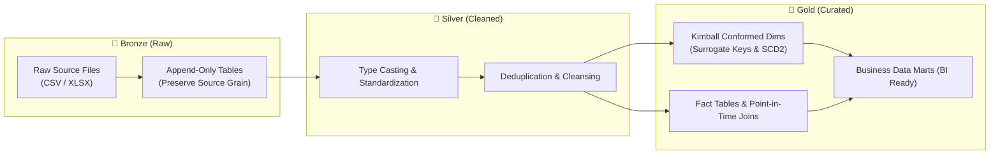

# 📖 Enterprise Data Dictionary — VietDist Analytics Platform

> **Comprehensive Technical & Business Data Catalog across the 3-Tier Medallion Architecture (Bronze → Silver → Gold) for VietDist Corporation.**  
> *Designed for Data Analysts, Analytics Engineers, and Technical Interview Reviewers.*

---

## 📌 Table of Contents
1. [Architecture & Naming Conventions](#1-architecture--naming-conventions)
2. [Bronze Layer — Raw Ingestion (`schema_bronze`)](#2-bronze-layer--raw-ingestion-schema_bronze)
3. [Silver Layer — Cleansed Staging (`schema_silver`)](#3-silver-layer--cleansed-staging-schema_silver)
4. [Gold Layer — Kimball Star Schema Dimensions (`schema_gold`)](#4-gold-layer--kimball-star-schema-dimensions-schema_gold)
5. [Gold Layer — Fact Tables (`schema_gold`)](#5-gold-layer--fact-tables-schema_gold)
6. [Gold Layer — Ready-to-Serve Data Marts (`schema_gold`)](#6-gold-layer--ready-to-serve-data-marts-schema_gold)
7. [Business Metrics Formula Glossary](#7-business-metrics-formula-glossary)
8. [End-to-End Lineage Matrix](#8-end-to-end-lineage-matrix)

---

## 1. Architecture & Naming Conventions

The platform adopts the **Medallion Data Lakehouse Architecture** to cleanly decouple raw ingestion from business-grade reporting:

### Key Conventions:
* `_sk` (Surrogate Key): Synthetic primary key generated at Gold layer (`BIGSERIAL` or `ROW_NUMBER()`).
* `_id` (Natural/Business Key): Unique operational identifier originating from source systems.
* `_loaded_at` / `_ingested_at`: Audit timestamp indicating when a record was processed.
* `_batch_id`: UUID tracking each unique execution of the master pipeline (`main.py`).

---

## 2. Bronze Layer — Raw Ingestion (`schema_bronze`)

All tables in Bronze preserve the original schema and grain. Non-destructive types (`TEXT`) are utilized to ensure ingestion resilience.

### 2.1 Ingestion Metadata & Log Tables

#### Table: `schema_bronze.ingest_log`
* **Grain:** 1 record per ingestion event per source file.
* **Purpose:** Audit tracking for data pipeline observability and SLA monitoring.

| Column | Data Type | Nullable | Description |
| :--- | :--- | :---: | :--- |
| `log_id` | `BIGSERIAL` | No | Primary Key. Synthetic log identifier. |
| `batch_id` | `UUID` | No | Unique identifier generated per pipeline run in `main.py`. |
| `source_name` | `TEXT` | No | Identifier of the data source (e.g., `sales_transactions`, `customers`). |
| `source_file` | `TEXT` | No | Name of the source file (e.g., `SRC01_sales_transactions.csv`). |
| `source_platform` | `TEXT` | No | Origin storage platform (`local_filesystem`, `google_drive`, `onedrive`). |
| `rows_loaded` | `INTEGER` | Yes | Number of rows extracted and successfully inserted. |
| `status` | `TEXT` | No | Pipeline status flag: `SUCCESS` or `FAILED`. |
| `error_message` | `TEXT` | Yes | Captured stack trace / error description if failed. |
| `duration_sec` | `NUMERIC(10,2)` | Yes | Total execution time in seconds. |
| `started_at` | `TIMESTAMP` | No | Ingestion start timestamp (`DEFAULT NOW()`). |
| `finished_at` | `TIMESTAMP` | Yes | Ingestion completion timestamp. |

#### Table: `schema_bronze.profiling_summary`
* **Grain:** 1 record per column per ingested Bronze table.
* **Purpose:** Automated data profiling telemetry generated by `loader/profilling.py`.

| Column | Data Type | Nullable | Description |
| :--- | :--- | :---: | :--- |
| `id` | `BIGSERIAL` | No | Primary Key. |
| `table_name` | `TEXT` | No | Target Bronze table evaluated. |
| `column_name` | `TEXT` | No | Column name inspected. |
| `dtype` | `TEXT` | Yes | Inferred Pandas/SQL data type. |
| `total_rows` | `INTEGER` | Yes | Total record count of the table. |
| `null_count` | `INTEGER` | Yes | Count of missing/null values in this column. |
| `null_pct` | `NUMERIC(5,2)` | Yes | Percentage of nulls (`null_count / total_rows * 100`). |
| `distinct_count`| `INTEGER` | Yes | Count of unique non-null values. |
| `profiled_at` | `TIMESTAMP` | No | Profiling execution timestamp. |

---

## 3. Silver Layer — Cleansed Staging (`schema_silver`)

In the Silver layer, data is validated, deduplicated, cast into correct types, and normalized for analytics.

### 3.1 `schema_silver.sales_transactions`
* **Source:** `schema_bronze.sales_transactions` (from `SRC01`)
* **Grain:** 1 line item per order (`order_id`, `product_id`).
* **Transformations:**
  * Deduplicated via composite key `(order_id, product_id, order_date)`.
  * Standardized `order_date` to `DATE`.
  * Computed `gross_amount = quantity * unit_price`.
  * Computed `discount_amount = gross_amount * (discount_pct / 100.0)`.
  * Computed `net_amount = gross_amount - discount_amount`.
  * Normalized string casing on `channel`, `delivery_status`, `payment_status`.

| Column | Data Type | Key | Description |
| :--- | :--- | :---: | :--- |
| `order_id` | `TEXT` | PK Component | Natural order number. |
| `product_id` | `TEXT` | PK Component | Natural SKU identifier. |
| `order_date` | `DATE` | - | Date transaction took place (`YYYY-MM-DD`). |
| `customer_id` | `TEXT` | FK | Customer natural key. |
| `employee_id` | `TEXT` | FK | Sales representative natural key. |
| `channel` | `TEXT` | - | Sales channel (`DIRECT`, `ONLINE`, `RETAIL`). |
| `region` | `TEXT` | - | Geographic sales territory (`NORTH`, `CENTRAL`, `SOUTH`). |
| `province` | `TEXT` | - | Recipient province / city name. |
| `delivery_status` | `TEXT` | - | Order delivery status (`DELIVERED`, `SHIPPED`, `CANCELLED`). |
| `payment_method` | `TEXT` | - | Payment mechanism (`BANK_TRANSFER`, `COD`, `CREDIT`). |
| `payment_status` | `TEXT` | - | Payment state (`PAID`, `PENDING`). |
| `quantity` | `INTEGER` | - | Units sold. |
| `unit_price` | `NUMERIC(15,2)` | - | List price per unit (VND). |
| `discount_pct` | `NUMERIC(5,2)` | - | Applied discount percentage (0 - 100). |
| `discount_amount` | `NUMERIC(15,2)` | - | Monetary value of discount. |
| `gross_amount` | `NUMERIC(15,2)` | - | Pre-discount sales total. |
| `net_amount` | `NUMERIC(15,2)` | - | Net revenue realized post-discount. |
| `_cleaned_at` | `TIMESTAMP` | - | Cleansing execution timestamp. |

### 3.2 `schema_silver.sales_targets`
* **Source:** `schema_bronze.sales_targets_raw` (from `SRC02`)
* **Grain:** 1 target line per employee per month per plan version.
* **Transformations:** Filtered invalid employee records, standardized numeric budget targets, preserved plan version tags.

| Column | Data Type | Key | Description |
| :--- | :--- | :---: | :--- |
| `plan_version` | `TEXT` | PK Component | Target version (`v1_Original`, `v2_MidYearReview`, `v3_Final`). |
| `version_date` | `DATE` | - | Effective date of target release. |
| `employee_id` | `TEXT` | PK Component | Sales rep natural key. |
| `employee_name` | `TEXT` | - | Full name of sales rep. |
| `region` | `TEXT` | - | Territory assigned for this plan version. |
| `team` | `TEXT` | - | Assigned sales team. |
| `year` | `INTEGER` | PK Component | Target fiscal year (e.g., 2023). |
| `month` | `INTEGER` | PK Component | Target fiscal month (1 - 12). |
| `target_revenue` | `NUMERIC(18,2)` | - | Targeted monthly sales revenue (VND). |
| `target_quantity` | `INTEGER` | - | Targeted monthly sales unit volume. |
| `target_new_customers`| `INTEGER` | - | Targeted new customer acquisition count. |

### 3.3 `schema_silver.distributor_orders`
* **Source:** `schema_bronze.distributor_orders` (from `SRC05`)
* **Grain:** 1 line item per B2B distributor purchase order.
* **Transformations:** Parsed delivery dates, calculated `fill_rate_pct = (qty_delivered / qty_ordered) * 100`, parsed `ontime_delivery` into boolean format.

| Column | Data Type | Key | Description |
| :--- | :--- | :---: | :--- |
| `order_id` | `TEXT` | PK Component | Distributor purchase order number. |
| `product_id` | `TEXT` | PK Component | Ordered SKU identifier. |
| `order_date` | `DATE` | - | Date PO was submitted. |
| `distributor_id` | `TEXT` | FK | Accredited distributor identifier. |
| `delivery_date` | `DATE` | - | Physical delivery completion date. |
| `ontime_delivery` | `TEXT` | - | SLA compliance indicator (`YES` / `NO`). |
| `qty_ordered` | `INTEGER` | - | Units ordered by distributor. |
| `qty_delivered` | `INTEGER` | - | Units fulfilled by warehouse. |
| `fill_rate_pct` | `NUMERIC(5,2)` | - | Order fulfillment fill rate percentage. |
| `gross_amount` | `NUMERIC(18,2)` | - | Total ordered value. |
| `delivered_amount` | `NUMERIC(18,2)` | - | Value of fulfilled goods. |

---

## 4. Gold Layer — Kimball Star Schema Dimensions (`schema_gold`)

Conformed dimensions establish standardized analytical context across enterprise fact tables.

### 4.1 `schema_gold.dim_date`
* **Type:** Conformed Date Dimension (Static Series).
* **Generation:** Generated via `generate_series('2018-01-01'::DATE, '2025-12-31'::DATE, '1 day')`.
* **Grain:** 1 row per calendar day.

| Column | Data Type | Key | Description |
| :--- | :--- | :---: | :--- |
| `date_id` | `INTEGER` | PK | Integer key in `YYYYMMDD` format (e.g., `20230514`). |
| `date` | `DATE` | Natural Key | Calendar date (`YYYY-MM-DD`). |
| `year` | `INTEGER` | - | Calendar year (e.g., `2023`). |
| `quarter` | `INTEGER` | - | Calendar quarter (1 - 4). |
| `month` | `INTEGER` | - | Calendar month (1 - 12). |
| `month_name` | `TEXT` | - | Full month name (`January` ... `December`). |
| `week_of_year` | `INTEGER` | - | ISO week number (1 - 53). |
| `day_of_month` | `INTEGER` | - | Day of the month (1 - 31). |
| `day_of_week` | `INTEGER` | - | Day of week index (1 = Sunday, 7 = Saturday). |
| `day_name` | `TEXT` | - | Day name (`Monday`, `Tuesday`...). |
| `is_weekend` | `BOOLEAN` | - | Flag indicating Saturday/Sunday. |

### 4.2 `schema_gold.dim_employees` (SCD Type 2)
* **Type:** **Slowly Changing Dimension Type 2 (Historical Tracking)**.
* **Grain:** 1 record per employee per version of their territory/team assignment.
* **Purpose:** Prevents historical revenue distortion when sales reps rotate regions mid-year.

| Column | Data Type | Key | Description |
| :--- | :--- | :---: | :--- |
| `employee_sk` | `BIGSERIAL` | PK | Surrogate Key uniquely identifying this version of the employee. |
| `employee_id` | `TEXT` | Natural Key | Business employee ID (e.g., `EMP014`). |
| `full_name` | `TEXT` | - | Full employee name. |
| `gender` | `TEXT` | - | Gender. |
| `date_of_birth` | `DATE` | - | Birth date. |
| `join_date` | `DATE` | - | Employment commencement date. |
| `position` | `TEXT` | Tracked SCD2 | Job title (e.g., `Senior Sales Rep`, `Area Manager`). |
| `region` | `TEXT` | Tracked SCD2 | Assigned sales region (`NORTH`, `CENTRAL`, `SOUTH`). |
| `team` | `TEXT` | Tracked SCD2 | Assigned sub-sales team. |
| `email` | `TEXT` | - | Corporate contact email. |
| `phone` | `TEXT` | - | Standardized phone number. |
| `status` | `TEXT` | Tracked SCD2 | Employment status (`ACTIVE`, `TRANSFERRED`, `RESIGNED`). |
| `effective_date` | `DATE` | SCD2 Window | Date this territory/role version became active. |
| `expiry_date` | `DATE` | SCD2 Window | Date this version closed (`9999-12-31` for active record). |
| `is_current` | `BOOLEAN` | SCD2 Flag | `TRUE` if this is the employee's currently active assignment. |

### 4.3 `schema_gold.dim_customers` (SCD Type 1)
* **Type:** Conformed Customer Dimension (SCD Type 1 - Overwrite).
* **Grain:** 1 row per unique retail customer.

| Column | Data Type | Key | Description |
| :--- | :--- | :---: | :--- |
| `customer_sk` | `BIGINT` | PK | Surrogate Key generated via `ROW_NUMBER()`. |
| `customer_id` | `TEXT` | Natural Key | Source customer ID (e.g., `CUST0012`). |
| `customer_name` | `TEXT` | - | Full name of account holder. |
| `customer_type` | `TEXT` | - | Customer tier (`KEY_ACCOUNT`, `RETAIL`, `B2C`). |
| `phone` | `TEXT` | - | Sanitized phone number. |
| `email` | `TEXT` | - | Customer email address. |
| `province` | `TEXT` | - | Registered province. |
| `region` | `TEXT` | - | Assigned geographic region. |
| `created_date` | `DATE` | - | Account creation date. |

### 4.4 `schema_gold.dim_products` (SCD Type 1)
* **Type:** Conformed Product Dimension (SCD Type 1).
* **Grain:** 1 row per unique SKU.

| Column | Data Type | Key | Description |
| :--- | :--- | :---: | :--- |
| `product_sk` | `BIGINT` | PK | Surrogate Key generated via `ROW_NUMBER()`. |
| `product_id` | `TEXT` | Natural Key | Product SKU identifier (e.g., `SKU089`). |
| `product_name` | `TEXT` | - | Commercial product name. |
| `category` | `TEXT` | - | Product family (e.g., `Beverages`, `Personal Care`, `Food`). |
| `sub_category` | `TEXT` | - | Granular sub-category classification. |
| `brand` | `TEXT` | - | Product brand. |
| `unit_of_measure`| `TEXT` | - | Packaging unit (`PCS`, `BOX`, `CARTON`). |
| `standard_cost` | `NUMERIC(15,2)` | - | Baseline manufacturing cost per unit. |
| `list_price` | `NUMERIC(15,2)` | - | Suggested retail list price. |

---

## 5. Gold Layer — Fact Tables (`schema_gold`)

### 5.1 `schema_gold.fact_sales`
* **Grain:** 1 line item per order (`order_id`, `product_id`).
* **Design Pattern:** Transactional Fact Table with **Point-in-Time Join** to `dim_employees`.

| Column | Data Type | Key | Description |
| :--- | :--- | :---: | :--- |
| `order_id` | `TEXT` | Degenerate Dim | Order tracking number. |
| `product_id` | `TEXT` | Degenerate Dim | SKU number for audit reconciliation. |
| `date_id` | `INTEGER` | FK | Joins `dim_date.date_id`. |
| `customer_sk` | `BIGINT` | FK | Joins `dim_customers.customer_sk`. |
| `product_sk` | `BIGINT` | FK | Joins `dim_products.product_sk`. |
| `employee_sk` | `BIGINT` | FK (SCD2) | Point-in-time join to `dim_employees.employee_sk`. |
| `channel` | `TEXT` | Degenerate Dim | Sales channel. |
| `region` | `TEXT` | Degenerate Dim | Transaction region. |
| `delivery_status`| `TEXT` | Degenerate Dim | Delivery fulfillment status. |
| `payment_status` | `TEXT` | Degenerate Dim | Payment settlement status. |
| `quantity` | `INTEGER` | Additive Measure | Unit quantity sold. |
| `unit_price` | `NUMERIC(15,2)` | Non-additive | List price per unit. |
| `discount_pct` | `NUMERIC(5,2)` | Non-additive | Discount rate applied. |
| `discount_amount`| `NUMERIC(15,2)` | Additive Measure | Total discount value given. |
| `gross_amount` | `NUMERIC(15,2)` | Additive Measure | Pre-discount transaction value. |
| `net_amount` | `NUMERIC(15,2)` | Additive Measure | Realized revenue (`gross_amount - discount_amount`). |
| `_loaded_at` | `TIMESTAMP` | Audit | Timestamp row was materialized into Gold. |

### 5.2 `schema_gold.fact_targets`
* **Grain:** 1 plan line per employee per month per version.
* **Design Pattern:** Periodic Snapshot Fact Table preserving multiple planning iterations.

| Column | Data Type | Key | Description |
| :--- | :--- | :---: | :--- |
| `plan_version` | `TEXT` | Degenerate Dim | Budget revision tag (`v1_Original`, `v2_MidYearReview`). |
| `version_date` | `DATE` | - | Budget effective release date. |
| `date_id` | `INTEGER` | FK | Standardized to first day of target month (`YYYYMM01`). |
| `employee_sk` | `BIGINT` | FK (SCD2) | Joins active `dim_employees.employee_sk`. |
| `year` | `INTEGER` | - | Target year. |
| `month` | `INTEGER` | - | Target month. |
| `target_revenue` | `NUMERIC(18,2)` | Additive Measure | Quota for net revenue. |
| `target_quantity`| `INTEGER` | Additive Measure | Quota for unit sales. |
| `target_new_customers`| `INTEGER` | Additive Measure | Quota for account acquisition. |

---

## 6. Gold Layer — Ready-to-Serve Data Marts (`schema_gold`)

Curated aggregated models pre-joined and optimized to deliver sub-second performance for executive BI reports.

### 6.1 `schema_gold.mart_sales_vs_target`
* **Grain:** 1 record per sales representative per month.
* **Business Purpose:** Monthly KPI evaluation comparing actual net sales against the **most recent approved target plan**.

| Column | Data Type | Description |
| :--- | :--- | :--- |
| `employee_sk` | `BIGINT` | Surrogate key linking sales representative. |
| `employee_id` | `TEXT` | Natural employee identifier. |
| `full_name` | `TEXT` | Employee full name. |
| `region` | `TEXT` | Sales territory assigned during the target period. |
| `team` | `TEXT` | Sales team assigned. |
| `year` | `INTEGER` | Fiscal year. |
| `month` | `INTEGER` | Fiscal month. |
| `active_plan_version` | `TEXT` | Latest approved target plan applied (`v1`, `v2`, etc.). |
| `actual_revenue` | `NUMERIC(18,2)` | Realized net sales revenue from `fact_sales`. |
| `target_revenue` | `NUMERIC(18,2)` | Budgeted target revenue from `fact_targets`. |
| `revenue_variance` | `NUMERIC(18,2)` | `actual_revenue - target_revenue`. |
| `target_achievement_rate_pct` | `NUMERIC(6,2)` | Percentage attainment (`actual_revenue / target_revenue * 100`). |
| `actual_quantity` | `INTEGER` | Units sold. |
| `target_quantity` | `INTEGER` | Target unit sales. |
| `actual_new_customers`| `INTEGER` | Newly acquired customer accounts. |
| `target_new_customers`| `INTEGER` | Targeted new accounts quota. |

### 6.2 `schema_gold.mart_distributor_performance`
* **Grain:** 1 record per accredited distributor per month.
* **Business Purpose:** Assesses B2B distributor logistics reliability and order fulfillment volume.

| Column | Data Type | Description |
| :--- | :--- | :--- |
| `distributor_sk` | `BIGINT` | Surrogate key linking distributor. |
| `distributor_id` | `TEXT` | Natural distributor code. |
| `distributor_name` | `TEXT` | Registered corporate name. |
| `tier` | `TEXT` | Distributor classification (`Tier 1`, `Tier 2`, `Tier 3`). |
| `region` | `TEXT` | Geographic operating region. |
| `year` | `INTEGER` | Calendar year. |
| `month` | `INTEGER` | Calendar month. |
| `total_orders` | `INTEGER` | Total purchase orders submitted. |
| `total_qty_ordered` | `BIGINT` | Total units requested across orders. |
| `total_qty_delivered` | `BIGINT` | Total units fulfilled and received. |
| `total_gross_amount` | `NUMERIC(18,2)`| Total ordered monetary value. |
| `total_delivered_amount`| `NUMERIC(18,2)`| Realized fulfilled monetary value. |
| `avg_fill_rate_pct` | `NUMERIC(5,2)` | Average order fill rate (`qty_delivered / qty_ordered * 100`). |
| `ontime_delivery_rate_pct`| `NUMERIC(5,2)`| Percentage of shipments fulfilling on-time delivery SLA. |

---

## 7. Business Metrics Formula Glossary

| Metric Name | Business Definition | Mathematical Formula | Target SLA / Benchmark |
| :--- | :--- | :--- | :---: |
| **Target Achievement Rate %** | Degree to which a sales rep fulfills assigned revenue quotas. | $$\frac{\sum \text{actual\_revenue}}{\sum \text{target\_revenue}} \times 100$$ | $\ge 100\%$ |
| **Revenue Variance** | Absolute monetary difference between actual sales and quota. | $$\text{actual\_revenue} - \text{target\_revenue}$$ | $\ge 0 \text{ VND}$ |
| **Fill Rate %** | Measure of inventory availability and logistics fulfillment capacity. | $$\frac{\sum \text{qty\_delivered}}{\sum \text{qty\_ordered}} \times 100$$ | $\ge 95\%$ |
| **On-Time Delivery Rate %** | Percentage of shipments reaching destination within SLA promise. | $$\frac{\text{Count of On-Time Orders}}{\text{Total Orders}} \times 100$$ | $\ge 90\%$ |
| **Product Return Rate %** | Proportion of sold value returned due to defects or cancellations. | $$\frac{\sum \text{return\_net\_amount}}{\sum \text{sales\_gross\_amount}} \times 100$$ | $\le 3\%$ |

---

## 8. End-to-End Lineage Matrix

| Source File | Bronze Table | Silver Cleansed Table | Gold Model Object | Layer Type |
| :--- | :--- | :--- | :--- | :--- |
| `SRC01_sales_transactions.csv` | `schema_bronze.sales_transactions` | `schema_silver.sales_transactions` | `schema_gold.fact_sales` | Fact |
| `SRC02_sales_target_plan.xlsx` | `schema_bronze.sales_targets_raw` | `schema_silver.sales_targets` | `schema_gold.fact_targets` | Fact |
| `SRC03_customer_master.csv` | `schema_bronze.customers` | `schema_silver.customers` | `schema_gold.dim_customers` | Dimension (SCD1) |
| `SRC04_product_master.xlsx` | `schema_bronze.products` | `schema_silver.products` | `schema_gold.dim_products` | Dimension (SCD1) |
| `SRC05_distributor_orders.xlsx` | `schema_bronze.distributor_orders` | `schema_silver.distributor_orders` | `schema_gold.mart_distributor_performance` | Data Mart |
| `SRC06_distributor_master.csv` | `schema_bronze.distributors` | `schema_silver.distributors` | `schema_gold.dim_distributors` | Dimension (SCD2) |
| `SRC07_employee_master.xlsx` | `schema_bronze.employees` | `schema_silver.employees` | `schema_gold.dim_employees` | Dimension (SCD2) |
| `SRC08_territory_mapping.xlsx` | `schema_bronze.territory_mapping` | `schema_silver.territory_mapping` | *(Enriched into Employee/Customer)* | Dimension Join |
| `SRC09_return_transactions.csv` | `schema_bronze.return_transactions` | `schema_silver.return_transactions` | `schema_gold.fact_returns` | Fact |
| `SRC10_promotion_program.xlsx` | `schema_bronze.promotion_program` | `schema_silver.promotion_program` | *(Promotion Lineage Mapping)* | Attribute |
| *(Calendar Script)* | - | - | `schema_gold.dim_date` | Dimension |
| *(Gold Aggregation)* | - | - | `schema_gold.mart_sales_vs_target` | Data Mart |
