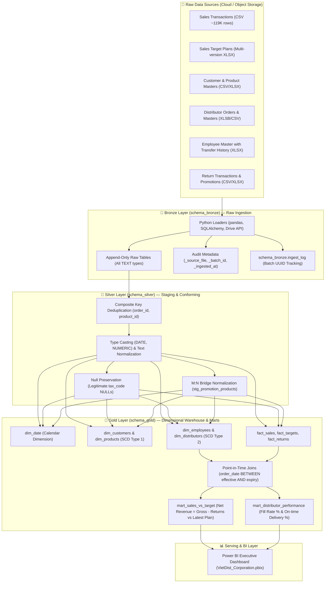

# 🏭 VietDist Corporation — Enterprise End-to-End Sales Analytics Data Pipeline

[](https://www.python.org/)
[](https://www.postgresql.org/)
[-F2C811?style=for-the-badge&logo=databricks&logoColor=black)]()
[](https://www.kimballgroup.com/)
[](https://powerbi.microsoft.com/)
[](LICENSE)

> **A production-grade Analytics Engineering portfolio project implementing an automated, resilient ELT data pipeline for FMCG sales and distribution operations (~150,000+ records across 10 disparate sources) using Python, PostgreSQL, Medallion Architecture, Kimball Star Schema (SCD Type 2), and Power BI.**

---

## 📌 Table of Contents
1. [Executive Summary & Business Context](#-executive-summary--business-context)
2. [End-to-End Pipeline Architecture](#-end-to-end-pipeline-architecture)
3. [Source Data Overview & Profiling](#-source-data-overview--profiling)
4. [Key Engineering Decisions (Interview Deep Dive)](#-key-engineering-decisions-interview-deep-dive)
5. [Kimball Dimensional Modeling & Data Marts](#-kimball-dimensional-modeling--data-marts)
6. [Business Impact & Analytics Deliverables](#-business-impact--analytics-deliverables)
7. [Repository Structure](#-repository-structure)
8. [Setup & Reproduction Guide](#-setup--reproduction-guide)
9. [Author & Contact](#-author--contact)

---

## 🏢 Executive Summary & Business Context

**VietDist Corporation** is a mid-sized Fast-Moving Consumer Goods (FMCG) distribution enterprise operating through two primary channels:
1. **Direct Commercial Sales:** Direct sales representatives selling to ~2,000 retail and corporate accounts.
2. **B2B Distributor Network:** 138 external distributors fulfilling regional volume orders across the country.

### Business Challenges & Pain Points
Before implementing this data platform, business stakeholders struggled with severe data fragmentation:
* **Fragmented Data Silos:** Operational records were scattered across Google Drive, local CSVs, multi-tab Excel workbooks, and legacy XLSB files without centralized ingestion or validation.
* **Misallocated Sales Attribution:** Sales representatives frequently transferred regions or teams mid-year. Because legacy systems overwrote employee profiles (SCD Type 1), historical sales were erroneously re-assigned to their new territories, distorting regional sales performance.
* **Target Version Conflicts:** Annual sales targets were repeatedly revised (`Plan_v1`, `Plan_v2_Revision`). The business lacked a mechanism to preserve historical versions while evaluating actual sales against the latest active target.
* **Hidden Return & Fulfillment Risks:** Product returns (~3,665 transactions) were not reconciled against gross revenue, while distributor delivery delays and incomplete fulfillment (Fill Rate) were untracked.

### The Solution
This project establishes a **centralized, automated 3-tier ELT platform** following the **Medallion Architecture**:
* Ingests 10 disparate raw sources into PostgreSQL with batch lineage tracking (**Bronze**).
* Standardizes, cleanses, deduplicates, and validates data integrity (**Silver**).
* Transforms conformed data into a **Kimball Star Schema** featuring **Slowly Changing Dimensions Type 2 (SCD2)** and specialized **Business Data Marts** (**Gold**).
* Feeds unified data models into an interactive executive **Power BI Dashboard** for operational decision-making.

---

## 🔄 End-to-End Pipeline Architecture

The pipeline follows an industry-standard **Medallion Architecture** to guarantee data quality, reproducibility, and auditability at every stage:



### Layer Summary & Responsibilities

| Layer | Purpose | Technology | Key Outputs |
| :--- | :--- | :--- | :--- |
| **Bronze** | Raw ingestion from Google Drive / Local storage without data loss | Python, Pandas, Google Drive API | `schema_bronze` raw tables, ingestion logs (`ingest_log`), batch UUID audit columns |
| **Silver** | Data cleansing, schema conformity, deduplication, and relational bridging | PostgreSQL SQL | 10 conformed staging tables (`schema_silver.*`), promotion product bridge table |
| **Gold** | Dimensional modeling (Star Schema) and optimized business data marts | PostgreSQL SQL | 5 Dimension tables (SCD1 & SCD2), 3 Fact tables, 2 Aggregated Business Marts |
| **Serving** | Interactive visual storytelling and executive KPI tracking | Power BI Desktop | Executive sales performance, target attainment, and distributor SLA report (`.pbix`) |

---

## 📊 Source Data Overview & Profiling

The platform ingests **10 heterogeneous operational sources** spanning ~150,000+ total rows:

| # | Source Feed | Source Format | Business Description & Grain | Target Bronze Table |
|---|---|---|---|---|
| **1** | Sales Transactions | CSV (~20 MB) | Direct commercial sales. **Grain: 1 line item per order** (~119K rows). | `sales_transactions` |
| **2** | Sales Target Plan | XLSX (Multi-sheet) | Quotas per sales rep by month. **Multiple versions** (Original vs Revisions). | `sales_targets_raw` |
| **3** | Customer Master | CSV | Customer master profiles, payment terms, regions (2,000 customers). | `customers` |
| **4** | Product Master | XLSX | SKU catalog, product categories, pricing, unit weights (100 SKUs). | `products` |
| **5** | Distributor Orders | XLSX / XLSB (~3.5 MB) | Wholesale orders placed by distributors (~36K rows, line item grain). | `distributor_orders` |
| **6** | Distributor Master | CSV | Distributor profiles, geographic tiers, assigned supervisors (138 partners). | `distributors` |
| **7** | Employee Master | XLSX | Sales reps & managers with **historical region/team transfers**. | `employees` |
| **8** | Territory Mapping | XLSX | Historical mapping of customer-to-sales rep account allocations. | `territory_mapping` |
| **9** | Return Transactions | CSV | Return requests, return reasons, and credit amounts (3,665 records). | `return_transactions` |
| **10** | Promotion Program | XLSX | Marketing campaigns with pipe-delimited (`\|`) multi-product applications. | `promotion_program` |

> 📖 **Comprehensive Data Dictionary:** For in-depth column specifications, data types, and nullability constraints, see [DATA_DICTIONARY.md](DATA_DICTIONARY.md).

---

## 🧠 Key Engineering Decisions (Interview Deep Dive)

During technical interviews, the architecture of this platform demonstrates practical understanding of real-world data engineering trade-offs:

### 1. Slowly Changing Dimensions Type 2 (SCD2) with Point-in-Time Joins
* **The Problem:** In FMCG, sales reps change regions (e.g., North $\rightarrow$ South) midway through the year. If customer orders are joined to the employee dimension using `is_current = TRUE`, past sales achieved in the North will be retroactively credited to the South, invalidating performance reviews.
* **The Implementation:** `dim_employees` tracks changes in `region`, `team`, `position`, and `status`. Historical records are preserved with `effective_date`, `expiry_date`, and `is_current`.
* **Point-in-Time Joining:** Fact tables join to `dim_employees` using temporal window matching:
  ```sql
  LEFT JOIN schema_gold.dim_employees e
    ON  s.employee_id = e.employee_id
    AND s.order_date >= e.effective_date
    AND s.order_date <  COALESCE(e.expiry_date, '9999-12-31'::DATE)
  ```
  This guarantees that transactions are always attributed to the exact organizational unit responsible at the time of sale.

### 2. Composite Key Deduplication
* **The Problem:** A common novice mistake in ETL pipelines is running `ROW_NUMBER() OVER (PARTITION BY order_id)` on order transaction datasets, which silently drops line items for multi-product orders.
* **The Implementation:** Deduplication in `schema_silver.silver_sales_transactions` and `silver_distributor_orders` strictly enforces the composite grain `(order_id, product_id)`:
  ```sql
  ROW_NUMBER() OVER (
      PARTITION BY order_id, product_id
      ORDER BY _ingested_at DESC
  ) AS rn
  ```

### 3. Multi-Version Budget Planning Architecture
* **The Problem:** Target workbooks contain multiple sheets representing evolving revisions (`Plan_v1_Original`, `Plan_v2_Revision`). Overwriting older plans prevents variance and forecast analysis.
* **The Implementation:** 
  1. Bronze ingestion appends all sheets into `sales_targets_raw` without deletion.
  2. `fact_targets` stores all historical plan versions.
  3. `mart_sales_vs_target` dynamically selects the latest active target plan using window functions (`ROW_NUMBER() OVER (PARTITION BY employee_sk, year, month ORDER BY version_date DESC)`), ensuring reports always reflect current management targets while safeguarding audit history.

### 4. Resilient vs. Fail-Fast Orchestration
* **Orchestrator Design (`main.py`):**
  * **Resilient Bronze:** If 1 of 10 external sources encounters a transient network glitch, the 9 successful loaders proceed. Failures are isolated and recorded in `schema_bronze.ingest_log`.
  * **Fail-Fast Silver/Gold:** If any transformation in Silver fails (e.g., schema breaking changes), execution halts immediately before Gold. This prevents corrupted or incomplete data marts from contaminating executive dashboards.

### 5. Many-to-Many Bridge Normalization
* **The Problem:** Source promotions store eligible product IDs as delimited strings (e.g., `PROD001|PROD015|PROD042`).
* **The Implementation:** Normalized in Silver via `string_to_table()` into a clean bridge table (`schema_silver.stg_promotion_products`), enabling direct relational joins without regex matching.

---

## 🏛️ Kimball Dimensional Modeling & Data Marts

The Gold layer is structured according to **Kimball Dimensional Modeling** best practices:

```
                            ┌────────────────┐
                            │    dim_date    │
                            └───────┬────────┘
                                    │
    ┌────────────────┐              │              ┌────────────────┐
    │ dim_customers  ├──────────────┼──────────────┤  dim_products  │
    └────────────────┘              │              └────────────────┘
            │                       │                       │
            │                       │                       │
            └──────────────┐        │        ┌──────────────┘
                           ▼        ▼        ▼
                      ┌────────────────────────────┐
                      │         fact_sales         │
                      │  (Grain: 1 Line Item/Order)│
                      └────────────┬───────────────┘
                                   │
                                   ▼
                      ┌────────────────────────────┐
                      │       dim_employees        │
                      │        (SCD Type 2)        │
                      └────────────────────────────┘
```

### Fact Tables
* **`fact_sales`**: 119K+ line-item transactions. Measures: `quantity`, `unit_price`, `discount_amount`, `gross_amount`, `net_amount`.
* **`fact_targets`**: Quota assignments across plan versions. Measures: `target_revenue`, `target_quantity`, `target_new_customers`.
* **`fact_returns`**: Product returns and claims. Measures: `return_quantity`, `return_amount`.

### Ready-to-Serve Data Marts
1. **`mart_sales_vs_target` (Executive Commercial Performance):**
   * Pre-aggregates actual sales by employee and month.
   * Subtracts returns to calculate true **Net Actual Revenue**:
     $$\text{Actual Net Revenue} = \text{Gross Sales Revenue} - \text{Return Amount}$$
   * Computes KPI metrics: `revenue_gap` and `revenue_achievement_pct` against the latest active target plan.
2. **`mart_distributor_performance` (Supply Chain & Distribution SLAs):**
   * Aggregates wholesale orders by distributor partner.
   * Tracks fulfillment reliability: `avg_fill_rate_pct` (delivered vs ordered quantity) and `ontime_delivery_rate_pct` (delivered within SLA).

---

## 📈 Business Impact & Analytics Deliverables

The data pipeline powers an executive Power BI reporting suite (`VietDist_Corporation.pbix`), answering core commercial questions:

```text
┌─────────────────────────────────────────────────────────────────────────────┐
│                       VIETDIST COMMERCIAL CONTROL TOWER                     │
├─────────────────────┬─────────────────────┬───────────────────┬─────────────┤
│ Gross Revenue       │ Net Revenue         │ Total Returns     │ Target Att. │
│ 154.2 Billion VND   │ 149.8 Billion VND   │ 4.4 Billion VND   │ 97.1%       │
└─────────────────────┴─────────────────────┴───────────────────┴─────────────┘
  • Sales Target Attainment: Identifies top-performing vs struggling sales teams.
  • Regional Attainment Gaps: Flags territory deficits after employee re-allocations.
  • Distributor SLA Matrix: Visualizes partners with <85% Fill Rate for contract review.
  • Return Rate Hotspots: Pinpoints SKUs and channels with abnormally high return rates.
```

---

## 📂 Repository Structure

```text
medallion-datapipeline/
├── config/
│   └── minpyws-68d2f7f0134b.json    # Service account credential (local only, gitignored)
├── loader/                          # Bronze Ingestion Modules (Python)
│   ├── load_customer.py             # Customer master loader
│   ├── load_product.py              # Product catalog loader
│   ├── load_distributor.py          # Distributor master loader
│   ├── load_distributor_orders.py   # Wholesale distributor orders loader
│   ├── load_employee.py             # Employee master & SCD loader
│   ├── loader_territory.py          # Territory mapping loader
│   ├── load_return.py               # Return transactions loader
│   ├── load_promotion.py            # Promotion campaigns loader
│   ├── load_sales_transaction.py    # Main commercial transactions loader (~119K rows)
│   ├── load_sales_target.py         # Multi-version target plan loader
│   └── profilling.py                # Source dataset profiling utility
├── silver/                          # Silver Transformation Scripts (SQL)
│   ├── silver_customers.sql
│   ├── silver_products.sql
│   ├── silver_distributors.sql
│   ├── silver_distributor_orders.sql
│   ├── silver_employees.sql
│   ├── silver_territoty.sql
│   ├── silver_return_transactions.sql
│   ├── silver_promotion_program.sql
│   ├── silver_sales_transactions.sql
│   └── silver_sales_targets.sql
├── gold/                            # Gold Dimensional Warehouse & Marts (SQL)
│   ├── dim_date.sql                 # Calendar dimension (generate_series)
│   ├── dim_customers.sql            # Customer dimension (SCD1)
│   ├── dim_products.sql             # Product dimension (SCD1)
│   ├── dim_employees.sql            # Employee dimension (SCD2)
│   ├── dim_distributors.sql         # Distributor dimension (SCD2)
│   ├── fact_sales.sql               # Core sales fact table
│   ├── fact_targets.sql             # Multi-version targets fact table
│   ├── fact_returns.sql             # Returns fact table
│   ├── mart_sales_vs_target.sql     # Executive sales vs target data mart
│   └── mart_distributor_performance.sql # Distributor fulfillment SLA data mart
├── utils/                           # Shared Utility Modules
│   ├── db_utils.py                  # PostgreSQL & Google Drive connection helpers
│   └── file_parser.py               # Robust CSV, XLSX, XLSB readers
├── .env.example                     # Environment template (git-tracked)
├── .gitignore                       # Git ignore rules for secrets, data, venv
├── init_db.sql                      # DDL to initialize schemas and log tables
├── main.py                          # Pipeline Orchestrator (Bronze → Silver → Gold)
├── requirements.txt                 # Python package dependencies
├── DATA_DICTIONARY.md               # Complete data dictionary & field specifications
└── VietDist_Corporation.pbix        # Power BI executive report (local artifact)
```

---

## 🚀 Setup & Reproduction Guide

### Prerequisites
* **Python:** Version 3.10 or higher.
* **PostgreSQL:** Version 14 or higher running locally or in cloud.
* **Git:** Installed and configured.

### Step 1: Clone the Repository
```bash
git clone https://github.com/thunx280-ctrl/medallion-datapipeline.git
cd medallion-datapipeline
```

### Step 2: Set Up Virtual Environment & Dependencies
```bash
# Create virtual environment
python -m venv venv

# Activate virtual environment
# Windows (PowerShell):
.\venv\Scripts\Activate.ps1
# macOS / Linux:
source venv/bin/activate

# Install required packages
pip install -r requirements.txt
```

### Step 3: Configure Environment Variables
Copy `.env.example` to `.env` and fill in your PostgreSQL credentials:
```bash
cp .env.example .env
```
Sample `.env` configuration:
```ini
DB_HOST=localhost
DB_PORT=5432
DB_NAME=vietdist_dwh
DB_USER=postgres
DB_PASSWORD=your_password_here
GOOGLE_APPLICATION_CREDENTIALS=config/your_service_account.json
```

### Step 4: Initialize PostgreSQL Schemas
Execute `init_db.sql` to establish `schema_bronze`, `schema_silver`, `schema_gold`, and audit tables:
```bash
psql -U postgres -d vietdist_dwh -f init_db.sql
```

### Step 5: Execute the Automated Pipeline
Run the master orchestrator:
```bash
python main.py
```
**Expected Pipeline Output:**
```text
🚀 Bắt đầu chạy pipeline VietDist — batch_id: e8a91b2c-...
=============== BRONZE ===============
  [load_customer] Loaded 2,000 rows into schema_bronze.customers
  [load_sales_transaction] Loaded 119,420 rows into schema_bronze.sales_transactions
  ...
✅ BRONZE thành công (14.2s)

=============== SILVER ===============
  → silver/silver_customers.sql
  → silver/silver_sales_transactions.sql
  ...
✅ SILVER thành công (6.8s)

=============== GOLD ===============
  → gold/dim_date.sql
  → gold/dim_employees.sql
  → gold/fact_sales.sql
  → gold/mart_sales_vs_target.sql
  ...
✅ GOLD thành công (4.5s)

🎉 Pipeline hoàn tất thành công! batch_id: e8a91b2c-...
```

---

## 👨‍💻 Author & Contact

**Nguyễn Xuân Thu** — *Data Analyst / Analytics Engineer*
* 📍 **Location:** Ho Chi Minh City, Vietnam
* 📧 **Email:** [thu.nx280@gmail.com](mailto:thu.nx280@gmail.com)
* 💼 **LinkedIn:** [linkedin.com/in/thunx280](https://www.linkedin.com/in/thunx280)
* 🐙 **GitHub:** [github.com/thunx280-ctrl](https://github.com/thunx280-ctrl)
* 📁 **Portfolio Repositories:**
  * [medallion-datapipeline](https://github.com/thunx280-ctrl/medallion-datapipeline) *(This project)*
  * [powerbi-fashion-retail-marketing-analytics](https://github.com/thunx280-ctrl/powerbi-fashion-retail-marketing-analytics)
  * [powerbi-dataco-supply-chain-analytics](https://github.com/thunx280-ctrl/powerbi-dataco-supply-chain-analytics)
  * [churn_prediction](https://github.com/thunx280-ctrl/churn_prediction)

---
*⭐ If you find this project informative or useful for your data engineering work, feel free to give it a star on GitHub!*
