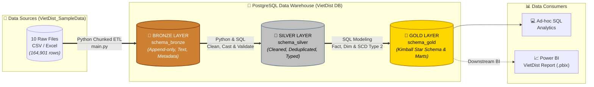
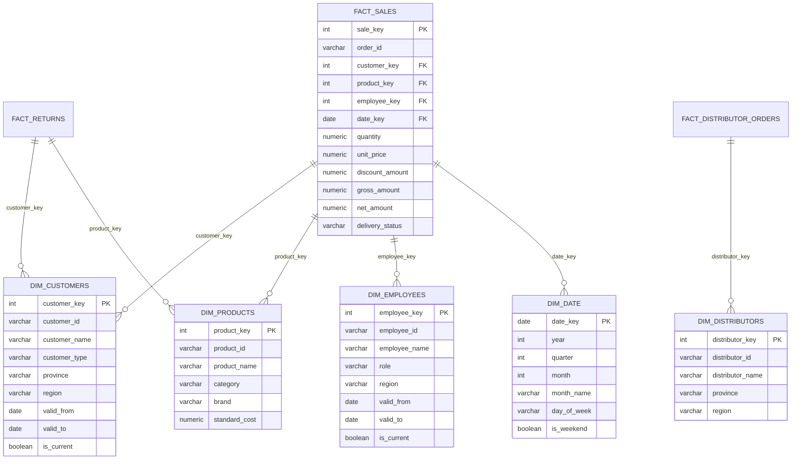

<div align="center">

# 🏛️ End-to-End Data Pipeline: Medallion Architecture
### *Từ Dữ Liệu Giao Dịch Thô (Raw Files) Đến Kho Dữ Liệu Phân Tích Chuẩn Hóa (PostgreSQL)*

[](https://www.python.org/)
[](https://www.postgresql.org/)
[](https://pandas.pydata.org/)
[](https://github.com/thunx280-ctrl/medallion-datapipeline/)

[**🎯 Bài Toán**](#-1-bối-cảnh--bài-toán-giải-quyết) • 
[**🏗️ Kiến Trúc**](#️-2-kiến-trúc-luồng-dữ-liệu-system-architecture) • 
[**🔄 Chi Tiết 3 Tầng**](#-3-quy-trình-biến-đổi-qua-3-tầng-medallion-layers) • 
[**📐 Star Schema**](#-4-mô-hình-dữ-liệu-tầng-gold-star-schema) • 
[**🚀 Cài Đặt**](#-5-cấu-trúc-thư-mục--hướng-dẫn-chạy-pipeline) • 
[**🗺️ Kỹ Thuật**](#️-6-điểm-nhấn-kỹ-thuật--định-hướng-mở-rộng)

</div>

---

## 🎯 1. Bối Cảnh & Bài Toán Giải Quyết

Dự án xây dựng một đường ống xử lý dữ liệu tự động (**Automated ETL Data Pipeline**) mô phỏng bài toán thực tế trong lĩnh vực **Phân phối Tiêu dùng & Bán buôn (VietDist Corporation - FMCG Distribution)** với hơn **119,000 dòng giao dịch bán hàng** và **10 nguồn dữ liệu rời rạc**.

Thay vì truy vấn trực tiếp trên các tập tin phẳng (`CSV`/`Excel`) chứa đầy dữ liệu nhiễu, sai lệch kiểu dữ liệu và bản ghi trùng lặp, hệ thống áp dụng **Kiến trúc Medallion (Bronze ➔ Silver ➔ Gold)** để nạp thô, làm sạch, chuẩn hóa và đóng gói thành mô hình **Kimball Star Schema** trên **PostgreSQL**.

| Vấn đề ở Dữ liệu Nguồn (Before Pipeline ❌) | Giải pháp tại Kho dữ liệu Tầng Gold (After Pipeline ✅) |
| :--- | :--- |
| **Bản ghi trùng lặp:** 10 tập tin nguồn phát sinh dòng trùng do gửi lại đơn hàng (order retry) hoặc cập nhật nhiều lần. | **Khử trùng lặp tuyệt đối:** Dùng Window Function `ROW_NUMBER() OVER (PARTITION BY order_id, product_id ORDER BY _ingested_at DESC)` giữ lại trạng thái mới nhất (0 trùng lặp). |
| **Định dạng hỗn loạn & Missing:** Ngày tháng không đồng nhất, định dạng tiền tệ chứa ký tự lạ, thiếu dữ liệu danh mục. | **Chuẩn hóa Schema & Kiểu dữ liệu:** Ép kiểu chặt chẽ `DATE`, `NUMERIC(15,2)`, chuẩn hóa chuỗi (`TRIM`, `UPPER`), bổ sung trường kiểm toán metadata (`_ingested_at`, `_source_file`). |
| **Lịch sử nhân sự & khách hàng biến động:** Đại diện kinh doanh chuyển vùng, thay đổi chức vụ làm sai lệch doanh thu lịch sử. | **Bảo toàn Lịch sử với SCD Type 2:** Áp dụng `valid_from`, `valid_to`, `is_current` trên các bảng chiều nhân viên và khách hàng, hỗ trợ phân tích Point-in-Time chính xác. |
| **Truy vấn chậm & Phức tạp:** Dữ liệu phẳng gây khó khăn khi đối soát doanh thu thực tế so với chỉ tiêu (Target Quota) và đánh giá nhà phân phối. | **Sẵn sàng cho BI & Analytics:** Tổ chức Fact/Dimension tối ưu hóa tốc độ JOIN, đóng gói sẵn Data Marts (`mart_sales_vs_target`, `mart_distributor_performance`) phục vụ Power BI. |

---

## 🏗️ 2. Kiến Trúc Luồng Dữ Liệu (System Architecture)



---

## 🔄 3. Quy Trình Biến Đổi Qua 3 Tầng (Medallion Layers)

### 🥉 Tầng 1: Bronze Layer (Raw Ingestion)
* **Mục tiêu:** Lưu trữ nguyên bản toàn bộ 10 nguồn dữ liệu vào `schema_bronze` (164,901 dòng), đảm bảo khả năng chạy lại (Reproducibility) và kiểm toán nguồn gốc mà không cần đọc lại file đĩa.
* **Cơ chế kỹ thuật:**
  * Nạp dữ liệu bằng cơ chế **Chunked Streaming Loader** trong Python (`chunksize=10,000`), tối ưu hóa bộ nhớ RAM khi xử lý file giao dịch lớn.
  * Toàn bộ các cột dữ liệu nghiệp vụ được nạp dưới định dạng chuỗi (`TEXT`) để ngăn ngừa lỗi đứt gãy pipeline do sai lệch kiểu dữ liệu đầu vào.
  * Bổ sung 4 cột Metadata kiểm toán: `_source_file` (tên file gốc), `_source_platform` (hệ thống nguồn), `_ingested_at` (thời điểm nạp), và `_batch_id` (mã phiên thực thi).

### 🥈 Tầng 2: Silver Layer (Cleaned & Enriched)
* **Mục tiêu:** Làm sạch, khử trùng lặp và chuẩn hóa dữ liệu tại `schema_silver`, tạo nguồn dữ liệu tin cậy cho tầng Gold.
* **Cơ chế kỹ thuật:**
  * **Composite Key Deduplication:** Sử dụng Window Function `ROW_NUMBER()` dựa trên khóa phức hợp `(order_id, product_id)` để lọc bỏ bản ghi trùng lặp, giữ lại trạng thái đơn hàng mới nhất (`rn = 1`).
  * **Type Casting & Normalization:** Ép kiểu chuẩn xác sang `DATE`, `INTEGER`, `NUMERIC(15,2)`, chuẩn hóa chuỗi bằng `TRIM`, `UPPER`, `INITCAP`.
  * **Quality Audit Gate:** Kiểm tra toàn vẹn dữ liệu, đảm bảo `net_amount = gross_amount - discount_amount`, loại bỏ đơn hàng có số lượng âm bất hợp lý.

<details>
<summary><b>🔍 Xem đoạn code SQL khử trùng lặp & làm sạch tiêu biểu tại tầng Silver (Click để mở rộng)</b></summary>

```sql
-- Trích đoạn từ silver/silver_sales_transactions.sql
DROP TABLE IF EXISTS schema_silver.sales_transactions;

CREATE TABLE schema_silver.sales_transactions AS
WITH dedup AS (
    SELECT
        *,
        ROW_NUMBER() OVER (
            PARTITION BY TRIM(order_id), TRIM(product_id)
            ORDER BY _ingested_at DESC
        ) AS rn
    FROM schema_bronze.sales_transactions
    WHERE order_id IS NOT NULL AND TRIM(order_id) <> ''
)
SELECT
    TRIM(order_id)                                              AS order_id,
    TO_DATE(NULLIF(TRIM(order_date), ''), 'YYYY-MM-DD')         AS order_date,
    NULLIF(TRIM(order_month), '')::INT                          AS order_month,
    NULLIF(TRIM(order_quarter), '')::INT                        AS order_quarter,
    NULLIF(TRIM(order_year), '')::INT                           AS order_year,
    TRIM(customer_id)                                           AS customer_id,
    UPPER(TRIM(region))                                         AS region,
    TRIM(province)                                              AS province,
    UPPER(TRIM(channel))                                        AS channel,
    TRIM(employee_id)                                           AS employee_id,
    TRIM(product_id)                                            AS product_id,
    UPPER(TRIM(product_category))                               AS product_category,
    NULLIF(TRIM(quantity), '')::NUMERIC                         AS quantity,
    NULLIF(TRIM(unit_price), '')::NUMERIC                       AS unit_price,
    NULLIF(TRIM(discount_amount), '')::NUMERIC                  AS discount_amount,
    NULLIF(TRIM(gross_amount), '')::NUMERIC                     AS gross_amount,
    NULLIF(TRIM(net_amount), '')::NUMERIC                       AS net_amount,
    INITCAP(TRIM(delivery_status))                              AS delivery_status,
    UPPER(TRIM(payment_method))                                 AS payment_method,
    _source_file, _ingested_at, _batch_id
FROM dedup
WHERE rn = 1;
```
</details>

### 🥇 Tầng 3: Gold Layer (Business-Ready Marts)
* **Mục tiêu:** Tổ chức dữ liệu tại `schema_gold` theo mô hình **Kimball Star Schema** và xây dựng các Data Marts phân tích nghiệp vụ sẵn sàng kết nối Power BI.
* **Cơ chế kỹ thuật:**
  * **Surrogate Keys & Point-in-Time Joins:** Sử dụng surrogate keys (`customer_key`, `employee_key`) kết hợp kỹ thuật AS-OF Join trên khoảng hiệu lực `valid_from` - `valid_to` (SCD Type 2) để gán đúng nhân viên phụ trách tại thời điểm phát sinh đơn hàng.
  * **Analytical Data Marts:** Xây dựng sẵn 2 Data Marts phân tích hiệu suất:
    * `mart_sales_vs_target`: Đối soát doanh thu thực tế so với chỉ tiêu kinh doanh theo từng Sales Rep và tháng (111 Sales Reps, tỷ lệ đạt chỉ tiêu bình quân 51.19%).
    * `mart_distributor_performance`: Đo lường tỷ lệ hoàn tất đơn hàng (Fill Rate đạt 84.63%) và tỷ lệ giao đúng hạn (On-Time Delivery đạt 40.36%) của 125 Nhà phân phối.

---

## 📐 4. Mô Hình Dữ Liệu Tầng Gold (Star Schema)



---

## 🚀 5. Cấu Trúc Thư Mục & Hướng Dẫn Chạy Pipeline

```text
📦 medallion-datapipeline
 ┣ 📂 VietDist_SampleData/       # 10 tập tin dữ liệu mẫu đầu vào (CSV / Excel)
 ┣ 📂 loader/                    # Python Streaming Loaders nạp dữ liệu vào schema_bronze
 ┃ ┣ 📜 load_sales_transaction.py
 ┃ ┣ 📜 load_distributor_orders.py
 ┃ ┣ 📜 load_sales_target.py
 ┃ ┗ 📜 ... (10 modules nạp dữ liệu)
 ┣ 📂 silver/                    # Kịch bản SQL làm sạch và khử trùng lặp schema_silver
 ┃ ┣ 📜 silver_sales_transactions.sql
 ┃ ┣ 📜 silver_customers.sql
 ┃ ┗ 📜 ... (10 kịch bản DDL & DML)
 ┣ 📂 gold/                      # Kịch bản SQL xây dựng Star Schema & Marts schema_gold
 ┃ ┣ 📜 fact_sales.sql
 ┃ ┣ 📜 dim_customers.sql
 ┃ ┣ 📜 dim_employees.sql
 ┃ ┣ 📜 mart_sales_vs_target.sql
 ┃ ┗ 📜 ... (10 kịch bản Kimball Modeling)
 ┣ 📜 main.py                    # Orchestrator điều phối toàn bộ luồng ETL 3 tầng
 ┣ 📜 init_db.sql                # Khởi tạo schemas và cấu hình cơ sở dữ liệu ban đầu
 ┣ 📜 .env.example               # Mẫu cấu hình kết nối PostgreSQL
 ┣ 📜 requirements.txt           # Danh sách thư viện Python phụ thuộc
 ┗ 📜 README.md                  # Tài liệu dự án
```

### Các bước cài đặt & thực thi:

```bash
# 1. Clone repository về máy
git clone https://github.com/thunx280-ctrl/medallion-datapipeline.git
cd medallion-datapipeline

# 2. Khởi tạo môi trường ảo và cài đặt thư viện phụ thuộc
python -m venv venv
# Windows (PowerShell):
.\venv\Scripts\Activate.ps1
# Linux / macOS:
source venv/bin/activate

pip install -r requirements.txt

# 3. Thiết lập biến môi trường (.env) chứa thông tin kết nối PostgreSQL
cp .env.example .env
# Chỉnh sửa file .env với thông tin database: DB_HOST, DB_PORT, DB_NAME, DB_USER, DB_PASSWORD

# 4. Khởi tạo database và cấu trúc schema
psql -U postgres -d vietdist_db -f init_db.sql

# 5. Thực thi toàn bộ luồng Data Pipeline qua 3 tầng (Bronze ➔ Silver ➔ Gold)
python main.py
```

*Toàn bộ pipeline chạy hoàn tất trong khoảng **~48.8 giây** (Bronze: 44.4s, Silver: 3.55s, Gold: 0.85s), tự động ghi nhận logs vào bảng `schema_bronze.pipeline_logs`.*

---

## 🗺️ 6. Điểm Nhấn Kỹ Thuật & Định Hướng Mở Rộng

* **Tính Idempotency (Chạy lại an toàn):** Các kịch bản SQL ở tầng Silver và Gold sử dụng chiến lược `DROP TABLE IF EXISTS ... CREATE TABLE AS` kết hợp partition dedup, đảm bảo việc thực thi lại pipeline nhiều lần không bao giờ sinh ra dữ liệu trùng lặp.
* **Cơ chế Fail-Fast Orchestration:** File điều phối [main.py](file:///C:/Users/admin/Desktop/Xuân%20Thu/Da_Portfolio/03_Python/medallion-datapipeline/main.py) tích hợp cơ chế ngắt luồng an toàn: nếu tầng Silver gặp lỗi dữ liệu, pipeline sẽ dừng ngay lập tức và không thực thi tầng Gold để ngăn chặn việc ghi dữ liệu bẩn vào báo cáo.
* **Xử lý Chiều biến đổi chậm (SCD Type 2):** Áp dụng kỹ thuật gắn cờ `is_current` và mốc thời gian `valid_from` - `valid_to` trên các bảng `dim_customers` và `dim_employees`, giúp bảo toàn chính xác lịch sử điều chuyển địa bàn và phân khúc khách hàng.
* **Lộ trình tiếp theo (Next Phase):** Kết nối trực tiếp tầng Gold vào Power BI Desktop (`VietDist_Corporation.pbix`), áp dụng quy trình **Design Thinking** để xây dựng Executive Dashboard hoàn chỉnh theo dõi hiệu suất bán hàng và giao nhận.

---

<div align="center">
  <b>Thực hiện bởi: Xuân Thu Nguyễn</b><br/>
  <a href="https://github.com/thunx280-ctrl">GitHub Profile</a> • <a href="mailto:thu.nx280@gmail.com">thu.nx280@gmail.com</a>
</div>
