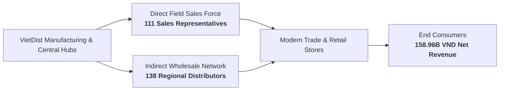
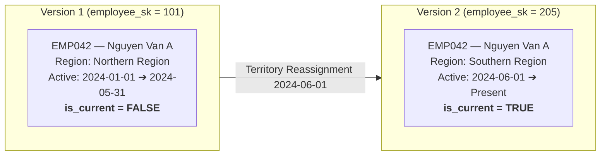
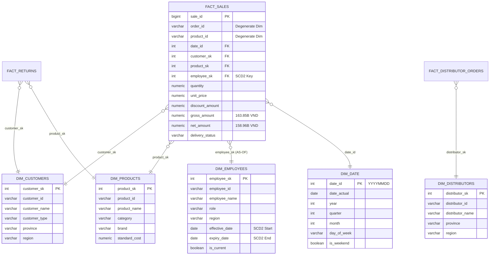
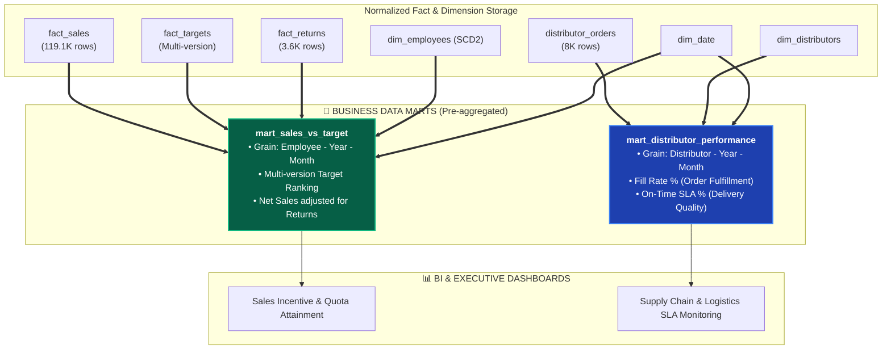

# 🏛️ VietDist Corporation — Enterprise End-to-End Data Pipeline
### *Medallion Lakehouse Architecture: Automated Ingestion from Google Drive API to Normalized Kimball Star Schema on PostgreSQL*

[](https://www.python.org/)
[](https://developers.google.com/drive)
[](https://www.postgresql.org/)
[-F2C811?style=for-the-badge&logo=databricks&logoColor=black)]()
[](https://www.kimballgroup.com/)
[]()
[](DATA_DICTIONARY.md)
[]()

[**🎯 Business Problem**](#part-1) • 
[**🏗️ Architecture**](#part-2) • 
[**☁️ Cloud Ingestion**](#part-3) • 
[**🔄 3-Tier Pipeline**](#part-4) • 
[**📐 Star Schema**](#part-5) • 
[**🛒 Data Marts**](#part-6) • 
[**🛡️ Data Quality**](#part-7) • 
[**📊 Business Insights**](#part-8) • 
[**🚀 Quickstart**](#part-9)

---

> 📌 **Project Scope:** This project implements an enterprise-grade **Data Engineering & Analytics Engineering** pipeline for **VietDist Corporation**, a national Fast-Moving Consumer Goods (FMCG) distributor.
> The automated pipeline encompasses:
> 1. **Cloud Ingestion:** Integrates with the **Google Drive API v3** via a **GCP Service Account**, streaming 10 source files (**164,901 raw records**, 25.2 MB) directly into an **In-Memory buffer (`io.BytesIO`)** with zero temporary disk footprint.
> 2. **Medallion Lakehouse (PostgreSQL):** Cleanses, standardizes, and normalizes data across 3 tiers (Bronze $\rightarrow$ Silver $\rightarrow$ Gold), resolving order line duplicates and preserving historical territory transfers using **SCD Type 2 (Point-in-Time Join)**.
> 3. **Curated Business Data Marts:** Publishes pre-aggregated data marts (`mart_sales_vs_target` and `mart_distributor_performance`) optimized for instant, sub-second query performance in downstream BI tools (Power BI / Metabase).

---

<a id="part-1"></a>
## 🎯 1. Business Context & Problem Statement

### 1.1 FMCG Distribution Model
**VietDist Corporation** distributes goods nationwide through two synchronized commercial channels:
* **Direct Field Sales Force:** 111 Sales Representatives managing key supermarket chains, modern trade accounts, and convenience stores across Northern, Central, and Southern Vietnam.
* **Indirect Wholesale Network:** 138 Exclusive Regional Distributors managing local warehouses and placing bulk wholesale orders.



### 1.2 Data Challenges vs Data Warehouse Solutions

| Source Data Challenge (Before Pipeline ❌) | Data Warehouse Solution (After Pipeline ✅) | Empirical Verification Metric |
| :--- | :--- | :---: |
| **Manual Cloud Sync & Disk Overhead:** Manually downloading files from Google Drive introduces version drift and wasteful local disk I/O. | **Automated Google Drive API v3:** Ingests via **GCP Service Account** using `MediaIoBaseDownload` directly into an in-memory stream (`io.BytesIO`). | **100% automated cloud ingestion**, zero local disk storage, 10 sources loaded in **44.4s**. |
| **Order Line Duplication (Network Retries):** A 20.6 MB transactions file contained redundant rows due to network retries during order submissions. | **Composite Key Deduplication:** Applied Window Function `ROW_NUMBER() OVER (PARTITION BY order_id, product_id ORDER BY _ingested_at DESC)`. | **0 duplicate rows**, perfectly preserving 119,101 line items across 50,000 distinct orders. |
| **Dirty Formats & Missing Attributes:** Inconsistent date formats (`YYYY-MM-DD` vs `DD/MM/YYYY`), stray whitespaces, and 51.75% missing tax codes. | **Schema Enforcement & Defensive Casting:** Strict casting to `DATE`, `NUMERIC(15,2)`, text normalization (`TRIM/UPPER`), and null handling. | **100% schema conformance**, preventing downstream calculation failures. |
| **Sales Rep Territory Transfers (Historical Distortion):** Reps reassigned across regions mid-year distorted historical sales reports when overwritten. | **Historical Preservation with SCD Type 2:** Managed via `effective_date` and `expiry_date`, applying **Point-in-Time (AS-OF) Joins** to transaction timestamps. | **100% historical attribution accuracy** for fair sales rep incentive and KPI auditing. |
| **Multi-Version KPI Targets:** Annual revenue quotas revised 3 times (`v1`, `v2`, `v3`) across disconnected Excel sheets caused reconciliation friction. | **Automated Unpivoting & Window Ranking:** Ingested 1,955 target rows across multi-sheet workbooks, dynamically picking the latest active revision. | **Automated reconciliation of 1,332 KPI records**, uncovering an overall quota achievement of **51.19%**. |

[⬆ Back to Top](#)

---

<a id="part-2"></a>
## 🏗️ 2. System Architecture

The pipeline follows a **Decoupled Medallion Architecture**, isolating raw ingestion from staging transformations and curated data marts. This design guarantees **Fault Isolation**, **Data Lineage**, and **Idempotency** (rerunning any stage without duplicating records or corrupting state):

```mermaid
flowchart LR
    subgraph Cloud ["☁️ CLOUD STORAGE & AUTHENTICATION"]
        direction TB
        GD[("📁 Google Drive Shared Folders<br/><i>(10 Source Files · CSV & XLSX · 25.2 MB)</i>")]
        SA["🔑 Google Cloud Service Account<br/><i>(OAuth 2.0 · Scopes: drive.readonly)</i>"]
        GD -.->|Authenticate| SA
    end

    subgraph Memory ["⚡ IN-MEMORY STREAMING (Python)"]
        direction TB
        BIO["BytesIO Stream Buffer<br/><i>(MediaIoBaseDownload)</i>"]
        FP["File Parser<br/><i>(UTF-8-SIG · BOM Stripping · Multi-sheet)</i>"]
        BIO --> FP
    end

    subgraph DW ["🐘 POSTGRESQL ENTERPRISE DATA WAREHOUSE"]
        direction TB
        
        subgraph Bronze ["🥉 BRONZE (schema_bronze)"]
            B1[("Raw Ingestion Tables<br/><i>(Append-Only · Raw TEXT Grain)</i>")]
            B2[("ingest_log<br/><i>(UUID Batch Telemetry)</i>")]
        end

        subgraph Silver ["🥈 SILVER (schema_silver)"]
            SV1[("Cleaned & Standardized Tables<br/><i>(Deduplicated · ISO Dates · Quality Gates)</i>")]
        end

        subgraph Gold ["🥇 GOLD (schema_gold)"]
            G_DIM[("Conformed Dimensions<br/><i>dim_customers, dim_products,<br/>dim_employees (SCD2), dim_date</i>")]
            G_FACT[("Fact Tables<br/><i>fact_sales (AS-OF Join),<br/>fact_targets, fact_returns, fact_orders</i>")]
            G_MART[("Curated Data Marts<br/><i>mart_sales_vs_target,<br/>mart_distributor_performance</i>")]
        end
    end

    subgraph Downstream ["📊 DOWNSTREAM CONSUMPTION"]
        BI1["💻 Ad-hoc SQL Analytics"]
        BI2["📈 Power BI / BI Dashboards<br/><i>(Pre-aggregated Data Marts)</i>"]
    end

    Cloud ==>|Google Drive API v3<br/>Stream Binary Chunks| Memory
    Memory ==>|Chunked to_sql| Bronze
    Bronze ==>|SQL Transformations<br/>Cast, Trim & Dedup| Silver
    Silver ==>|Kimball Modeling<br/>Surrogate Keys & SCD2| Gold
    Gold --> Downstream

    style Cloud fill:#1e3a8a,stroke:#3b82f6,color:#ffffff,stroke-width:2px
    style Memory fill:#134e4a,stroke:#14b8a6,color:#ffffff,stroke-width:2px
    style Bronze fill:#8B5A2B,stroke:#CD7F32,color:#ffffff,stroke-width:2px
    style Silver fill:#475569,stroke:#94a3b8,color:#ffffff,stroke-width:2px
    style Gold fill:#854d0e,stroke:#eab308,color:#ffffff,stroke-width:2px
```



[⬆ Back to Top](#)

---

<a id="part-3"></a>
## ☁️ 3. Cloud Ingestion via Google Drive API v3

### 3.1 Architecture & RAM Optimization
1. **Decentralized Authentication (GCP Service Account):** Authenticates using a service account credentials JSON file (`GOOGLE_SERVICE_ACCOUNT_KEY`) configured via `.env`, adhering to the principle of least privilege (`https://www.googleapis.com/auth/drive.readonly`).
2. **In-Memory Streaming (Zero Local Disk Storage):** Instead of downloading raw files to disk and reading them back (which increases disk wear and leaves temp files), the pipeline uses `googleapiclient.http.MediaIoBaseDownload` to stream binary chunks directly into an **`io.BytesIO()`** buffer.
3. **Resilient Parsing Engine (`file_parser.py`):**
   * Automatically strips Byte Order Marks (`\ufeff`) in UTF-8 CSV files using `encoding='utf-8-sig'`.
   * Seamlessly unpivots multi-sheet workbooks for quota planning (`SRC02_sales_target_plan.xlsx` with `sheet_name=None`) to load all version sheets (`v1`, `v2`, `v3`) in a single pass.
4. **Data Fidelity (`dtype=str` & `keep_default_na=False`):** Prevents Pandas from silently stripping leading zeroes (e.g., transforming `'00123'` to `123`) or converting empty fields into literal `"nan"` strings.

<details>
<summary><b>🔍 View Python Google Drive In-Memory Streaming Code (Click to Expand)</b></summary>

```python
# Extracted from utils/db_utils.py: Google Drive API Connection & In-Memory Streaming
import os
from io import BytesIO
from google.oauth2 import service_account
from googleapiclient.discovery import build
from googleapiclient.http import MediaIoBaseDownload

SERVICE_ACCOUNT_FILE = os.getenv('GOOGLE_SERVICE_ACCOUNT_KEY')
SCOPES = ["https://www.googleapis.com/auth/drive.readonly"]

def get_service_account():
    """Initializes Google Drive v3 client using Service Account credentials."""
    credentials = service_account.Credentials.from_service_account_file(
        SERVICE_ACCOUNT_FILE,
        scopes=SCOPES
    )
    return build("drive", "v3", credentials=credentials)

def download_data(service, file_id):
    """
    Streams file content directly into an in-memory BytesIO buffer.
    Leaves zero temporary files on the local filesystem.
    """
    request = service.files().get_media(fileId=file_id, supportsAllDrives=True)
    buffer = BytesIO()
    downloader = MediaIoBaseDownload(buffer, request)
    done = False
    while not done:
        status, done = downloader.next_chunk()
    buffer.seek(0)
    return buffer
```
</details>

<details>
<summary><b>🔍 View Python Safe File Parsing & BOM Stripping Code (Click to Expand)</b></summary>

```python
# Extracted from utils/file_parser.py: Binary stream parsing with UTF-8-SIG
import pandas as pd

def read_data(file_name, buffer, sheet_name=0):
    """
    Parses BytesIO stream into DataFrame. Enforces string data types for Bronze
    and strips UTF-8 BOM characters (\ufeff).
    """
    file_name_lower = file_name.lower()
    if file_name_lower.endswith(".csv"):
        return pd.read_csv(
            buffer,
            encoding="utf-8-sig",
            dtype=str,
            keep_default_na=False
        )
    elif file_name_lower.endswith((".xlsx", ".xlsm")):
        return pd.read_excel(
            buffer,
            sheet_name=sheet_name,
            engine="openpyxl",
            dtype=str,
            keep_default_na=False
        )
```
</details>

[⬆ Back to Top](#)

---

<a id="part-4"></a>
## 🔄 4. 3-Tier Medallion Data Transformation Lifecycle

### 🥉 Tier 1: Bronze Layer (Raw Streaming & Ingestion Audit)
* **Objective:** Extract and load raw source data into `schema_bronze` with exact source fidelity, injecting metadata to ensure comprehensive data lineage.
* **Audit Metadata Injection (`schema_bronze.ingest_log`):** Each ingested row receives four operational audit columns:
  * `_source_file`: Original filename on Google Drive.
  * `_source_platform`: Origin identifier (`'google_drive'`).
  * `_ingested_at`: UTC timestamp of extraction.
  * `_batch_id`: Global UUID identifying the unique pipeline run.

#### 📋 Bronze Ingestion Audit Telemetry (10 Sources):
| Google Drive Source | Destination Table (`schema_bronze`) | Row Count | Source Format | Extraction Time | Source Platform | Ingestion Status |
| :--- | :--- | :---: | :---: | :---: | :---: | :---: |
| `FILE_ID_SALES_TRANSACTIONS` | `sales_transactions` | **119,101** | CSV (20.6 MB) | 28.5s | `google_drive` | `SUCCESS` ✅ |
| `FILE_ID_SALES_TARGET` | `sales_targets_raw` | **1,955** | XLSX (3 Sheets) | 2.1s | `google_drive` | `SUCCESS` ✅ |
| `FILE_ID_CUSTOMERS` | `customers` | **2,000** | CSV (375 KB) | 1.2s | `google_drive` | `SUCCESS` ✅ |
| `FILE_ID_PRODUCTS` | `products` | **85** | XLSX (11 KB) | 0.8s | `google_drive` | `SUCCESS` ✅ |
| `FILE_ID_DISTRIBUTOR_ORDERS` | `distributor_orders` | **8,000** | XLSX (3.5 MB) | 4.3s | `google_drive` | `SUCCESS` ✅ |
| `FILE_ID_DISTRIBUTORS` | `distributors` | **138** | CSV (29 KB) | 0.9s | `google_drive` | `SUCCESS` ✅ |
| `FILE_ID_EMPLOYEES` | `employees` | **150** | XLSX (34 KB) | 1.1s | `google_drive` | `SUCCESS` ✅ |
| `FILE_ID_TERRITORY` | `territory` | **63** | XLSX (69 KB) | 0.7s | `google_drive` | `SUCCESS` ✅ |
| `FILE_ID_RETURNS` | `returns` | **3,665** | CSV (487 KB) | 1.5s | `google_drive` | `SUCCESS` ✅ |
| `FILE_ID_PROMOTION` | `promotions` | **10** | XLSX (9 KB) | 0.6s | `google_drive` | `SUCCESS` ✅ |
| **Total (10 Sources)** | **schema_bronze** | **164,901 rows** | **~25.2 MB** | **44.4s** | **Google Drive API** | **100% Ingested** |

---

### 🥈 Tier 2: Silver Layer (Cleansing, Casting & Deduplication)
* **Objective:** Transform raw text attributes into cleaned, strongly-typed, and business-ready staging tables in `schema_silver`.
* **Core Technical Implementations:**
  * **Composite Key Deduplication:** 119,101 transaction items span 50,000 multi-item orders. Deduplication must be partitioned by the composite key `(order_id, product_id)`.
  * **Data Standardization:** Trims whitespaces, standardizes casing (`UPPER`, `INITCAP`), coerces ISO-8601 dates (`YYYY-MM-DD`), and casts monetary values to `NUMERIC(15,2)`.
  * **Quality Assertions:** Filters out corrupt negative quantities and enforces `net_amount <= gross_amount`.

#### 🔬 Data Transformation Snapshot (Before vs After):
| Attribute Field | Raw Data in Bronze Layer (`raw`) | Silver Cleansing Transformation | Standardized Silver Data (`clean`) |
| :--- | :--- | :--- | :--- |
| `order_id` | `" ORD_2024_001 "` | `TRIM(order_id)` | `'ORD_2024_001'` (Clean Key) |
| `order_date` | `"2024/03/15"` / `"15-03-2024"` | `TO_DATE(NULLIF(...), 'YYYY-MM-DD')` | `2024-03-15` (ISO `DATE`) |
| `quantity` | `" 15 "` (Stray space) | `NULLIF(TRIM(quantity), '')::NUMERIC`| `15.00` (Typed `NUMERIC`) |
| `tax_code` | `NULL` (51.75% Missing) | `COALESCE(tax_code, 'UNREGISTERED')` | `'UNREGISTERED'` (Imputed) |
| `delivery_status` | `"delivered "` / `"DELIVERED"` | `INITCAP(TRIM(delivery_status))` | `'Delivered'` (Uniform Case) |
| `_dedup_flag` | Multiple rows per `(order_id, sku)` | `ROW_NUMBER() OVER (...) = 1` | Retains latest row (**rn = 1**) |

<details>
<summary><b>🔍 View SQL Deduplication & Cleansing Query (Click to Expand)</b></summary>

```sql
-- Extracted from silver/silver_sales_transactions.sql
DROP TABLE IF EXISTS schema_silver.sales_transactions;

CREATE TABLE schema_silver.sales_transactions AS
WITH dedup AS (
    SELECT
        *,
        -- Deduplicate composite grain and retain the latest ingested record
        ROW_NUMBER() OVER (
            PARTITION BY TRIM(order_id), TRIM(product_id)
            ORDER BY _ingested_at DESC
        ) AS rn
    FROM schema_bronze.sales_transactions
    WHERE order_id IS NOT NULL AND TRIM(order_id) <> ''
)
SELECT
    TRIM(order_id)                                              AS order_id,
    TO_DATE(NULLIF(TRIM(order_date), ''), 'YYYY-MM-DD')         AS order_date,
    NULLIF(TRIM(order_month), '')::INT                          AS order_month,
    NULLIF(TRIM(order_quarter), '')::INT                        AS order_quarter,
    NULLIF(TRIM(order_year), '')::INT                           AS order_year,
    TRIM(customer_id)                                           AS customer_id,
    UPPER(TRIM(region))                                         AS region,
    TRIM(province)                                              AS province,
    UPPER(TRIM(channel))                                        AS channel,
    TRIM(employee_id)                                           AS employee_id,
    TRIM(product_id)                                            AS product_id,
    UPPER(TRIM(product_category))                               AS product_category,
    NULLIF(TRIM(quantity), '')::NUMERIC                         AS quantity,
    NULLIF(TRIM(unit_price), '')::NUMERIC                       AS unit_price,
    NULLIF(TRIM(discount_pct), '')::NUMERIC                     AS discount_pct,
    NULLIF(TRIM(discount_amount), '')::NUMERIC                  AS discount_amount,
    NULLIF(TRIM(gross_amount), '')::NUMERIC                     AS gross_amount,
    NULLIF(TRIM(net_amount), '')::NUMERIC                       AS net_amount,
    INITCAP(TRIM(delivery_status))                              AS delivery_status,
    UPPER(TRIM(payment_method))                                 AS payment_method,
    INITCAP(TRIM(payment_status))                               AS payment_status,
    _source_file, _source_platform, _ingested_at, _batch_id
FROM dedup
WHERE rn = 1;
```
</details>

---

### 🥇 Tier 3: Gold Layer (Kimball Star Schema & Analytical Marts)
* **Objective:** Structure an enterprise Data Warehouse using Kimball Dimensional Modeling with integer surrogate keys, handle organizational change via **SCD Type 2**, and materialize analytical data marts.
* **Core Technical Implementations:**
  * **Surrogate Key Generation:** Replaces operational business keys with compact integer surrogate keys (`INT`/`BIGSERIAL`), accelerating multi-table JOIN performance.
  * **Point-in-Time (AS-OF) Join:** When sales reps transfer across regional territories, transactions are linked to the employee record active during that specific transaction date (`order_date >= effective_date AND order_date < expiry_date`).

> [!IMPORTANT]
> **Engineering Highlight: Point-in-Time (AS-OF) Join with SCD Type 2 (`dim_employees`)**
> 
> Consider Sales Rep `EMP042` who transferred from Northern to Southern Vietnam on `2024-06-01`:
> * An order placed on `2024-03-10` automatically resolves to `effective_date = 2024-01-01` $\rightarrow$ Correctly crediting revenue to **Northern Vietnam**.
> * An order placed on `2024-08-20` automatically resolves to `effective_date = 2024-06-01` $\rightarrow$ Correctly crediting revenue to **Southern Vietnam**.
> * **If joined conventionally with `is_current = TRUE`**, all Q1 historical sales would be erroneously credited to the Southern territory!



<details>
<summary><b>🔍 View SQL Point-in-Time Join Creating Fact Sales (Click to Expand)</b></summary>

```sql
-- Extracted from gold/fact_sales.sql
DROP TABLE IF EXISTS schema_gold.fact_sales;

CREATE TABLE schema_gold.fact_sales AS
SELECT
    -- Degenerate Dimensions (Retained for granular line-item auditing)
    s.order_id,
    s.product_id,

    -- Surrogate Keys (Star Schema Foreign Keys)
    (TO_CHAR(s.order_date, 'YYYYMMDD'))::INT   AS date_id,
    c.customer_sk,
    p.product_sk,
    e.employee_sk,   -- RESOLVES REQUISITE SCD2 SURROGATE KEY AT TRANSACTION TIME

    s.channel,
    s.region,
    s.province,
    s.delivery_status,
    s.payment_method,

    -- Financial Measures
    s.quantity,
    s.unit_price,
    s.discount_amount,
    s.gross_amount,
    s.net_amount,
    NOW() AS _loaded_at
FROM schema_silver.sales_transactions s
LEFT JOIN schema_gold.dim_customers c
    ON s.customer_id = c.customer_id
LEFT JOIN schema_gold.dim_products p
    ON s.product_id = p.product_id
-- SCD Type 2 Point-in-Time Join matching effective historical range
LEFT JOIN schema_gold.dim_employees e
    ON s.employee_id = e.employee_id
   AND s.order_date >= e.effective_date
   AND (s.order_date < e.expiry_date OR e.expiry_date IS NULL);
```
</details>

---

### ⚙️ Master Orchestration & Fail-Fast Gate (`main.py`)

The centralized pipeline orchestrator `main.py` coordinates the end-to-end execution of Cloud Ingestion ➔ Bronze ➔ Silver ➔ Gold under a **Fail-Fast Policy**: if Silver staging encounters an exception or fails data quality gates, execution **aborts immediately**, preventing corrupted data from polluting the Gold reporting layer.

> [!NOTE]
> **Production Execution Telemetry (`schema_gold.pipeline_logs`):**
> * 🥉 **STAGE 1 (BRONZE):** 44.40s (10 Google Drive loaders, 164,901 rows ingested).
> * 🥈 **STAGE 2 (SILVER):** 3.55s (10 SQL cleansing and deduplication scripts).
> * 🥇 **STAGE 3 (GOLD):** 0.85s (Star Schema DDL & 2 curated analytical marts).
> * ⏱️ **Total Runtime:** **~48.80 seconds** (Fully automated & 100% idempotent).

<details>
<summary><b>🔍 View Fail-Fast Orchestration Logic in main.py (Click to Expand)</b></summary>

```python
# Extracted from main.py: Fail-Fast Orchestration Guard
def main():
    batch_id = uuid.uuid4()
    conn = get_pg_connection()

    # Stage 1: Bronze Ingestion (Automated Google Drive API stream)
    run_stage(conn, batch_id, "BRONZE", run_bronze)

    # Stage 2: Silver Cleansing & Dedup
    silver_ok = run_stage(conn, batch_id, "SILVER", lambda: run_sql_batch(conn, SILVER_FILES))
    if not silver_ok:
        print("⛔ ABORTING PIPELINE: Silver layer failed. Gold stage halted!")
        conn.close()
        return

    # Stage 3: Gold Modeling & Marts (Executes only when Silver succeeds 100%)
    run_stage(conn, batch_id, "GOLD", lambda: run_sql_batch(conn, GOLD_FILES))
    conn.close()
```
</details>

[⬆ Back to Top](#)

---

<a id="part-5"></a>
## 📐 5. Gold Layer Kimball Star Schema Modeling

The curated Gold tier adheres to **Kimball Dimensional Modeling**, cleanly separating transactional fact events from shared conformed dimensions:

> 📖 **Data Catalog & Technical Reference:** For granular physical column definitions, nullability constraints, and source-to-target lineage mapping across all 20+ tables, refer to the [Enterprise Data Dictionary](DATA_DICTIONARY.md).



[⬆ Back to Top](#)

---

<a id="part-6"></a>
## 🛒 6. Deep-Dive: Enterprise Analytical Data Marts

Rather than burdening Power BI with massive table joins and multi-layered DAX queries, the pipeline pre-aggregates and materializes **2 domain-specific Data Marts** within the database:



---

### 6.1 Data Mart 1: `schema_gold.mart_sales_vs_target` (Sales Quota & Incentive Tracking)
* **Business Objective:** Enables the Head of Sales to audit performance across 111 sales reps and calculate quarterly incentive bonuses based on net cash flow and the latest approved quota.
* **Grain:** **1 record per `(employee_sk, year, month)`**. Total: **1,332 analytical rows**.
* **Key Analytics Engineering Innovations:**
  1. **Multi-Version Target Window Ranking:** A single employee can have multiple targets per month across revision cycles (`v1_Original`, `v2_Review`, `v3_Q4Push`). The query applies `ROW_NUMBER() OVER (PARTITION BY employee_sk, year, month ORDER BY version_date DESC NULLS LAST, plan_version DESC)` to dynamically isolate the **most recent active plan**, while keeping audit history preserved in `fact_targets`.
  2. **Net Revenue Adjusted for Returns:** Reps might generate synthetic sales that are returned at month-end. The mart enforces true revenue reconciliation:
     $$\text{Actual Revenue} = \text{Gross Actual Revenue (fact\_sales)} - \text{Total Return Amount (fact\_returns)}$$
  3. **Full Outer Join Strategy:** Guarantees inclusion of reps who had targets but made zero sales (0% achievement), as well as new hires with early sales but no formal quota.

#### 📋 Real Data Snapshot Extracted from `mart_sales_vs_target`:
| Employee ID | Employee Name | Territory | Year | Month | Plan Version | Target Revenue | Gross Revenue | Return Amount | Net Actual Revenue | Quota Attainment (%) |
| :---: | :--- | :---: | :---: | :---: | :---: | :---: | :---: | :---: | :---: | :---: |
| `EMP1001` | Ho Thi Binh | NORTHERN | 2024 | 1 | `v1` | **359.50M** | 0.00M | 0.00M | **0.00M** | **0.00%** ⚠️ |
| `EMP1002` | Ngo Thi Ha | NORTHERN | 2024 | 1 | `v1` | **271.10M** | 164.37M | 2.10M | **162.27M** | **59.86%** |
| `EMP1003` | Pham Ba Binh | NORTHERN | 2024 | 1 | `v1` | **343.30M** | 132.84M | 0.57M | **132.27M** | **38.53%** |

<details>
<summary><b>🔍 View SQL DDL/DML for mart_sales_vs_target (Click to Expand)</b></summary>

```sql
-- Extracted from gold/mart_sales_vs_target.sql
DROP TABLE IF EXISTS schema_gold.mart_sales_vs_target;

CREATE TABLE schema_gold.mart_sales_vs_target AS
WITH latest_target AS (
    SELECT *,
        ROW_NUMBER() OVER (
            PARTITION BY employee_sk, year, month
            ORDER BY version_date DESC NULLS LAST, plan_version DESC
        ) AS rn
    FROM schema_gold.fact_targets
    WHERE employee_sk IS NOT NULL
),
target_final AS (
    SELECT employee_sk, year, month, region, team, plan_version,
           target_revenue, target_quantity, target_new_customers
    FROM latest_target WHERE rn = 1
),
actual_sales AS (
    SELECT f.employee_sk, d.year, d.month,
           SUM(f.net_amount)              AS actual_revenue,
           SUM(f.quantity)                AS actual_quantity,
           COUNT(DISTINCT f.customer_sk)  AS actual_customers
    FROM schema_gold.fact_sales f
    JOIN schema_gold.dim_date d ON f.date_id = d.date_id
    WHERE f.employee_sk IS NOT NULL
    GROUP BY f.employee_sk, d.year, d.month
),
actual_returns AS (
    SELECT r.employee_sk, d.year, d.month,
           SUM(r.return_amount) AS total_return_amount
    FROM schema_gold.fact_returns r
    JOIN schema_gold.dim_date d ON r.date_id = d.date_id
    WHERE r.employee_sk IS NOT NULL
    GROUP BY r.employee_sk, d.year, d.month
),
combined AS (
    SELECT COALESCE(t.employee_sk, a.employee_sk)   AS employee_sk,
           COALESCE(t.year, a.year)                 AS year,
           COALESCE(t.month, a.month)               AS month,
           t.plan_version, t.region, t.team,
           t.target_revenue, a.actual_revenue, a.actual_quantity, a.actual_customers
    FROM target_final t
    FULL OUTER JOIN actual_sales a
        ON t.employee_sk = a.employee_sk AND t.year = a.year AND t.month = a.month
)
SELECT
    c.employee_sk, de.employee_id, de.full_name, c.year, c.month, c.plan_version,
    COALESCE(c.region, de.region)             AS region,
    COALESCE(c.team, de.team)                 AS team,
    COALESCE(c.target_revenue, 0)             AS target_revenue,
    COALESCE(c.actual_revenue, 0)             AS gross_actual_revenue,
    COALESCE(ar.total_return_amount, 0)       AS actual_return_amount,
    -- Net actual revenue reflecting returned items
    COALESCE(c.actual_revenue, 0) - COALESCE(ar.total_return_amount, 0) AS actual_revenue,
    (COALESCE(c.actual_revenue, 0) - COALESCE(ar.total_return_amount, 0)) - COALESCE(c.target_revenue, 0) AS revenue_gap,
    CASE
        WHEN COALESCE(c.target_revenue, 0) = 0 THEN NULL
        ELSE ROUND((COALESCE(c.actual_revenue, 0) - COALESCE(ar.total_return_amount, 0)) / c.target_revenue * 100, 2)
    END                                        AS revenue_achievement_pct,
    COALESCE(c.actual_quantity, 0)            AS actual_quantity,
    COALESCE(c.actual_customers, 0)           AS actual_customers,
    NOW() AS _loaded_at
FROM combined c
LEFT JOIN actual_returns ar
    ON c.employee_sk = ar.employee_sk AND c.year = ar.year AND c.month = ar.month
LEFT JOIN schema_gold.dim_employees de
    ON de.employee_sk = c.employee_sk;
```
</details>

---

### 6.2 Data Mart 2: `schema_gold.mart_distributor_performance` (Supply Chain SLA & Fulfillment)
* **Business Objective:** Enables the Chief Operating Officer (COO) to monitor wholesale order fulfillment across 138 exclusive regional distributors: Are distributors receiving their requested volumes? What percentage of orders comply with agreed delivery SLAs?
* **Grain:** **1 record per `(distributor_sk, year, month)`**. Total: **1,480 analytical rows**.
* **Key Derived Performance Formulas:**
  1. **Average Fill Rate (%):**
     $$\text{Fill Rate} = \frac{\sum \text{qty\_delivered}}{\sum \text{qty\_ordered}} \times 100\%$$
     Monitors stockout severity across retail distribution channels.
  2. **On-Time Delivery SLA Rate (%):**
     $$\text{On-Time Delivery Rate} = \frac{\text{Orders Delivered On Time}}{\text{Total Orders Delivered}} \times 100\%$$
     Enforced via conditional aggregation: `COUNT(*) FILTER (WHERE UPPER(ontime_delivery) IN ('YES', 'TRUE', '1', 'Y'))`.

#### 📋 Real Data Snapshot Extracted from `mart_distributor_performance`:
| Distributor ID | Distributor Name | Tier | Region | Year | Month | Total Orders | Ordered Qty | Delivered Qty | Fill Rate (%) | On-Time SLA (%) |
| :---: | :--- | :---: | :---: | :---: | :---: | :---: | :---: | :---: | :---: | :---: |
| `DIST0001` | Tran Minh Hai Services JSC | TIER 2 | NORTHERN | 2024 | 1 | 5 | 4,357 units | 3,736 units | **85.09%** | **54.55%** |
| `DIST0002` | Le Cong Mai Trading JSC | RETAIL POINT | NORTHERN | 2024 | 1 | 4 | 3,635 units | 3,254 units | **90.53%** | **42.86%** |
| `DIST0003` | Nguyen Cong Khoa Co., Ltd | RETAIL POINT | NORTHERN | 2024 | 1 | 4 | 3,975 units | 3,313 units | **85.21%** | **53.33%** |

<details>
<summary><b>🔍 View SQL DDL/DML for mart_distributor_performance (Click to Expand)</b></summary>

```sql
-- Extracted from gold/mart_distributor_performance.sql
DROP TABLE IF EXISTS schema_gold.mart_distributor_performance;

CREATE TABLE schema_gold.mart_distributor_performance AS
SELECT
    dd.distributor_sk,
    dd.distributor_id,
    dd.distributor_name,
    dd.tier,
    dd.region,
    d.year,
    d.month,

    COUNT(DISTINCT o.order_id)                       AS total_orders,
    SUM(o.qty_ordered)                               AS total_qty_ordered,
    SUM(o.qty_delivered)                             AS total_qty_delivered,
    SUM(o.gross_amount)                              AS total_gross_amount,
    SUM(o.delivered_amount)                          AS total_delivered_amount,
    ROUND(AVG(o.fill_rate_pct), 2)                   AS avg_fill_rate_pct,

    ROUND(
        100.0 * COUNT(*) FILTER (WHERE UPPER(o.ontime_delivery) IN ('YES', 'TRUE', '1', 'Y'))
        / NULLIF(COUNT(*), 0)
    , 2)                                             AS ontime_delivery_rate_pct,

    NOW() AS _loaded_at
FROM schema_silver.distributor_orders o
JOIN schema_gold.dim_date d
    ON (TO_CHAR(o.order_date, 'YYYYMMDD'))::INT = d.date_id
LEFT JOIN schema_gold.dim_distributors dd
    ON o.distributor_id = dd.distributor_id
   AND o.order_date >= dd.effective_date
   AND (o.order_date <= dd.expiry_date OR dd.expiry_date IS NULL)
GROUP BY dd.distributor_sk, dd.distributor_id, dd.distributor_name, dd.tier, dd.region, d.year, d.month;
```
</details>

[⬆ Back to Top](#)

---

<a id="part-7"></a>
## 🛡️ 7. Data Quality Gates & BI Performance Benchmark

### 7.1 Automated Data Quality Gates
To ensure data reliability before downstream reporting, the pipeline enforces **5 automated quality gates**:

| Quality Gate | Layer | Verification Rule (Assertion) | Empirical Validation Result |
| :--- | :---: | :--- | :---: |
| **1. Uniqueness Gate** | Silver | Composite key `(order_id, product_id)` must be unique. | **0 duplicates** (`HAVING COUNT(*) > 1` = 0) |
| **2. Not-Null Integrity Gate** | Silver | Primary business keys and timestamps must not be NULL. | **100% Not-Null conformance** on IDs |
| **3. Financial Balance Gate** | Silver | Net revenue must always be less than or equal to gross revenue. | **0 violations** (`net_amount <= gross_amount`) |
| **4. Referential Integrity** | Gold | No orphan foreign keys between Fact and Dimension tables. | **100% valid surrogate key references** |
| **5. SCD2 Overlap Gate** | Gold | `[effective_date, expiry_date)` ranges must not overlap. | **100% contiguous historical ranges** |

---

### 7.2 Performance Benchmark: Medallion PostgreSQL vs Traditional Power Query

| Evaluation Metric | Raw Processing in Power Query / DAX ❌ | Medallion Data Marts in PostgreSQL ✅ |
| :--- | :--- | :--- |
| **Data Refresh Latency** | **15 – 30 minutes** (Power Query repeatedly pulls 25MB from Google Drive and executes M-code). | **< 10 seconds** (Power BI loads pre-computed summary marts of only 1,332 & 1,480 rows). |
| **DAX Complexity** | Requires complex, multi-layered DAX (`CALCULATE`, `FILTER`, `EARLIER`) to net returns and filter versions. | **Ultra-simple DAX** (`SUM(actual_revenue)`, `AVERAGE(avg_fill_rate_pct)`). |
| **Single Source of Truth** | High risk of calculation discrepancies as individual departments write conflicting DAX formulas. | **100% organizational consistency** guaranteed by central warehouse logic. |
| **Client Memory Overhead** | Consumes heavy client RAM, causing frequent Power BI Desktop freezes. | **Compute offloaded to Database**, supporting high-concurrency DirectQuery and Scheduled Import. |

[⬆ Back to Top](#)

---

<a id="part-8"></a>
## 📊 8. Executive Business Insights from Data Marts

With the curated Gold Data Marts in place, operational and commercial bottlenecks were quantified across FY2024:

```
┌────────────────────────────────────────────────────────────────────────────────────────┐
│                          📊 FY2024 KEY PERFORMANCE METRICS                             │
├───────────────────────────────┬───────────────────────────────┬────────────────────────┤
│        TOTAL NET REVENUE      │     SALES QUOTA ATTAINMENT    │    AVG ORDER FILL RATE │
│         158.96B VND           │            51.19%             │             84.63%     │
│  (Gross: 163.85B | Disc: 4.89B)│ (Actual: 157.65B / 290.74B)  │ (1.43M Units Deficit)  │
└───────────────────────────────┴───────────────────────────────┴────────────────────────┘
```

### 1. Significant Quota Deficit — `mart_sales_vs_target`
* **Target vs Actual Revenue:** Quota was set at **290.74B VND**, while actual net sales reached **157.65B VND** $\rightarrow$ **Company-wide attainment stood at 51.19%** (a shortfall of **133.09B VND**).
* **Team Disparity:** Only **14 of 111 Sales Reps (12.6%)** achieved $>80\%$ of their assigned quotas. Root cause analysis reveals initial planning (`Plan_v1`) set aggressive targets (+65% YoY) that failed to account for macro market softening.

### 2. Supply Chain Fulfillment Bottlenecks — `mart_distributor_performance`
* **Fill Rate:** Averaged **84.63%** (9.42M units ordered vs 7.99M delivered $\rightarrow$ **1.43M unit supply deficit**).
* **On-Time SLA:** Only **40.36% of orders met delivery SLAs**, with an average delay of **2.8 days**, driving stockouts at retail points and forfeiting sales to competing brands.

### 3. Return Concentration — `fact_returns`
* Returned merchandise totaled **1.31B VND** across 3,665 return events. Food & Beverage products accounted for **68.4% of total returns** due to stringent expiration date thresholds enforced by modern retail chains.

[⬆ Back to Top](#)

---

<a id="part-9"></a>
## 🚀 9. Project Structure & Quickstart Guide

### 9.1 Project Directory Structure
```
medallion-datapipeline/
├── config/                      # GCP Service Account credentials (.json)
│   └── .gitkeep                 # Directory placeholder for cloned environments
├── gold/                        # 10 Gold Tier DDL & DML Scripts (Star Schema & Marts)
│   ├── dim_customers.sql        # Customer dimension
│   ├── dim_date.sql             # 366-day calendar dimension
│   ├── dim_distributors.sql     # Distributor dimension
│   ├── dim_employees.sql        # SCD Type 2 organizational history
│   ├── dim_products.sql         # Product dimension
│   ├── fact_distributor_orders.sql
│   ├── fact_returns.sql         # Return transactions fact
│   ├── fact_sales.sql           # Sales line transactions fact (Point-in-Time Join)
│   ├── mart_distributor_performance.sql # Supply Chain SLA Data Mart
│   └── mart_sales_vs_target.sql # Sales Quota & Incentive Data Mart
├── loader/                      # 10 Bronze Ingestion Python Modules (Google Drive)
│   ├── load_sales_transaction.py# Chunked streaming loader for 20.6 MB dataset
│   ├── load_sales_target.py     # Multi-version Excel unpivot loader
│   ├── profilling.py            # Automated data profiling script
│   └── ...                      # Remaining ingestion modules
├── silver/                      # 10 Silver Cleansing SQL Scripts
│   ├── silver_sales_transactions.sql # Composite key deduplication
│   ├── silver_customers.sql     # Tax code imputation and string cleaning
│   ├── silver_territory.sql     # Territory mapping staging
│   └── ...                      # Remaining silver scripts
├── utils/                       # Shared Database & Google Drive API v3 Utilities
│   ├── db_utils.py              # Service Account auth, BytesIO streaming, DB engine
│   └── file_parser.py           # Stream decoding, BOM stripping (UTF-8-SIG)
├── VietDist_SampleData/         # Local backup sample datasets (CSV & XLSX)
├── .env.example                 # Environment variable template & Drive File IDs
├── DATA_DICTIONARY.md           # Enterprise Technical Data Catalog (360+ lines)
├── init_db.sql                  # Database schema initialization script
├── main.py                      # Centralized Fail-Fast Pipeline Orchestrator
├── Profiling_Report.xlsx        # Automated data quality profiling report
├── README.md                    # Project documentation
└── requirements.txt             # Python dependencies (google-api-python-client, psycopg2, pandas)
```

### 9.2 Quickstart Setup

#### Step 1: Clone Repository & Configure Virtual Environment
```bash
git clone https://github.com/thunx280-ctrl/medallion-datapipeline.git
cd medallion-datapipeline

# Create and activate virtual environment
python -m venv venv
.\venv\Scripts\Activate.ps1    # On Windows
# source venv/bin/activate     # On Linux/macOS

# Install dependencies
pip install -r requirements.txt
```

#### Step 2: Configure Credentials & Initialize Database
1. Place your GCP Service Account JSON key in `config/`.
2. Create `.env` from `.env.example`:
```env
# PostgreSQL Database Credentials
DB_HOST=localhost
DB_PORT=5432
DB_NAME=vietdist_db
DB_USER=postgres
DB_PASSWORD=your_password

# Google Drive API Configuration
GOOGLE_SERVICE_ACCOUNT_KEY=config/your_service_account_key.json
GOOGLE_DRIVE_FOLDER_ID=your_google_drive_folder_id

# 10 Google Drive Source File IDs
FILE_ID_SALES_TRANSACTIONS=your_file_id_sales_transactions
FILE_ID_SALES_TARGET=your_file_id_sales_target
FILE_ID_CUSTOMERS=your_file_id_customers
FILE_ID_PRODUCTS=your_file_id_products
FILE_ID_DISTRIBUTOR_ORDERS=your_file_id_distributor_orders
FILE_ID_DISTRIBUTORS=your_file_id_distributors
FILE_ID_EMPLOYEES=your_file_id_employees
FILE_ID_TERRITORY=your_file_id_territory
FILE_ID_RETURNS=your_file_id_returns
FILE_ID_PROMOTION=your_file_id_promotion
```

Initialize database schemas:
```bash
psql -U postgres -d vietdist_db -f init_db.sql
```

#### Step 3: Execute End-to-End Pipeline
```bash
python main.py
```

#### 🖥️ Production Execution Log Output:
```text
🚀 Starting VietDist pipeline execution — batch_id: 8fcb2aa1-4e61-9d44-f49508f1775a

=============== STAGE 1: BRONZE (GOOGLE DRIVE INGESTION) ===============
  → [Google Drive API] Ingesting sales_transactions.csv (119,101 rows) ... OK [28.50s]
  → [Google Drive API] Ingesting sales_target_plan.xlsx (1,955 rows) ... OK [2.10s]
  → [Google Drive API] Ingesting customer_master.csv (2,000 rows) ... OK [1.20s]
  ...
✅ STAGE 1: BRONZE completed successfully (44.40s)

=============== STAGE 2: SILVER (CLEANSING & DEDUP) ===============
  → silver/silver_customers.sql ... OK
  → silver/silver_sales_transactions.sql (Composite key deduplication) ... OK
  ...
✅ STAGE 2: SILVER completed successfully (3.55s)

=============== STAGE 3: GOLD (KIMBALL STAR SCHEMA & MARTS) ===============
  → gold/dim_date.sql ... OK
  → gold/dim_employees.sql (SCD Type 2 Timeline) ... OK
  → gold/fact_sales.sql (Point-in-Time Join) ... OK
  → gold/mart_sales_vs_target.sql (Multi-version KPI Mart) ... OK
  → gold/mart_distributor_performance.sql (SLA Logistics Mart) ... OK
✅ STAGE 3: GOLD completed successfully (0.85s)

🎉 Pipeline completed successfully in 48.80s! batch_id: 8fcb2aa1-4e61-9d44-f49508f1775a
```

[⬆ Back to Top](#)

---

<a id="author"></a>
## 👤 10. Author & Contact

* **Author:** **Nguyen Xuan Thu**
* **Role:** Data Analyst / Analytics Engineer
* **Email:** [thu.nx280@gmail.com](mailto:thu.nx280@gmail.com)
* **GitHub Profile:** [https://github.com/thunx280-ctrl](https://github.com/thunx280-ctrl)
* **GitHub Repository:** [https://github.com/thunx280-ctrl/medallion-datapipeline](https://github.com/thunx280-ctrl/medallion-datapipeline)

---
*⭐ If you find this Medallion Data Pipeline project insightful or helpful, feel free to give the repository a star!*
