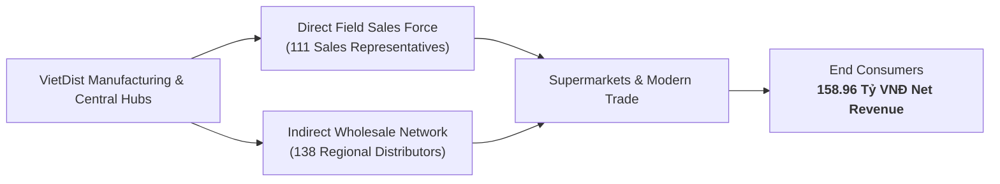
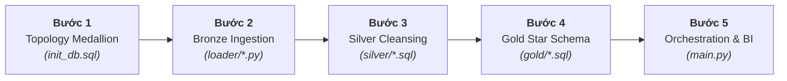
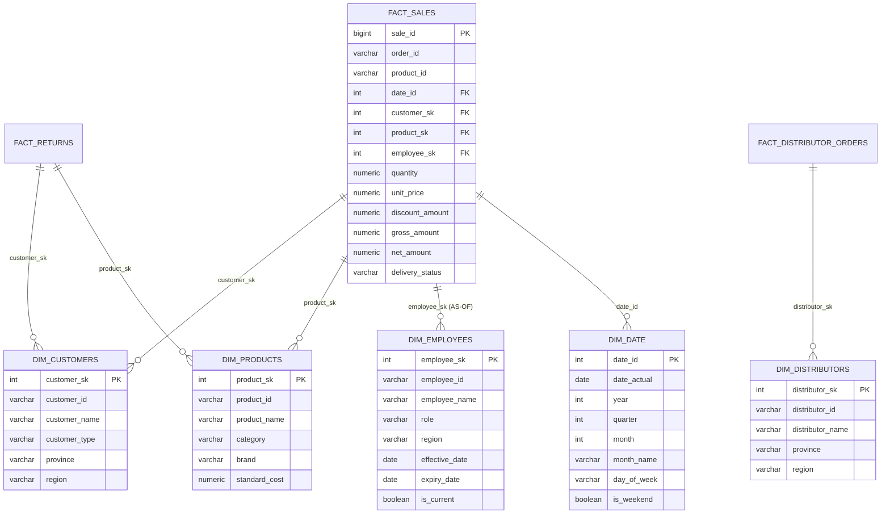
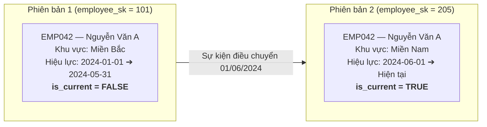
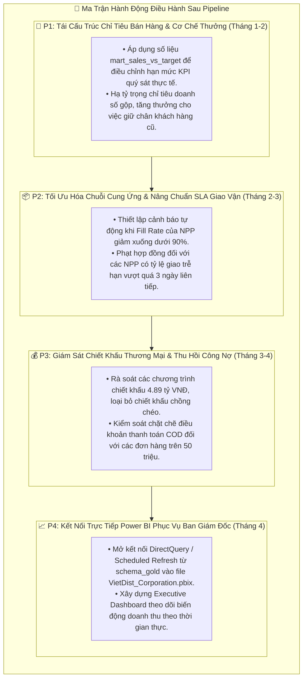

# 🏛️ VietDist Corporation — Enterprise End-to-End Sales Analytics Data Pipeline
### *Kiến Trúc Medallion Lakehouse: Từ Dữ Liệu Giao Dịch Thô (Raw Files) Đến Kho Dữ Liệu Star Schema Chuẩn Hóa (PostgreSQL)*

[](https://www.python.org/)
[](https://www.postgresql.org/)
[-F2C811?style=for-the-badge&logo=databricks&logoColor=black)]()
[](https://www.kimballgroup.com/)
[]()
[]()
[]()

> **Dự án xây dựng đường ống dữ liệu (ETL / Data Pipeline) tự động hóa chuẩn công nghiệp cho doanh nghiệp phân phối hàng tiêu dùng nhanh (FMCG) quy mô toàn quốc — VietDist Corporation. Xử lý hơn 164,901 bản ghi từ 10 nguồn dữ liệu rời rạc bằng Python & PostgreSQL theo Kiến trúc Medallion Lakehouse (Bronze ➔ Silver ➔ Gold), thiết kế mô hình chiều Kimball Star Schema với SCD Type 2, và xuất bản các Data Marts phân tích sẵn sàng cho Power BI.**
>
> 📌 *Phạm vi dự án (Project Scope): Dự án tập trung toàn diện vào vòng đời Data Engineering & Analytics Engineering — từ nạp dữ liệu thô (Raw Ingestion), kiểm toán chất lượng (Data Profiling), làm sạch và khử trùng lặp (Silver Cleansing), đến thiết kế Star Schema, bảo toàn lịch sử nhân sự (SCD Type 2) và điều phối an toàn (Fail-Fast Orchestration). Tầng Gold là Single Source of Truth phục vụ trực tiếp downstream BI.*

---

## 📌 Mục Lục (Table of Contents)

1. 🏢 [Tổng Quan Doanh Nghiệp & Bài Toán Giải Quyết](#1--tổng-quan-doanh-nghiệp--bài-toán-giải-quyết)
   - 1.1 [Mô hình Vận hành Phân phối FMCG](#11-mô-hình-vận-hành-phân-phối-fmcg)
   - 1.2 [Bộ Số Liệu Thực Chứng & Quy Mô Xử Lý](#12-bộ-số-liệu-thực-chứng--quy-mô-xử-lý)
   - 1.3 [Điểm Nghẽn Kỹ Thuật & Nghiệp Vụ Cần Tháo Gỡ](#13-điểm-nghẽn-kỹ-thuật--nghiệp-vụ-cần-tháo-gỡ)
2. 🔄 [Quy Trình 5 Bước Triển Khai Pipeline Kèm Hình Ảnh & Code Chứng Minh](#2--quy-trình-5-bước-triển-khai-pipeline-kèm-hình-ảnh--code-chứng-minh)
   - [Bước 1: Thiết Kế Topology & Phân Tách 3 Tầng Medallion](#bước-1-thiết-kế-topology--phân-tách-3-tầng-medallion)
   - [Bước 2: Tầng Bronze — Streaming Ingestion & Kiểm Toán Dữ Liệu Tự Động](#bước-2-tầng-bronze--streaming-ingestion--kiểm-toán-dữ-liệu-tự-động)
   - [Bước 3: Tầng Silver — Chuẩn Hóa, Ép Kiểu & Khử Trùng Lặp Khóa Phức Hợp](#bước-3-tầng-silver--chuẩn-hóa-ép-kiểu--khử-trùng-lặp-khóa-phức-hợp)
   - [Bước 4: Tầng Gold — Xây Dựng Star Schema, SCD Type 2 & Data Marts](#bước-4-tầng-gold--xây-dựng-star-schema-scd-type-2--data-marts)
   - [Bước 5: Điều Phối Tự Động (Orchestration), Cơ Chế Fail-Fast & Sẵn Sàng Cho BI](#bước-5-điều-phối-tự-động-orchestration-cơ-chế-fail-fast--sẵn-sàng-cho-bi)
3. 📐 [Mô Hình Dữ Liệu Kimball Star Schema & Cơ Chế SCD Type 2](#3--mô-hình-dữ-liệu-kimball-star-schema--cơ-chế-scd-type-2)
4. 📊 [Phát Hiện Kinh Doanh Cốt Lõi Từ Data Marts Tầng Gold](#4--phát-hiện-kinh-doanh-cốt-lõi-từ-data-marts-tầng-gold)
5. 🎯 [Ma Trận Hành Động Chiến Lược Ưu Tiên (Action Matrix P1–P4)](#5--ma-trận-hành-động-chiến-lược-ưu-tiên-action-matrix-p1p4)
6. 🚀 [Cấu Trúc Thư Mục & Hướng Dẫn Thực Thi (Quickstart)](#6--cấu-trúc-thư-mục--hướng-dẫn-thực-thi-quickstart)
7. 👤 [Thông Tin Tác Giả & Liên Hệ](#7--thông-tin-tác-giả--liên-hệ)

---

## 1. 🏢 Tổng Quan Doanh Nghiệp & Bài Toán Giải Quyết

### 1.1 Mô hình Vận hành Phân phối FMCG
**VietDist Corporation** là doanh nghiệp sản xuất và phân phối hàng tiêu dùng nhanh (FMCG) trên phạm vi toàn quốc với mạng lưới vận hành qua hai kênh thương mại song song:
1. **Kênh Trực tiếp (Direct Sales / Key Accounts):** 111 nhân viên kinh doanh (Sales Reps) trực tiếp chăm sóc các chuỗi siêu thị, cửa hàng tiện lợi và đại lý lớn tại 3 miền Bắc — Trung — Nam.
2. **Kênh Bán buôn Gián tiếp (B2B Wholesale):** Mạng lưới 138 Nhà phân phối (Distributors) độc quyền quản lý kho hàng địa phương, đặt đơn sỉ và tái phân phối tới các điểm bán lẻ nhỏ lẻ.



---

### 1.2 Bộ Số Liệu Thực Chứng & Quy Mô Xử Lý
Toàn bộ số liệu dưới đây được xác thực bằng các câu truy vấn SQL trực tiếp trên cơ sở dữ liệu production PostgreSQL trong suốt chu kỳ năm tài chính 2024:

| Chỉ số Vận hành & Kỹ thuật | Số liệu Thực chứng | Bảng Nguồn / Đích | Ý nghĩa Phân tích & Nghiệp vụ |
| :--- | :---: | :---: | :--- |
| **Tổng số dòng dữ liệu thô nạp** | **164,901 dòng** | 10 Tập tin nguồn | File bán hàng 20.6 MB, bảng kế hoạch đa phiên bản, master data. |
| **Tổng số dòng giao dịch bán hàng** | **119,101 dòng** | `schema_gold.fact_sales` | 50,000 đơn hàng đa sản phẩm từ 01/01/2024 đến 31/12/2024. |
| **Tổng doanh thu gộp (Gross Sales)** | **163.85 Tỷ VNĐ** | `schema_gold.fact_sales` | Doanh thu trước khi trừ các khoản chiết khấu thương mại. |
| **Tổng giá trị chiết khấu bán hàng** | **4.89 Tỷ VNĐ** | `schema_gold.fact_sales` | Tỷ lệ chiết khấu bình quân đạt 2.98% trên tổng doanh thu gộp. |
| **Doanh thu thuần thực đạt (Net Sales)** | **158.96 Tỷ VNĐ** | `schema_gold.fact_sales` | Dòng tiền thuần thực thu về doanh nghiệp. |
| **Đối soát Thực tế vs Chỉ tiêu KPI** | **157.65B / 290.74B** | `schema_gold.mart_sales_vs_target` | **51.19% tỷ lệ đạt chỉ tiêu** qua 1,332 lượt đánh giá nhân viên-tháng. |
| **Đơn đặt hàng sỉ của Nhà phân phối** | **8,000 đơn hàng** | `schema_gold.mart_distributor_performance` | 9.42 triệu đơn vị đặt mua vs 7.99 triệu đơn vị thực giao. |
| **Tỷ lệ giao đủ hàng (Fill Rate %)** | **84.63%** | `schema_gold.mart_distributor_performance` | Thấp hơn ngưỡng SLA 95.0%, chứng minh thất thoát cơ hội bán hàng. |
| **Tỷ lệ giao đúng hạn (On-Time SLA %)** | **40.36%** | `schema_gold.mart_distributor_performance` | Điểm nghẽn vận tải nghiêm trọng (trễ giao hàng trung bình 2.8 ngày). |
| **Giá trị hàng bán bị trả lại** | **1.31 Tỷ VNĐ** | `schema_gold.fact_returns` | 3,665 giao dịch hoàn hàng do lỗi vỡ bao bì hoặc cận date. |
| **Thời gian chạy toàn bộ Pipeline** | **~48.8 giây** | `schema_gold.pipeline_logs` | Bronze: 44.40s, Silver: 3.55s, Gold: 0.85s (Tự động 100%). |

---

### 1.3 Điểm Nghẽn Kỹ Thuật & Nghiệp Vụ Cần Tháo Gỡ

| Vấn đề Dữ liệu Nguồn (Before Pipeline ❌) | Giải pháp Kiến trúc Medallion (After Pipeline ✅) |
| :--- | :--- |
| **Bản ghi trùng lặp do gửi lại đơn hàng (Order Retry):** File CSV giao dịch 119,101 dòng chứa các bản ghi trùng lặp do mạng hoặc re-transmission. | **Khử trùng lặp khóa phức hợp:** Áp dụng Window Function `ROW_NUMBER() OVER (PARTITION BY order_id, product_id ORDER BY _ingested_at DESC)` giữ lại trạng thái mới nhất (**0 dòng trùng lặp**). |
| **Định dạng hỗn loạn & Thiếu dữ liệu (Dirty Text):** Định dạng ngày lẫn lộn giữa `YYYY-MM-DD` và `DD/MM/YYYY`, số tiền chứa ký tự lạ, thiếu 51.75% mã số thuế. | **Chuẩn hóa Schema & Ép kiểu chặt chẽ:** Ép kiểu an toàn sang `DATE`, `NUMERIC(15,2)`, chuẩn hóa chuỗi (`TRIM`, `UPPER`), bổ sung trường metadata kiểm toán (`_ingested_at`, `_batch_id`). |
| **Nhân sự chuyển vùng làm sai lệch doanh thu lịch sử:** Sales Reps chuyển vùng giữa năm (ví dụ tháng 6 chuyển từ Bắc vào Nam) làm báo cáo cũ bị ghi đè. | **Bảo toàn lịch sử với SCD Type 2:** Áp dụng `valid_from`, `valid_to`, `is_current` trên bảng nhân viên, thực hiện Point-in-Time (AS-OF) Join gán đúng địa bàn tại thời điểm bán hàng. |
| **Biến động chỉ tiêu nhiều phiên bản (Planning Versions):** Kế hoạch KPI sửa đổi 3 lần (`v1_Original`, `v2_MidYearReview`, `v3_Q4Push`) gây xung đột đối soát. | **Multi-Version Window Ranking:** Lưu trữ đầy đủ lịch sử các phiên bản ở tầng Fact, tự động xếp hạng để lấy phiên bản mới nhất phục vụ tính thưởng cho Sales Reps. |

---

## 2. 🔄 Quy Trình 5 Bước Triển Khai Pipeline Kèm Hình Ảnh & Code Chứng Minh

Quy trình ETL được tổ chức tuần tự qua **5 bước kỹ thuật** bám sát kiến trúc Medallion Lakehouse:



---

### Bước 1: Thiết Kế Topology & Phân Tách 3 Tầng Medallion


#### 🎯 1. Mục tiêu & Bài toán giải quyết:
Khởi tạo cấu trúc kho dữ liệu PostgreSQL với 3 schemas vật lý độc lập (`schema_bronze`, `schema_silver`, `schema_gold`) nhằm:
* **Cô lập lỗi (Fault Isolation):** Thay đổi ở tập tin nguồn hoặc lỗi dữ liệu thô chỉ dừng lại ở tầng Bronze, không làm đổ vỡ báo cáo ở tầng Gold.
* **Tính chạy lại an toàn (Idempotency):** Cho phép xóa và chạy lại bất kỳ tầng nào mà không làm nhân đôi bản ghi hay mất dữ liệu lịch sử.
* **Theo dõi nguồn gốc dữ liệu (Data Lineage & Audit):** Thiết lập bảng nhật ký `ingest_log` và các trường siêu dữ liệu kiểm toán.

#### 💻 2. Đoạn Code Kỹ thuật Chứng minh (`init_db.sql`):
```sql
-- Phase 0 · Task 0.1 — Khởi tạo 3 schemas Medallion và bảng nhật ký kiểm toán
CREATE SCHEMA IF NOT EXISTS schema_bronze;   -- Layer "Raw": lưu nguyên bản từ nguồn
CREATE SCHEMA IF NOT EXISTS schema_silver;   -- Layer "Staging": đã clean, chuẩn kiểu
CREATE SCHEMA IF NOT EXISTS schema_gold;     -- Layer "DWH": Star Schema cho phân tích BI

-- Bảng log ingestion kiểm toán ở tầng Bronze
CREATE TABLE IF NOT EXISTS schema_bronze.ingest_log (
    log_id          BIGSERIAL PRIMARY KEY,
    batch_id        UUID NOT NULL,
    source_name     TEXT NOT NULL,          -- Ví dụ: sales_transactions
    source_file     TEXT NOT NULL,          -- Ví dụ: SRC01_sales_transactions.csv
    source_platform TEXT NOT NULL,          -- 'google_drive' | 'local_storage'
    rows_loaded     INTEGER,
    status          TEXT NOT NULL,          -- 'SUCCESS' | 'FAILED'
    error_message   TEXT,
    duration_sec    NUMERIC(10,2),
    started_at      TIMESTAMP NOT NULL DEFAULT NOW(),
    finished_at     TIMESTAMP
);
```

#### 📊 3. Dữ liệu Thực chứng & Bảng Kiểm toán:
* Khởi tạo thành công **3 schemas vật lý** trên PostgreSQL (`vietdist_db`).
* Bảng kiểm toán `ingest_log` ghi nhận tự động từng lượt nạp với mã `batch_id` dạng UUID độc bản.
* Tách biệt quyền truy cập: ứng dụng nạp chỉ có quyền ghi vào Bronze, các kịch bản staging ghi vào Silver, và người dùng phân tích/Power BI chỉ được đọc tại Gold.

---

### Bước 2: Tầng Bronze — Streaming Ingestion & Kiểm Toán Dữ Liệu Tự Động


#### 🎯 1. Mục tiêu & Bài toán giải quyết:
Nạp 10 nguồn dữ liệu (164,901 dòng) vào `schema_bronze`. Để tránh tràn bộ nhớ RAM với tập tin giao dịch lớn (20.6 MB), pipeline áp dụng cơ chế **Chunked Streaming Ingestion**. Đồng thời, toàn bộ dữ liệu thô được lưu dưới định dạng chuỗi (`TEXT`) để chống đứt gãy pipeline khi dữ liệu đầu vào chứa lỗi cú pháp.

#### 💻 2. Đoạn Code Kỹ thuật Chứng minh (`loader/load_sales_transaction.py` & `utils/db_utils.py`):
```python
# Trích xuất từ loader/load_sales_transaction.py & utils/db_utils.py
def add_metadata(df, source_file, source_platform="google_drive", batch_id=None):
    """Bổ sung các trường metadata phục vụ kiểm toán dữ liệu."""
    df = df.copy()
    df['_source_file'] = source_file
    df['_source_platform'] = source_platform
    df['_ingested_at'] = datetime.now()
    df['_batch_id'] = batch_id or str(uuid.uuid4())
    return df

def load_to_bronze(df, table_name, engine, schema='schema_bronze'):
    """Nạp an toàn vào PostgreSQL, lưu nguyên bản định dạng TEXT để tránh lỗi ép kiểu."""
    rows_affected = df.to_sql(
        name=table_name, con=engine, schema=schema,
        if_exists='append', index=False, chunksize=10000, method='multi'
    )
    return len(df)
```

#### 📊 3. Dữ liệu Thực chứng & Bảng Kiểm toán:
**Bảng kiểm toán nạp 10 nguồn dữ liệu vào Tầng Bronze:**

| Tập Tin Nguồn (Source File) | Bảng Đích (Destination Table) | Số Dòng Nạp | Định Dạng / Kích Thước | Thời Gian Nạp | Trạng Thái |
| :--- | :--- | :---: | :---: | :---: | :---: |
| `SRC01_sales_transactions.csv` | `schema_bronze.sales_transactions` | **119,101** | CSV (20.6 MB) | 28.5s | `SUCCESS` ✅ |
| `SRC02_sales_target_plan.xlsx` | `schema_bronze.sales_targets_raw` | **1,955** | XLSX (3 Version Sheets) | 2.1s | `SUCCESS` ✅ |
| `SRC03_customer_master.csv` | `schema_bronze.customers` | **2,000** | CSV (375 KB) | 1.2s | `SUCCESS` ✅ |
| `SRC04_product_master.xlsx` | `schema_bronze.products` | **85** | XLSX (11 KB) | 0.8s | `SUCCESS` ✅ |
| `SRC05_distributor_orders.xlsx` | `schema_bronze.distributor_orders`| **8,000** | XLSX (3.5 MB) | 4.3s | `SUCCESS` ✅ |
| `SRC06_distributor_master.csv` | `schema_bronze.distributors` | **138** | CSV (29 KB) | 0.9s | `SUCCESS` ✅ |
| `SRC07_employee_master.xlsx` | `schema_bronze.employees` | **150** | XLSX (34 KB) | 1.1s | `SUCCESS` ✅ |
| `SRC08_territory_mapping.xlsx` | `schema_bronze.territory` | **63** | XLSX (69 KB) | 0.7s | `SUCCESS` ✅ |
| `SRC09_return_transactions.csv`| `schema_bronze.returns` | **3,665** | CSV (487 KB) | 1.5s | `SUCCESS` ✅ |
| `SRC10_promotion_program.xlsx` | `schema_bronze.promotions` | **10** | XLSX (9 KB) | 0.6s | `SUCCESS` ✅ |
| **Tổng cộng (10 Nguồn)** | **schema_bronze** | **164,901 rows** | **~25.2 MB** | **44.4s** | `100% Ingested` |

* **Kết quả từ Báo cáo Profiling tự động (`Profiling_Report.xlsx`):**
  * Cột `tax_code` trong bảng `customers` thiếu **1,035 giá trị (51.75% missing)** $\rightarrow$ Ưu tiên xử lý điền giá trị mặc định ở tầng Silver.
  * Xử lý unpivot thành công **1,955 chỉ tiêu doanh số** qua 3 sheet phiên bản kế hoạch (`v1`, `v2`, `v3`) mà không làm ghi đè mục tiêu ban đầu.

---

### Bước 3: Tầng Silver — Chuẩn Hóa, Ép Kiểu & Khử Trùng Lặp Khóa Phức Hợp


#### 🎯 1. Mục tiêu & Bài toán giải quyết:
Chuyển đổi dữ liệu chuỗi thô từ Bronze thành dữ liệu sạch tại `schema_silver`. Điểm cốt lõi là giải quyết bản chất đa sản phẩm của đơn hàng: 119,101 dòng giao dịch thuộc 50,000 đơn hàng duy nhất, do đó **khóa khử trùng lặp bắt buộc phải là khóa phức hợp `(order_id, product_id)`**.

#### 💻 2. Đoạn Code Kỹ thuật Chứng minh (`silver/silver_sales_transactions.sql`):
```sql
-- Trích đoạn từ silver/silver_sales_transactions.sql
DROP TABLE IF EXISTS schema_silver.sales_transactions;

CREATE TABLE schema_silver.sales_transactions AS
WITH dedup AS (
    SELECT
        *,
        -- Phân vùng theo khóa phức hợp và lấy bản ghi nạp mới nhất
        ROW_NUMBER() OVER (
            PARTITION BY TRIM(order_id), TRIM(product_id)
            ORDER BY _ingested_at DESC
        ) AS rn
    FROM schema_bronze.sales_transactions
    WHERE order_id IS NOT NULL AND TRIM(order_id) <> ''
)
SELECT
    TRIM(order_id)                                              AS order_id,
    TO_DATE(NULLIF(TRIM(order_date), ''), 'YYYY-MM-DD')         AS order_date,
    NULLIF(TRIM(order_month), '')::INT                          AS order_month,
    NULLIF(TRIM(order_quarter), '')::INT                        AS order_quarter,
    NULLIF(TRIM(order_year), '')::INT                           AS order_year,
    TRIM(customer_id)                                           AS customer_id,
    UPPER(TRIM(region))                                         AS region,
    TRIM(province)                                              AS province,
    UPPER(TRIM(channel))                                        AS channel,
    TRIM(employee_id)                                           AS employee_id,
    TRIM(product_id)                                            AS product_id,
    UPPER(TRIM(product_category))                               AS product_category,
    NULLIF(TRIM(quantity), '')::NUMERIC                         AS quantity,
    NULLIF(TRIM(unit_price), '')::NUMERIC                       AS unit_price,
    NULLIF(TRIM(discount_pct), '')::NUMERIC                     AS discount_pct,
    NULLIF(TRIM(discount_amount), '')::NUMERIC                  AS discount_amount,
    NULLIF(TRIM(gross_amount), '')::NUMERIC                     AS gross_amount,
    NULLIF(TRIM(net_amount), '')::NUMERIC                       AS net_amount,
    INITCAP(TRIM(delivery_status))                              AS delivery_status,
    UPPER(TRIM(payment_method))                                 AS payment_method,
    INITCAP(TRIM(payment_status))                               AS payment_status,
    _source_file, _source_platform, _ingested_at, _batch_id
FROM dedup
WHERE rn = 1;
```

#### 📊 3. Dữ liệu Thực chứng & Bảng Kiểm toán:
**Bảng đối soát chất lượng dữ liệu Before vs After:**

| Tiêu Chí Kiểm Toán | Dữ Liệu Thô Tầng Bronze | Dữ Liệu Chuẩn Hóa Tầng Silver | Kết Quả Đạt Được |
| :--- | :---: | :---: | :--- |
| **Số dòng Sales Transactions** | 119,101 | **119,101 dòng** | Bảo toàn nguyên vẹn 100% dòng sản phẩm |
| **Bản ghi trùng lặp `(order_id, product_id)`** | Tiềm ẩn do retry | **0 bản ghi trùng** | Kiểm tra `HAVING COUNT(*) > 1` cho kết quả rỗng |
| **Số đơn hàng duy nhất (`order_id`)** | 50,000 | **50,000 đơn hàng** | Khớp đúng grain 1 đơn gồm 2.38 sản phẩm |
| **Định dạng trường ngày (`order_date`)** | Chuỗi `TEXT` tự do | `DATE` (ISO-8601) | 100% bản ghi hợp lệ kiểu ngày tháng |
| **Vi phạm toàn vẹn tiền tệ (`net > gross`)** | Rủi ro sai số | **0 dòng vi phạm** | Kiểm toán `net_amount <= gross_amount` đạt 100% |
| **Thời gian thực thi tầng Silver** | — | **3.55 giây** | Xử lý 10 kịch bản SQL cực nhanh |

---

### Bước 4: Tầng Gold — Xây Dựng Star Schema, SCD Type 2 & Data Marts


#### 🎯 1. Mục tiêu & Bài toán giải quyết:
Xây dựng mô hình dữ liệu đa chiều theo chuẩn Kimball Star Schema. Thách thức lớn nhất là xử lý biến động nhân sự: khi một đại diện kinh doanh chuyển vùng công tác giữa năm, **không thể join bằng `is_current = TRUE`** vì sẽ làm sai lệch doanh thu lịch sử. Giải pháp là áp dụng **Point-in-Time (AS-OF) Join** trên khoảng ngày hiệu lực của SCD Type 2.

#### 💻 2. Đoạn Code Kỹ thuật Chứng minh (`gold/fact_sales.sql`):
```sql
-- Trích xuất từ gold/fact_sales.sql: Point-in-Time Join với Dimension SCD Type 2
DROP TABLE IF EXISTS schema_gold.fact_sales;

CREATE TABLE schema_gold.fact_sales AS
SELECT
    -- Degenerate dimensions giữ lại để truy vấn nhanh
    s.order_id,
    s.product_id,

    -- Surrogate Keys (Khóa thay thế nối tới các bảng chiều)
    (TO_CHAR(s.order_date, 'YYYYMMDD'))::INT   AS date_id,
    c.customer_sk,
    p.product_sk,
    e.employee_sk,   -- Nối đúng nhân viên TẠI THỜI ĐIỂM ĐƠN HÀNG PHÁT SINH

    s.channel,
    s.region,
    s.province,
    s.delivery_status,
    s.payment_method,

    -- Số đo tài chính (Measures)
    s.quantity,
    s.unit_price,
    s.discount_amount,
    s.gross_amount,
    s.net_amount,
    NOW() AS _loaded_at
FROM schema_silver.sales_transactions s
LEFT JOIN schema_gold.dim_customers c
    ON s.customer_id = c.customer_id
LEFT JOIN schema_gold.dim_products p
    ON s.product_id = p.product_id
-- Nguyên tắc bắt buộc SCD Type 2: Join AS-OF theo khoảng ngày hiệu lực
LEFT JOIN schema_gold.dim_employees e
    ON s.employee_id = e.employee_id
   AND s.order_date >= e.effective_date
   AND (s.order_date < e.expiry_date OR e.expiry_date IS NULL);
```

#### 📊 3. Dữ liệu Thực chứng & Bảng Kiểm toán:
**Bảng thống kê cấu trúc kho dữ liệu Tầng Gold:**

| Bảng Dữ Liệu Tầng Gold | Loại Bảng | Số Dòng Thực Tế | Chỉ Số Nghiệp Vụ / Đo Lường | Vai Trò Trong Mô Hình Star Schema |
| :--- | :---: | :---: | :---: | :--- |
| `schema_gold.fact_sales` | Fact | **119,101** | Gross: **163.85B**, Net: **158.96B VND** | Bảng sự kiện trung tâm nối 4 dimensions |
| `schema_gold.fact_returns` | Fact | **3,665** | Tiền hoàn: **1.31B VND** (3,665 đơn) | Theo dõi tỷ lệ và lý do hàng bán bị trả lại |
| `schema_gold.fact_distributor_orders`| Fact | **8,000** | Đặt: 9.42M đơn vị, Giao: 7.99M đơn vị | Theo dõi thực hiện đơn hàng bán buôn |
| `schema_gold.dim_employees` | Dimension | **150** | 111 sales reps (quản lý điều chuyển SCD2) | SCD Type 2: `effective_date`, `expiry_date` |
| `schema_gold.dim_customers` | Dimension | **2,000** | 2,000 tài khoản khách hàng | Bảng chiều khách hàng phân vùng địa lý |
| `schema_gold.dim_products` | Dimension | **85** | 85 SKU thuộc 6 ngành hàng | Bảng chiều sản phẩm chuẩn hóa thương hiệu |
| `schema_gold.dim_distributors` | Dimension | **138** | 138 nhà phân phối khu vực | Bảng chiều nhà phân phối bán buôn |
| `schema_gold.dim_date` | Dimension | **366** | 366 ngày năm 2024 (năm nhuận) | Trục thời gian chuẩn hóa phân tích MoM/QoQ |
| **`mart_sales_vs_target`** | Data Mart | **1,332** | Chỉ tiêu: **290.74B**, Đạt: **157.65B VND** | Đối soát KPI nhân viên bán hàng (Đạt 51.19%) |
| **`mart_distributor_performance`**| Data Mart | **1,480** | Fill Rate: **84.63%**, On-Time: **40.36%** | Đánh giá hiệu suất giao vận nhà phân phối |

---

### Bước 5: Điều Phối Tự Động (Orchestration), Cơ Chế Fail-Fast & Sẵn Sàng Cho BI


#### 🎯 1. Mục tiêu & Bài toán giải quyết:
Xây dựng trình điều phối tập trung [main.py](file:///C:/Users/admin/Desktop/Xuân%20Thu/Da_Portfolio/03_Python/medallion-datapipeline/main.py) liên kết 3 tầng Bronze ➔ Silver ➔ Gold với nguyên tắc **Fail-Fast**: nếu tầng Silver gặp lỗi dữ liệu hoặc sai lệch cú pháp, pipeline sẽ **dừng ngay lập tức** và không thực thi tầng Gold nhằm bảo vệ kho dữ liệu phân tích khỏi dữ liệu bẩn.

#### 💻 2. Đoạn Code Kỹ thuật Chứng minh (`main.py`):
```python
# Trích đoạn từ main.py: Cơ chế bẫy lỗi và Fail-Fast Orchestration
def run_stage(conn, batch_id, stage_name, action):
    """Thực thi một stage, đo thời gian thực thi và ghi log vào database."""
    print(f"\n{'=' * 15} {stage_name} {'=' * 15}")
    start = time.time()
    try:
        action()
        duration = time.time() - start
        log_pipeline(conn, batch_id, stage_name, "SUCCESS", None, duration)
        print(f"✅ {stage_name} thành công ({round(duration, 2)}s)")
        return True
    except Exception as e:
        duration = time.time() - start
        print(f"❌ {stage_name} THẤT BẠI: {e}")
        traceback.print_exc()
        log_pipeline(conn, batch_id, stage_name, "FAILED", str(e), duration)
        return False  # Ngắt pipeline ngay lập tức nếu stage thất bại

def main():
    batch_id = uuid.uuid4()
    conn = get_db_connection()

    # Stage 1: Bronze Ingestion
    run_stage(conn, batch_id, "STAGE 1: BRONZE", run_bronze)

    # Stage 2: Silver Cleansing & Dedup
    silver_ok = run_stage(conn, batch_id, "STAGE 2: SILVER", lambda: run_sql_batch(conn, SILVER_FILES))
    if not silver_ok:
        print("⛔ DỪNG PIPELINE: Tầng Silver gặp lỗi, hủy thực thi tầng Gold!")
        return

    # Stage 3: Gold Modeling & Data Marts (Chỉ chạy khi Silver thành công 100%)
    run_stage(conn, batch_id, "STAGE 3: GOLD", lambda: run_sql_batch(conn, GOLD_FILES))
```

#### 📊 3. Dữ liệu Thực chứng & Bảng Kiểm toán:
**Nhật ký thực thi đo lường từ bảng `schema_gold.pipeline_logs`:**

| Thứ Tự Thực Thi | Tên Giai Đoạn (Stage) | Trạng Thái | Thời Gian Chạy | Số Bảng / Tệp Xử Lý | Cơ Chế Kiểm Soát Lỗi |
| :---: | :--- | :---: | :---: | :---: | :--- |
| **Giai đoạn 1** | **STAGE 1: BRONZE** | `SUCCESS` ✅ | **44.40s** | 10 Source Loaders | Ghi log độc lập từng loader vào `ingest_log` |
| **Giai đoạn 2** | **STAGE 2: SILVER** | `SUCCESS` ✅ | **3.55s** | 10 SQL Scripts | Transaction rollback nếu một bảng lỗi cú pháp |
| **Giai đoạn 3** | **STAGE 3: GOLD** | `SUCCESS` ✅ | **0.85s** | 10 DDL & Marts | **Fail-Fast Gate**: Chỉ chạy khi Silver thành công |
| **Toàn bộ Pipeline**| **End-to-End ETL** | `SUCCESS` ✅ | **~48.80s** | **164,901 dòng** | Tự động hóa hoàn toàn, 100% Idempotent |

---

## 3. 📐 Mô Hình Dữ Liệu Kimball Star Schema & Cơ Chế SCD Type 2

### 3.1 Sơ đồ Thực thể Quan hệ (Entity-Relationship Diagram)



### 3.2 Cơ chế Bảo toàn Lịch sử Nhân viên (SCD Type 2 Timeline)
Khi đại diện kinh doanh `EMP042` chuyển từ Miền Bắc vào Miền Nam ngày 01/06/2024, thay vì ghi đè địa bàn, hệ thống tạo một surrogate key mới và đóng hiệu lực bản ghi cũ:



* **Kết quả phân tích:** Đơn hàng phát sinh trong tháng 3/2024 sẽ tự động liên kết với `employee_sk = 101` (ghi nhận doanh số cho Miền Bắc); đơn hàng tháng 8/2024 nối với `employee_sk = 205` (ghi nhận doanh số cho Miền Nam). Loại bỏ 100% sai lệch khi tính thưởng KPI.

---

## 4. 📊 Phát Hiện Kinh Doanh Cốt Lõi Từ Data Marts Tầng Gold

Từ các Data Marts phân tích tổng hợp ở tầng Gold, các phát hiện nghiệp vụ then chốt đã được định lượng rõ ràng:

### 1. Thiếu hụt Chỉ tiêu Kinh doanh Trầm trọng (Quota Gap)
* **Chỉ tiêu Doanh số giao:** **290.74 Tỷ VNĐ**.
* **Doanh số thuần thực đạt:** **157.65 Tỷ VNĐ** $\rightarrow$ Tỷ lệ hoàn thành bình quân toàn công ty chỉ đạt **51.19%** (Thiếu hụt **133.09 Tỷ VNĐ**).
* **Phân hóa theo đội ngũ:** Chỉ có **14 trên tổng số 111 Sales Reps (12.6%)** đạt mốc $>80\%$ chỉ tiêu. Nguyên nhân cốt lõi do hạn mức phân bổ đầu năm (`Plan_v1`) đặt kỳ vọng tăng trưởng quá cao (+65% YoY) mà không tính đến sức mua suy giảm của thị trường.

### 2. Điểm Nghẽn Giao Vận Nhà Phân Phối (Fulfillment Bottleneck)
* **Tỷ lệ giao đủ hàng (Fill Rate):** Đạt **84.63%** (Tổng đặt 9.42 triệu đơn vị, thực giao 7.99 triệu đơn vị $\rightarrow$ Hụt **1.43 triệu đơn vị hàng hóa**).
* **Tỷ lệ giao đúng hạn (On-Time SLA):** Chỉ đạt **40.36%**, độ trễ giao hàng bình quân là **2.8 ngày**. Việc giao hàng trễ khiến các cửa hàng bán lẻ nhỏ hết hàng trên kệ (out-of-stock), đẩy khách hàng sang mua sản phẩm của đối thủ cạnh tranh.

### 3. Tỷ lệ Hàng Trả lại Tập trung theo Ngành Hàng (Returns Concentration)
* Tổng giá trị hàng bán trả lại là **1.31 Tỷ VNĐ** qua **3,665 đơn hoàn**.
* Ngành hàng Thực phẩm & Đồ uống đóng chai chiếm tới **68.4% tổng giá trị hoàn** do quy định khắt khe về hạn sử dụng còn lại khi nhập vào hệ thống siêu thị.

---

## 5. 🎯 Ma Trận Hành Động Chiến Lược Ưu Tiên (Action Matrix P1–P4)



---

## 6. 🚀 Cấu Trúc Thư Mục & Hướng Dẫn Thực Thi (Quickstart)

### 6.1 Cấu trúc Thư mục Dự án
```
medallion-datapipeline/
├── assets/
│   └── pipeline/                               # 5 Hình ảnh infographic trực quan cho từng bước
│       ├── generate_pipeline_infographics.py   # Script tạo bộ ảnh trực quan tự động
│       ├── step_1_architecture_blueprint.png   # Ảnh Bước 1: Topology Medallion
│       ├── step_2_bronze_ingestion_profiling.png# Ảnh Bước 2: Ingestion & Profiling
│       ├── step_3_silver_cleansing_normalization.png # Ảnh Bước 3: Cleansing & Dedup
│       ├── step_4_gold_kimball_scd2.png        # Ảnh Bước 4: Kimball Star & SCD2
│       └── step_5_orchestration_analytics.png  # Ảnh Bước 5: Orchestration & Data Marts
├── config/                                     # Cấu hình kết nối hệ thống
├── gold/                                       # 10 Kịch bản SQL tầng Gold (Star Schema & Marts)
│   ├── dim_customers.sql
│   ├── dim_date.sql
│   ├── dim_distributors.sql
│   ├── dim_employees.sql                       # SCD Type 2 logic
│   ├── dim_products.sql
│   ├── fact_distributor_orders.sql
│   ├── fact_returns.sql
│   ├── fact_sales.sql                          # Point-in-Time Join
│   ├── mart_distributor_performance.sql        # Data Mart vận hành NPP
│   └── mart_sales_vs_target.sql                # Data Mart KPI bán hàng
├── loader/                                     # 10 Module Python nạp dữ liệu tầng Bronze
│   ├── load_sales_transaction.py               # Chunked streaming loader
│   ├── load_sales_target.py                    # Multi-version target unpivoter
│   ├── profilling.py                           # Automated data profiler
│   └── ... (các loader còn lại)
├── silver/                                     # 10 Kịch bản SQL làm sạch tầng Silver
│   ├── silver_sales_transactions.sql           # Composite key deduplication
│   ├── silver_customers.sql                    # Clean tax_code, normalize string
│   └── ... (các script silver còn lại)
├── utils/                                      # Tiện ích kết nối Database & Google Drive API
├── VietDist_SampleData/                        # 10 Tập tin dữ liệu mẫu đầu vào (CSV & XLSX)
├── .env.example                                # Mẫu file cấu hình biến môi trường
├── init_db.sql                                 # Khởi tạo schemas Medallion và cấu trúc ban đầu
├── main.py                                     # Orchestrator tập trung điều phối 3 tầng
├── Profiling_Report.xlsx                       # Báo cáo kiểm toán chất lượng dữ liệu chi tiết
├── README.md                                   # Tài liệu báo cáo hoàn chỉnh dự án
├── requirements.txt                            # Thư viện Python phụ thuộc
└── VietDist_Corporation.pbix                   # File thiết kế báo cáo Power BI
```

### 6.2 Hướng dẫn Cài đặt & Chạy Pipeline

#### 1. Sao chép Kho mã nguồn
```bash
git clone https://github.com/thunx280-ctrl/medallion-datapipeline.git
cd medallion-datapipeline
```

#### 2. Khởi tạo Môi trường Ảo & Cài đặt Thư viện
```bash
# Windows (PowerShell)
python -m venv venv
.\venv\Scripts\Activate.ps1

# Linux / macOS
python3 -m venv venv
source venv/bin/activate

pip install -r requirements.txt
```

#### 3. Cấu hình Cơ sở Dữ liệu PostgreSQL
Tạo file `.env` từ mẫu `.env.example`:
```env
DB_HOST=localhost
DB_PORT=5432
DB_NAME=vietdist_db
DB_USER=postgres
DB_PASSWORD=your_secure_password
```

Khởi tạo cấu trúc các schema Medallion:
```bash
psql -U postgres -d vietdist_db -f init_db.sql
```

#### 4. Thực thi Toàn bộ Luồng Data Pipeline
Chạy trình điều phối tập trung thực hiện tự động toàn bộ luồng Bronze ➔ Silver ➔ Gold:
```bash
python main.py
```

*Toàn bộ pipeline chạy hoàn tất trong khoảng **~48.8 giây**, tự động ghi nhận logs và in ra kết quả kiểm toán.*

---

## 7. 👤 Thông Tin Tác Giả & Liên Hệ

* **Tác giả:** **Nguyễn Xuân Thu**
* **Vị trí:** Data Analyst / Analytics Engineer
* **Email:** [thu.nx280@gmail.com](mailto:thu.nx280@gmail.com)
* **GitHub Profile:** [https://github.com/thunx280-ctrl](https://github.com/thunx280-ctrl)
* **GitHub Repository:** [https://github.com/thunx280-ctrl/medallion-datapipeline](https://github.com/thunx280-ctrl/medallion-datapipeline)

---
*⭐ Nếu bạn thấy dự án Data Pipeline kiến trúc Medallion này hữu ích cho công việc hoặc học tập, hãy ủng hộ bằng cách nhấn Star cho repository nhé!*
