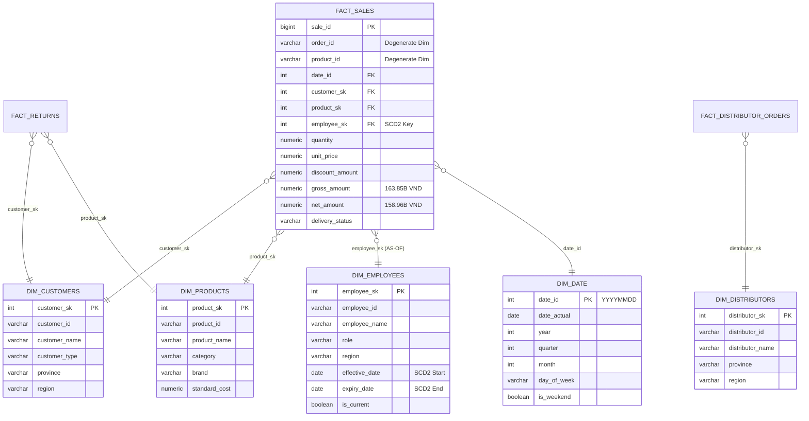
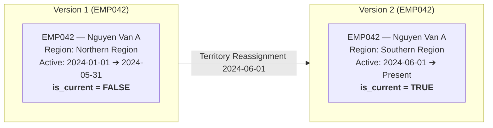

# 🏛️ VietDist Corporation — Sales & Distribution Data Pipeline
### *End-to-End Medallion Architecture (Bronze → Silver → Gold) in Python & PostgreSQL with Power BI Reporting*

[](https://www.python.org/)
[](https://www.postgresql.org/)
[](https://developers.google.com/drive)
[-F2C811?style=for-the-badge&logo=databricks&logoColor=black)]()
[](https://www.kimballgroup.com/)
[]()
[](https://powerbi.microsoft.com/)
[](DATA_DICTIONARY.md)

---

## 📌 Table of Contents
1. [Project Overview & Business Context](#-1-project-overview--business-context)
2. [System Architecture & Workflow](#%EF%B8%8F-2-system-architecture--workflow)
3. [Implementation Tasks by Phase](#-3-implementation-tasks-by-phase)
   - [Phase 0: Environment & Database Setup](#phase-0-environment--database-setup)
   - [Phase 1: Bronze Layer — Ingestion & Raw Storage](#phase-1-bronze-layer--ingestion--raw-storage)
   - [Phase 2: Silver Layer — Data Cleansing & Validation](#phase-2-silver-layer--data-cleansing--validation)
   - [Phase 3: Gold Layer — Dimensional Modeling & Data Marts](#phase-3-gold-layer--dimensional-modeling--data-marts)
   - [Phase 4: Serving & Business Intelligence (Power BI)](#phase-4-serving--business-intelligence-power-bi)
4. [📖 Data Dictionary — Comprehensive Table Overview](#-4-data-dictionary--comprehensive-table-overview)
5. [📁 Repository Structure](#-5-repository-structure)
6. [👤 Author & Contact](#-6-author--contact)

---

## 🏢 1. Project Overview & Business Context

### 1.1 Project Overview
* **Role:** **Intern / Junior Analytics Engineer**
* **Project Reference:** VietDist Analytics Project Specification (v2.0)
* **Core Objective:** Design and implement an automated local ELT data pipeline using **Python** and **PostgreSQL** following the **Medallion Architecture (Bronze → Silver → Gold)**. The pipeline ingests raw files from Google Drive, performs automated profiling and cleansing, structures a Kimball Star Schema with **SCD Type 2**, materializes curated **Data Marts**, and serves clean models to **Power BI Desktop**.

### 1.2 Business Context
**VietDist Corporation** is a nationwide Fast-Moving Consumer Goods (FMCG) distribution enterprise operating across Northern, Central, and Southern Vietnam. The company distributes food, beverage, and personal care products through two synchronized commercial channels:
* **Direct Field Sales Force:** 111 sales representatives servicing supermarkets, convenience stores, and modern trade accounts.
* **Indirect Wholesale Network:** 138 regional wholesale distributors managing local warehouses and logistics fulfillment.

### 1.3 The Business Problem
Management faced critical operational challenges due to fragmented data sources:
* **Decentralized Raw Files:** 10 core business datasets were stored on Google Drive across mixed file formats (`.csv`, `.xlsx`, `.xlsm`, `.xlsb`).
* **Data Quality Friction:** Raw transaction files contained duplicate order lines, mixed date formats (`YYYY-MM-DD` vs `DD/MM/YYYY`), untrimmed whitespaces, and missing attributes (e.g., 51.75% missing customer tax codes).
* **Organizational Changes (SCD):** Sales representatives transferred territories mid-year. Overwriting their profiles caused historical sales to be miscredited to new regions.
* **Multi-Version Quotas:** Sales targets were revised across multiple cycles (`v1_Original`, `v2_MidYearReview`) across separate Excel sheets, creating reporting conflicts.
* **Reporting Overhead:** Direct ingestion into Power Query was slow, unstable, and required complex DAX formulas to reconcile net revenue and track delivery SLAs.


---

## 🏗️ 2. System Architecture & Workflow

The pipeline separates data ingestion, cleansing, and business modeling into three distinct PostgreSQL schemas, ensuring data lineage, fault isolation, and reproducibility:


| Layer | Schema | Role & Processing Logic | Technologies |
| :--- | :--- | :--- | :--- |
| **Bronze** | `schema_bronze` | Ingests exact raw data from source files. All columns stored as `TEXT` to prevent schema drift. Adds 4 operational audit metadata columns. | Python, Google Drive API, SQLAlchemy |
| **Silver** | `schema_silver` | Data profiling, type casting (`DATE`, `NUMERIC`, `INTEGER`), text cleaning (`TRIM`, `UPPER`), null handling, and composite key deduplication. | PostgreSQL, SQL Staging Scripts |
| **Gold** | `schema_gold` | Analytical Star Schema with conformed dimensions, **SCD Type 2** historical tracking, fact tables, and 2 pre-aggregated Data Marts. | PostgreSQL, Kimball Modeling |
| **Serving** | BI Layer | Interactive reporting for sales quota attainment and distributor supply chain fulfillment. | Power BI Desktop |

---

## 🔄 3. Implementation Tasks by Phase

### Phase 0: Environment & Database Setup
* **Python Environment:** Initialized a virtual environment (`venv`) with core libraries: `pandas`, `openpyxl`, `pyxlsb`, `psycopg2-binary`, `sqlalchemy`, `google-api-python-client`, and `python-dotenv`.
* **Database Initialization (`init_db.sql`):** Configured PostgreSQL 16 database `vietdist_dw` and created the three core schemas: `schema_bronze`, `schema_silver`, and `schema_gold`.
* **Security & Configuration:** Configured database credentials and Google Service Account key paths in `.env`, ensuring `.env` and `config/` are excluded via `.gitignore`.

---

### Phase 1: Bronze Layer — Ingestion & Raw Storage

* **Objective:** Extract and load raw source data into `schema_bronze` with exact source fidelity, injecting metadata to ensure comprehensive data lineage.
* **Google Drive Connector (`utils/db_utils.py`):** Authenticates via GCP Service Account OAuth 2.0 (`drive.readonly`) and streams files into memory using `MediaIoBaseDownload` without saving temporary files to disk.
* **Multi-Format Parsing (`utils/file_parser.py`):** Robust parser handling standard `.csv` (with UTF-8 BOM stripping via `utf-8-sig`), `.xlsx`, `.xlsm`, and binary `.xlsb` files (using `pyxlsb`).
    
    ```python
    # utils/db_utils.py — Google Drive v3 Binary In-Memory Stream
    def download_data(service, file_id):
        request = service.files().get_media(fileId=file_id, supportsAllDrives=True)
        buffer = BytesIO()
        downloader = MediaIoBaseDownload(buffer, request)
        done = False
        while not done:
            status, done = downloader.next_chunk()
        buffer.seek(0)
        return buffer
    
    # utils/file_parser.py — Multi-Format Parsing & BOM Stripping
    def read_data(file_name, buffer, sheet_name=0):
        file_name_lower = file_name.lower()
        if file_name_lower.endswith(".csv"):
            # utf-8-sig strips BOM (); dtype=str preserves leading zeroes
            return pd.read_csv(buffer, encoding="utf-8-sig", dtype=str, keep_default_na=False)
        elif file_name_lower.endswith((".xlsx", ".xlsm")):
            return pd.read_excel(buffer, sheet_name=sheet_name, engine="openpyxl", dtype=str, keep_default_na=False)
        elif file_name_lower.endswith(".xlsb"):
            return pd.read_excel(buffer, sheet_name=sheet_name, engine="pyxlsb", dtype=str, keep_default_na=False)
    ```

* **Audit Metadata Injection:** Every table in Bronze receives 4 standard audit columns:
  * `_source_file`: Original file name.
  * `_source_platform`: Origin identifier (`'google_drive'`).
  * `_ingested_at`: Timestamp of ingestion (`DEFAULT NOW()`).
  * `_batch_id`: UUID tracking each pipeline run.
* **Ingestion Logging (`schema_bronze.ingest_log`):** Records execution telemetry (`batch_id`, `source_name`, `rows_loaded`, `status`, `duration_sec`).
* **Special Handling — Multi-Version Sales Targets (`loader/load_sales_target.py`):**
  * Reads `SRC02_sales_target_plan.xlsx` across all sheets (`Plan_v1_Original`, `Plan_v2`) using `sheet_name=None`.
  * Unpivots monthly target columns (`T1` to `T12`) into normalized rows.
  * Filters out summary/total rows ('TỔNG' / 'TOTAL').
  * Appends versioned rows into `schema_bronze.sales_targets_raw` without overwriting earlier plans, recording sheet metadata in `schema_bronze.sales_target_files`.

    ```python
    # loader/load_sales_target.py — Multi-Sheet Ingestion & Cleansing
    def run():
        batch_id = new_batch_id()
        engine = get_db_engine()
        service = get_service_account()
        buffer = download_data(service, FILE_ID)
        # sheet_name=None reads all sheets into a dictionary: {sheet_name: DataFrame}
        all_sheets = read_data(FILE_NAME, buffer, sheet_name=None)
        for sheet_name, df in all_sheets.items():
            if df.empty:
                continue
            df_clean = _clean_sheet(df)
            version_label = _extract_version_label(sheet_name, df_clean)
            # Inject audit metadata
            df_clean["_source_file"] = FILE_NAME
            df_clean["_sheet_name"] = sheet_name
            df_clean["_source_platform"] = "google_drive"
            df_clean["_ingested_at"] = datetime.now()
            df_clean["_batch_id"] = batch_id
            # Append mode ensures historical versions are never overwritten
            df_clean.to_sql("sales_targets_raw", con=engine, schema="schema_bronze", if_exists="append", index=False)
    ```
    

#### Ingested Data Sources Summary (10 Sources · 164,901 Rows):
| Source ID | Source Dataset | File Format | Bronze Table Name | Ingested Rows |
| :---: | :--- | :---: | :--- | :---: |
| `SRC-01` | Sales Transactions | CSV (20.6 MB) | `schema_bronze.sales_transactions` | 119,101 |
| `SRC-02` | Sales Target Plan | XLSX (3 Sheets) | `schema_bronze.sales_targets_raw` | 1,955 |
| `SRC-03` | Customer Master | CSV (375 KB) | `schema_bronze.customers` | 2,000 |
| `SRC-04` | Product Master | XLSX (11 KB) | `schema_bronze.products` | 85 |
| `SRC-05` | Distributor Orders | XLSB (3.5 MB) | `schema_bronze.distributor_orders` | 8,000 |
| `SRC-06` | Distributor Master | CSV (29 KB) | `schema_bronze.distributors` | 138 |
| `SRC-07` | Employee Master | XLSX (34 KB) | `schema_bronze.employees` | 150 |
| `SRC-08` | Territory Mapping | XLSX (69 KB) | `schema_bronze.territory` | 63 |
| `SRC-09` | Return Transactions | CSV (487 KB) | `schema_bronze.returns` | 3,665 |
| `SRC-10` | Promotion Program | XLSX (9 KB) | `schema_bronze.promotions` | 10 |

---

### Phase 2: Silver Layer — Data Cleansing & Validation

* **Objective:** Transform raw text attributes into cleaned, strongly-typed, and business-ready staging tables in `schema_silver`.
* **Automated Data Profiling (`loader/profilling.py`):**
  * Scans all 10 Bronze tables column-by-column, computing data types, row counts, null counts, null percentages, distinct values, and sample values.
  * Stores profiling metadata in `schema_bronze.profiling_summary` and exports an enterprise multi-tab workbook `Profiling_Report.xlsx`.
* **SQL Staging Transformations (`silver/*.sql`):**
  * **Strong Type Casting:** Converts raw text into native PostgreSQL types: `DATE`, `INTEGER`, `NUMERIC(15,2)`, and `BOOLEAN`.
  * **Text Cleaning:** Standardizes whitespace via `TRIM()`, capitalizes codes via `UPPER()`, and formats names via `INITCAP()`.
  * **Missing Value Imputation:** Handled missing attributes (e.g., `COALESCE(tax_code, 'UNREGISTERED')`).
  * **Target Version Staging (`silver/silver_sales_targets.sql`):** Cleanses unpivoted target rows, deduplicates by composite key `(employee_id, plan_version, year, month)`, and removes residual header/total rows.
  * **Composite Key Deduplication:** Eliminated order line duplicates generated from application submission retries using window functions:
    <details>
    <summary><b>🔍 View SQL (Click to Expand)</b></summary>
    
    ```sql
    -- Extracted from silver/silver_sales_transactions.sql
    DROP TABLE IF EXISTS schema_silver.sales_transactions;
    
    CREATE TABLE schema_silver.sales_transactions AS
    WITH dedup AS (
        SELECT
            *,
            -- Deduplicate composite grain and retain the latest ingested record
            ROW_NUMBER() OVER (
                PARTITION BY TRIM(order_id), TRIM(product_id)
                ORDER BY _ingested_at DESC
            ) AS rn
        FROM schema_bronze.sales_transactions
        WHERE order_id IS NOT NULL AND TRIM(order_id) <> ''
    )
    SELECT
        TRIM(order_id)                                              AS order_id,
        TO_DATE(NULLIF(TRIM(order_date), ''), 'YYYY-MM-DD')         AS order_date,
        NULLIF(TRIM(order_month), '')::INT                          AS order_month,
        NULLIF(TRIM(order_quarter), '')::INT                        AS order_quarter,
        NULLIF(TRIM(order_year), '')::INT                           AS order_year,
        TRIM(customer_id)                                           AS customer_id,
        UPPER(TRIM(region))                                         AS region,
        TRIM(province)                                              AS province,
        UPPER(TRIM(channel))                                        AS channel,
        TRIM(employee_id)                                           AS employee_id,
        TRIM(product_id)                                            AS product_id,
        UPPER(TRIM(product_category))                               AS product_category,
        NULLIF(TRIM(quantity), '')::NUMERIC                         AS quantity,
        NULLIF(TRIM(unit_price), '')::NUMERIC                       AS unit_price,
        NULLIF(TRIM(discount_pct), '')::NUMERIC                     AS discount_pct,
        NULLIF(TRIM(discount_amount), '')::NUMERIC                  AS discount_amount,
        NULLIF(TRIM(gross_amount), '')::NUMERIC                     AS gross_amount,
        NULLIF(TRIM(net_amount), '')::NUMERIC                       AS net_amount,
        INITCAP(TRIM(delivery_status))                              AS delivery_status,
        UPPER(TRIM(payment_method))                                 AS payment_method,
        INITCAP(TRIM(payment_status))                               AS payment_status,
        _source_file, _source_platform, _ingested_at, _batch_id
    FROM dedup
    WHERE rn = 1;
    ```
    </details>

#### 🔬 Data Transformation Snapshot (Before vs After):
| Attribute Field | Raw Data in Bronze Layer (`raw`) | Silver Cleansing Transformation | Standardized Silver Data (`clean`) |
| :--- | :--- | :--- | :--- |
| `order_id` | `" ORD_2024_001 "` | `TRIM(order_id)` | `'ORD_2024_001'` (Clean Key) |
| `order_date` | `"2024/03/15"` / `"15-03-2024"` | `TO_DATE(NULLIF(...), 'YYYY-MM-DD')` | `2024-03-15` (ISO `DATE`) |
| `quantity` | `" 15 "` (Stray space) | `NULLIF(TRIM(quantity), '')::NUMERIC`| `15.00` (Typed `NUMERIC`) |
| `tax_code` | `NULL` (51.75% Missing) | `COALESCE(tax_code, 'UNREGISTERED')` | `'UNREGISTERED'` (Imputed) |
| `delivery_status` | `"delivered "` / `"DELIVERED"` | `INITCAP(TRIM(delivery_status))` | `'Delivered'` (Uniform Case) |
| `_dedup_flag` | Multiple rows per `(order_id, sku)` | `ROW_NUMBER() OVER (...) = 1` | Retains latest row (**rn = 1**) |

---

### Phase 3: Gold Layer — Dimensional Modeling & Data Marts

The curated Gold tier adheres to **Kimball Dimensional Modeling**, cleanly separating transactional fact events from shared conformed dimensions:

> 📖 **Data Catalog & Technical Reference:** For granular physical column definitions, nullability constraints, and source-to-target lineage mapping across all 20+ tables, refer to the [Enterprise Data Dictionary](DATA_DICTIONARY.md).



#### 1. Conformed Star Schema Dimensions
* **`dim_date`:** Pre-populated calendar table covering all operational years (date, day of week, month, quarter, year, fiscal year).
* **`dim_customers`:** Customer master with customer types and geographic regions (SCD Type 1).
* **`dim_products`:** SKU catalog, brand hierarchies, product categories, and unit standard costs (SCD Type 1).
* **`dim_distributors`:** Regional wholesale distributors, tier levels, and assigned territories (SCD Type 2).
* **`dim_employees` (SCD Type 2):** Tracks sales representative territory reassignments over time using historical date ranges (`effective_date`, `expiry_date`, `is_current`). When an employee transfers regions mid-year, the previous record is closed and a new record is created with an updated surrogate key (`employee_sk`), preserving historical reporting integrity.

```sql
-- gold/dim_employees.sql (SCD Type 2 Execution)
-- Step 1: Close active records where tracked columns changed
UPDATE schema_gold.dim_employees de
SET
    expiry_date = COALESCE(e.effective_date, CURRENT_DATE) - 1,
    is_current  = FALSE
FROM schema_silver.employees e
WHERE de.employee_id = e.employee_id
  AND de.is_current = TRUE
  AND (
        COALESCE(de.region, '') <> COALESCE(e.region, '')
     OR COALESCE(de.team, '')   <> COALESCE(e.team, '')
  );
-- Step 2: Insert new versions for newly hired or updated employees
INSERT INTO schema_gold.dim_employees (
    employee_id, full_name, "position", region, team, effective_date, expiry_date, is_current
)
SELECT
    e.employee_id, e.full_name, e."position", e.region, e.team,
    COALESCE(e.effective_date, CURRENT_DATE) AS effective_date,
    NULL                                      AS expiry_date,
    TRUE                                      AS is_current
FROM schema_silver.employees e
LEFT JOIN schema_gold.dim_employees de
    ON e.employee_id = de.employee_id AND de.is_current = TRUE
WHERE de.employee_id IS NULL;
```
 **Engineering Highlight: Point-in-Time (AS-OF) Join with SCD Type 2 (`dim_employees`)**
    Consider Sales Rep `EMP042` who transferred from Northern to Southern Vietnam on `2024-06-01`:
    * An order placed on `2024-03-10` automatically resolves to `effective_date = 2024-01-01` → Correctly crediting revenue to **Northern Vietnam**.
    * An order placed on `2024-08-20` automatically resolves to `effective_date = 2024-06-01` → Correctly crediting revenue to **Southern Vietnam**.
    * **If joined conventionally with `is_current = TRUE`**, all Q1 historical sales would be erroneously credited to the Southern territory!



#### 2. Fact Tables
* **`fact_sales`:** Granular sales transactions (1 row per line item). Resolves foreign keys to dimensions and performs a **Point-in-Time (AS-OF) Join** to `dim_employees`:
  
    <details>
    <summary><b>🔍 View SQL Point-in-Time Join Creating Fact Sales (Click to Expand)</b></summary>

    ```sql
    -- Extracted from gold/fact_sales.sql
    DROP TABLE IF EXISTS schema_gold.fact_sales;

    CREATE TABLE schema_gold.fact_sales AS
    SELECT
        -- Degenerate Dimensions (Retained for granular line-item auditing)
        s.order_id,
        s.product_id,

        -- Surrogate Keys (Star Schema Foreign Keys)
        (TO_CHAR(s.order_date, 'YYYYMMDD'))::INT   AS date_id,
        c.customer_sk,
        p.product_sk,
        e.employee_sk,   -- RESOLVES REQUISITE SCD2 SURROGATE KEY AT TRANSACTION TIME

        s.channel,
        s.region,
        s.province,
        s.delivery_status,
        s.payment_method,

        -- Financial Measures
        s.quantity,
        s.unit_price,
        s.discount_amount,
        s.gross_amount,
        s.net_amount,
        NOW() AS _loaded_at
    FROM schema_silver.sales_transactions s
    LEFT JOIN schema_gold.dim_customers c
        ON s.customer_id = c.customer_id
    LEFT JOIN schema_gold.dim_products p
        ON s.product_id = p.product_id
    -- SCD Type 2 Point-in-Time Join matching effective historical range
    LEFT JOIN schema_gold.dim_employees e
        ON s.employee_id = e.employee_id
    AND s.order_date >= e.effective_date
    AND (s.order_date < e.expiry_date OR e.expiry_date IS NULL);
    ```
    </details>

* **`fact_targets`:** Monthly revenue and customer target quotas per sales representative and plan version.
* **`fact_returns`:** Product return events with return values and return reason codes.

#### 3. Curated Analytical Data Marts (Pre-aggregated)
Instead of burdening Power BI with multi-table joins and complex DAX formulas, the pipeline materializes 2 business-ready data marts:

* **Data Mart 1: `schema_gold.mart_sales_vs_target` (Sales Quota & Incentive Attainment)**
  * *Business Objective:* Enables the Head of Sales to audit performance across 111 sales reps and calculate quarterly incentive bonuses based on net cash flow and the latest approved quota.
  * *Grain:* 1 row per `(employee_sk, year, month)`. Total: **1,332 rows**.
  * *Business Logic:* Compares actual net revenue against assigned target quotas. Reconciles net cash revenue by deducting returns (`gross_actual_revenue - actual_return_amount`).
  * *Multi-Version Resolution:* Dynamically filters to the **most recent approved plan version** using window ranking:
    ```sql
    -- gold/mart_sales_vs_target.sql (Key Logic)
    WITH latest_target AS (
        SELECT *,
            ROW_NUMBER() OVER (
                PARTITION BY employee_sk, year, month
                ORDER BY version_date DESC NULLS LAST, plan_version DESC
            ) AS rn
        FROM schema_gold.fact_targets
        WHERE employee_sk IS NOT NULL
    ),
    target_final AS (
        SELECT * FROM latest_target WHERE rn = 1 -- Latest approved plan version
    ),
    actual_sales AS (
        SELECT f.employee_sk, d.year, d.month, SUM(f.net_amount) AS actual_revenue
        FROM schema_gold.fact_sales f
        JOIN schema_gold.dim_date d ON f.date_id = d.date_id
        GROUP BY f.employee_sk, d.year, d.month
    ),
    actual_returns AS (
        SELECT r.employee_sk, d.year, d.month, SUM(r.return_amount) AS total_return_amount
        FROM schema_gold.fact_returns r
        JOIN schema_gold.dim_date d ON r.date_id = d.date_id
        GROUP BY r.employee_sk, d.year, d.month
    )
    SELECT
        c.employee_sk, de.employee_id, de.full_name, c.year, c.month, c.plan_version,
        COALESCE(c.target_revenue, 0) AS target_revenue,
        COALESCE(c.actual_revenue, 0) AS gross_actual_revenue,
        COALESCE(ar.total_return_amount, 0) AS actual_return_amount,
        -- Actual Net Revenue reconciled post-returns
        COALESCE(c.actual_revenue, 0) - COALESCE(ar.total_return_amount, 0) AS actual_revenue,
        CASE
            WHEN COALESCE(c.target_revenue, 0) = 0 THEN NULL
            ELSE ROUND((COALESCE(c.actual_revenue, 0) - COALESCE(ar.total_return_amount, 0)) / c.target_revenue * 100, 2)
        END AS revenue_achievement_pct
    FROM combined c
    LEFT JOIN actual_returns ar ON c.employee_sk = ar.employee_sk AND c.year = ar.year AND c.month = ar.month
    LEFT JOIN schema_gold.dim_employees de ON de.employee_sk = c.employee_sk;
    ```
#### 📋 Real Data Snapshot Extracted from `mart_sales_vs_target`:
| Employee ID | Employee Name | Territory | Year | Month | Plan Version | Target Revenue | Gross Revenue | Return Amount | Net Actual Revenue | Quota Attainment (%) |
| :---: | :--- | :---: | :---: | :---: | :---: | :---: | :---: | :---: | :---: | :---: |
| `EMP1001` | Ho Thi Binh | NORTHERN | 2024 | 1 | `v1` | **359.50M** | 0.00M | 0.00M | **0.00M** | **0.00%** ⚠️ |
| `EMP1002` | Ngo Thi Ha | NORTHERN | 2024 | 1 | `v1` | **271.10M** | 164.37M | 2.10M | **162.27M** | **59.86%** |
| `EMP1003` | Pham Ba Binh | NORTHERN | 2024 | 1 | `v1` | **343.30M** | 132.84M | 0.57M | **132.27M** | **38.53%** |

* **Data Mart 2: `schema_gold.mart_distributor_performance` (Wholesale Supply Chain SLA)**
  * *Business Objective:* Enables the Chief Operating Officer (COO) to monitor wholesale order fulfillment across 138 exclusive regional distributors: Are distributors receiving their requested volumes? What percentage of orders comply with agreed delivery SLAs?
  * *Grain:* 1 row per `(distributor_sk, year, month)`. Total: **1,480 rows**.
  * *Business Logic:* Measures order fulfillment across wholesale distributors:
    * `avg_fill_rate_pct`: Delivered quantity vs ordered quantity (`total_qty_delivered / total_qty_ordered * 100`).
    * `ontime_delivery_rate_pct`: Percentage of shipments delivered within agreed carrier SLAs.

    ```sql
    -- gold/mart_distributor_performance.sql (Key Logic)
    SELECT
        dd.distributor_sk, dd.distributor_id, dd.distributor_name, dd.tier, dd.region, d.year, d.month,
        COUNT(DISTINCT o.order_id)  AS total_orders,
        SUM(o.qty_ordered)          AS total_qty_ordered,
        SUM(o.qty_delivered)        AS total_qty_delivered,
        -- Average Fill Rate %
        ROUND(AVG(o.fill_rate_pct), 2) AS avg_fill_rate_pct,
        -- On-Time SLA Compliance Rate %
        ROUND(
            100.0 * COUNT(*) FILTER (WHERE UPPER(o.ontime_delivery) IN ('YES', 'TRUE', '1', 'Y'))
            / NULLIF(COUNT(*), 0)
        , 2) AS ontime_delivery_rate_pct
    FROM schema_silver.distributor_orders o
    JOIN schema_gold.dim_date d ON (TO_CHAR(o.order_date, 'YYYYMMDD'))::INT = d.date_id
    LEFT JOIN schema_gold.dim_distributors dd
        ON o.distributor_id = dd.distributor_id
    AND o.order_date >= dd.effective_date
    AND (o.order_date <= dd.expiry_date OR dd.expiry_date IS NULL)
    GROUP BY dd.distributor_sk, dd.distributor_id, dd.distributor_name, dd.tier, dd.region, d.year, d.month;
    ```
#### 📋 Real Data Snapshot Extracted from `mart_distributor_performance`:
| Distributor ID | Distributor Name | Tier | Region | Year | Month | Total Orders | Ordered Qty | Delivered Qty | Fill Rate (%) | On-Time SLA (%) |
| :---: | :--- | :---: | :---: | :---: | :---: | :---: | :---: | :---: | :---: | :---: |
| `DIST0001` | Tran Minh Hai Services JSC | TIER 2 | NORTHERN | 2024 | 1 | 5 | 4,357 units | 3,736 units | **85.09%** | **54.55%** |
| `DIST0002` | Le Cong Mai Trading JSC | RETAIL POINT | NORTHERN | 2024 | 1 | 4 | 3,635 units | 3,254 units | **90.53%** | **42.86%** |
| `DIST0003` | Nguyen Cong Khoa Co., Ltd | RETAIL POINT | NORTHERN | 2024 | 1 | 4 | 3,975 units | 3,313 units | **85.21%** | **53.33%** |

---

### Phase 4: Serving & Business Intelligence (Power BI)

* **File:** `main.py`
* **Technical Explanation:** Executes Bronze → Silver → Gold sequentially. If Silver staging encounters an exception or fails data quality gates, the pipeline **aborts immediately**, preventing bad data from contaminating Gold reporting tables:

    ```python
    # main.py — Fail-Fast Orchestration
    def main():
        batch_id = uuid.uuid4()
        conn = get_pg_connection()
        print(f"🚀 Bắt đầu chạy pipeline VietDist — batch_id: {batch_id}")
    
        # Stage 1: Bronze Ingestion
        if not run_stage(conn, batch_id, "BRONZE", run_bronze):
            print("⛔ Dừng pipeline: lỗi hạ tầng ở stage BRONZE.")
            conn.close()
            return
    
        # Stage 2: Silver Cleansing & Dedup
        if not run_stage(conn, batch_id, "SILVER", lambda: run_sql_batch(conn, SILVER_FILES)):
            print("⛔ Dừng pipeline: Silver lỗi -> không chạy Gold (Gold phụ thuộc Silver).")
            conn.close()
            return
    
        # Stage 3: Gold Modeling & Marts (Runs only if Silver succeeds 100%)
        run_stage(conn, batch_id, "GOLD", lambda: run_sql_batch(conn, GOLD_FILES))
        conn.close()
    ```

* **Direct Warehouse Connection:** Power BI Desktop (`VietDist_Corporation.pbix`) connects directly to PostgreSQL `schema_gold.mart_sales_vs_target` and `schema_gold.mart_distributor_performance`.
* **Performance Gain:** Report refresh latency is reduced from **15–30 minutes** in raw Power Query to **under 10 seconds** from PostgreSQL pre-computed marts.
* **Simplified DAX:** Eliminates complicated `CALCULATE`, `FILTER`, and version-matching DAX logic on the client, utilizing simple aggregations (`SUM(actual_revenue)`, `AVERAGE(avg_fill_rate_pct)`).
* **Single Source of Truth:** Business rules (net return deduction, target version ranking, SCD2 territory attribution) are codified once in the data warehouse, ensuring 100% organizational consistency.

---

## 📖 4. Data Dictionary — Comprehensive Table Overview

> For the granular, column-level data dictionary (including data types, nullability, constraints, and business logic for all 20+ physical tables), refer to the dedicated [DATA_DICTIONARY.md](DATA_DICTIONARY.md).

### 4.1 Bronze Layer Tables (`schema_bronze`)
<details><summary><b>Click to Expand</b></summary>
    
| Table Name | Grain (1 Row Level) | Source File | Description | Primary / Composite Key |
| :--- | :--- | :--- | :--- | :--- |
| **`sales_transactions`** | 1 line item in an order | `SRC01_sales_transactions.csv` | Raw transactional sales events across retail and direct channels. All columns TEXT. | Composite: `(order_id, product_id)` |
| **`sales_targets_raw`** | 1 monthly rep quota | `SRC02_sales_target_plan.xlsx` | Raw unpivoted target lines for all version revisions (v1, v2, v3). | Synthetic: `id` |
| **`sales_target_files`** | 1 Excel sheet (plan version) | `SRC02_sales_target_plan.xlsx` | Metadata tracking each ingested target plan version, sheet name, and row count. | Primary: `id` |
| **`customers`** | 1 customer profile | `SRC03_customer_master.csv` | Raw retail customer master, store classification, channel, and address. | Natural Key: `customer_id` |
| **`products`** | 1 SKU item | `SRC04_product_master.xlsx` | Raw product catalog, brand hierarchies, packaging, and list price. | Natural Key: `product_id` |
| **`distributor_orders`** | 1 wholesale order item | `SRC05_distributor_orders.xlsx` | Wholesale fulfillment lines from regional distributors, ordered vs delivered qty. | Composite: `(order_id, product_id)` |
| **`distributors`** | 1 wholesale distributor | `SRC06_distributor_master.csv` | Distributor profiles, wholesale tier levels, and designated distribution hubs. | Natural Key: `distributor_id` |
| **`employees`** | 1 sales representative | `SRC07_employee_master.xlsx` | Sales rep demographic data, hire dates, regions, and team assignments. | Natural Key: `employee_id` |
| **`territory`** | 1 province / city mapping | `SRC08_territory_mapping.xlsx` | Geographic mappings aligning provinces into Northern, Central, and Southern regions. | Natural Key: `province` |
| **`returns`** | 1 return transaction line | `SRC09_return_transactions.csv` | Return transaction events, return reasons, and refunded monetary amounts. | Natural Key: `return_id` |
| **`promotions`** | 1 promotional campaign | `SRC10_promotion_program.xlsx` | Marketing discounts, campaign start/end dates, and budget parameters. | Natural Key: `promo_id` |
| **`ingest_log`** | 1 file ingestion event | Pipeline Telemetry | Audit log tracking pipeline run batch ID, execution time, and load status. | Primary: `log_id` |
| **`profiling_summary`**| 1 column in a Bronze table | Profiling Runner | Column-level quality audit metrics: null counts, null percentages, distinct values. | Primary: `id` |

</details>

---

### 4.2 Silver Layer Tables (`schema_silver`)
<details><summary><b>Click to Expand</b></summary>

| Table Name | Grain (1 Row Level) | Source Table (`schema_bronze`) | Cleansing & Transformation Logic | Keys & Constraints |
| :--- | :--- | :--- | :--- | :--- |
| **`sales_transactions`** | 1 line item per order | `sales_transactions` | Deduplicated via composite key window ranking (`rn = 1`); cast to `DATE`, `NUMERIC(15,2)`, `INTEGER`; strings normalized (`TRIM`, `UPPER`). | Composite PK: `(order_id, product_id)` |
| **`sales_targets`** | 1 rep target per month/ver | `sales_targets_raw` | Cleaned unpivoted target lines; filtered out summary/total rows; deduplicated by `(employee_id, plan_version, year, month)`. | Composite: `(employee_id, plan_version, year, month)` |
| **`customers`** | 1 customer profile | `customers` | Stripped whitespaces, standardized channel casing, imputed missing tax codes as `'UNREGISTERED'`. | Primary Key: `customer_id` |
| **`products`** | 1 product SKU | `products` | Standardized category casing; cast unit costs and prices to `NUMERIC(15,2)`. | Primary Key: `product_id` |
| **`distributors`** | 1 distributor profile | `distributors` | Standardized tier codes (`TIER 1`, `TIER 2`); validated contact numbers and province names. | Primary Key: `distributor_id` |
| **`distributor_orders`** | 1 wholesale order item | `distributor_orders` | Type-casted order and delivery dates, computed line fulfillment values, deduplicated composite keys. | Composite PK: `(order_id, product_id)` |
| **`employees`** | 1 employee profile | `employees` | Formatted join dates and birth dates; standardized regional sales team designations. | Primary Key: `employee_id` |
| **`territory`** | 1 province mapping | `territory` | Standardized province names to match customer and distributor regional hierarchies. | Primary Key: `province` |
| **`return_transactions`**| 1 return record | `returns` | Normalized return reason codes, cast return dates, validated positive return monetary values. | Primary Key: `return_id` |
| **`promotion_program`** | 1 promotional program | `promotions` | Validated campaign date intervals (`start_date <= end_date`), cast discount percentages. | Primary Key: `promo_id` |

</details>

---

### 4.3 Gold Layer Tables (`schema_gold`)
<details><summary><b>Dimensions & Facts:</b></summary>

| Table Name | Type | Grain | Purpose & Key Attributes | SCD Type / Join Strategy |
| :--- | :---: | :--- | :--- | :---: |
| **`dim_date`** | Dimension | 1 calendar day | Date dimension supporting time intelligence (year, quarter, month, day of week, fiscal year). | Static (`date_id = YYYYMMDD`) |
| **`dim_customers`** | Dimension | 1 customer | Conformed customer master with customer types and geographic regions. | SCD Type 1 (`customer_sk`) |
| **`dim_products`** | Dimension | 1 product SKU | Conformed product catalog with brand hierarchies, categories, and standard unit costs. | SCD Type 1 (`product_sk`) |
| **`dim_distributors`** | Dimension | 1 distributor | Wholesale distributor profiles, commercial tier levels, and designated logistics hubs. | SCD Type 2 (`distributor_sk`) |
| **`dim_employees`** | Dimension | 1 employee version | Tracks sales representative territory reassignments using `effective_date`, `expiry_date`, and `is_current`. | **SCD Type 2** (`employee_sk`) |
| **`fact_sales`** | Fact | 1 line item sold | Core sales fact containing quantities, prices, discounts, gross/net revenue. | **Point-in-Time Join** to `dim_employees` |
| **`fact_targets`** | Fact | 1 target quota | Quota assignments per sales rep, year, month, and plan version revision. | Temporal (`target_id`) |
| **`fact_returns`** | Fact | 1 return line | Returned merchandise lines, return quantities, and refunded values. | Fact (`return_sk`) |
| **`fact_distributor_orders`**| Fact | 1 wholesale line | Distributor order fulfillment monitoring ordered quantity vs delivered quantity. | Fact (`order_item_sk`) |

</details>

<details><summary><b>Data Marts (Pre-aggregated for BI):</b></summary>
    
| Data Mart Name | Grain (1 Row Level) | Total Rows | Target BI Report | Key Business Metrics Provided |
| :--- | :--- | :---: | :--- | :--- |
| **`mart_sales_vs_target`** | `(employee_sk, year, month)` | **1,332** | Sales Quota & Incentive Tracking | `target_revenue`, `gross_actual_revenue`, `actual_return_amount`, `actual_revenue` (Net), `revenue_gap`, `revenue_achievement_pct`. |
| **`mart_distributor_performance`** | `(distributor_sk, year, month)` | **1,480** | Wholesale Supply Chain & SLA Dashboard | `total_orders`, `total_qty_ordered`, `total_qty_delivered`, `avg_fill_rate_pct`, `ontime_delivery_rate_pct`. |
</details>
---

## 📁 5. Repository Structure

```
medallion-datapipeline/
├── assets/pipeline/             # Architectural and process infographics
│   ├── step_1_architecture_blueprint.png
│   ├── step_2_bronze_ingestion_profiling.png
│   ├── step_3_silver_cleansing_normalization.png
│   ├── step_4_gold_kimball_scd2.png
│   └── step_5_orchestration_analytics.png
├── config/                      # Service Account credentials directory (.gitkeep)
├── gold/                        # Gold tier DDL & DML SQL scripts
│   ├── dim_customers.sql        # Customer dimension (SCD1)
│   ├── dim_date.sql             # Calendar dimension
│   ├── dim_distributors.sql     # Distributor dimension (SCD2)
│   ├── dim_employees.sql        # Employee dimension (SCD2 historical tracking)
│   ├── dim_products.sql         # Product dimension (SCD1)
│   ├── fact_distributor_orders.sql
│   ├── fact_returns.sql         # Product returns fact
│   ├── fact_sales.sql           # Sales fact with Point-in-Time join
│   ├── fact_targets.sql         # Sales quota fact
│   ├── mart_distributor_performance.sql # Distributor supply chain SLA mart
│   └── mart_sales_vs_target.sql # Quota attainment and incentive mart
├── loader/                      # Bronze ingestion Python loaders
│   ├── load_customer.py         # Customer loader
│   ├── load_distributor.py      # Distributor loader
│   ├── load_distributor_orders.py # Binary XLSB order loader
│   ├── load_employee.py         # Employee loader
│   ├── load_product.py          # Product loader
│   ├── load_promotion.py        # Promotion loader
│   ├── load_return.py           # Return loader
│   ├── load_sales_target.py     # Multi-version sales target unpivot loader
│   ├── load_sales_transaction.py# Sales transaction loader (119k rows)
│   ├── loader_territory.py      # Territory mapping loader
│   └── profilling.py            # Automated Bronze data profiling runner
├── silver/                      # Silver tier cleansing SQL scripts
│   ├── silver_customers.sql
│   ├── silver_distributor_orders.sql
│   ├── silver_distributors.sql
│   ├── silver_employees.sql
│   ├── silver_products.sql
│   ├── silver_promotion_program.sql
│   ├── silver_return_transactions.sql
│   ├── silver_sales_targets.sql # Target deduplication and version staging
│   ├── silver_sales_transactions.sql # Composite key deduplication
│   └── silver_territory.sql
├── utils/                       # Shared utility modules
│   ├── db_utils.py              # Database connection, Drive API streaming, logging
│   └── file_parser.py           # Multi-format stream parser (CSV, XLSX, XLSB)
├── VietDist_SampleData/         # Local sample backup datasets
├── .env.example                 # Environment variable template
├── DATA_DICTIONARY.md           # Physical schema data dictionary
├── init_db.sql                  # Database and 3-tier schema initialization
├── main.py                      # Master pipeline orchestrator (Fail-Fast)
├── Profiling_Report.xlsx        # Data profiling report across 10 tables
├── VietDist_Corporation.pbix    # Production Power BI report
├── requirements.txt             # Python project dependencies
└── README.md                    # Project documentation
```
---

## 👤 6. Author & Contact

* **Author:** **Nguyen Xuan Thu**
* **Email:** [thu.nx280@gmail.com](mailto:thu.nx280@gmail.com)
* **GitHub Profile:** [https://github.com/thunx280-ctrl](https://github.com/thunx280-ctrl)
* **GitHub Repository:** [https://github.com/thunx280-ctrl/medallion-datapipeline](https://github.com/thunx280-ctrl/medallion-datapipeline)

