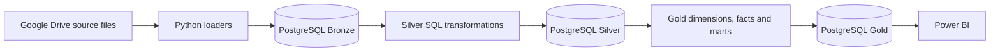

# VietDist Corporation — Sales Analytics Data Pipeline

> A portfolio project demonstrating an end-to-end ELT pipeline for sales and distribution analytics, using Python, PostgreSQL, a medallion architecture, and Power BI.


## Project overview

VietDist is a fictional distribution company used to demonstrate how raw operational files can be loaded, cleaned, modeled, and prepared for business intelligence reporting. The pipeline follows three stages:

1. **Bronze:** Python loaders retrieve source files from Google Drive and append raw records with ingestion metadata to PostgreSQL.
2. **Silver:** SQL scripts standardize and clean source tables, including deduplication and type conversion.
3. **Gold:** SQL scripts build dimensions, fact tables, and reporting marts for sales, targets, returns, and distributor performance.

The project focuses on practical analytics engineering patterns: traceable ingestion batches, layered transformations, dimensional modeling, and an orchestrated pipeline.

## Architecture



| Layer | Purpose | Implementation | Main outputs |
|---|---|---|---|
| Bronze | Load source data and ingestion metadata | Python, pandas, Google Drive API | `schema_bronze` raw tables and ingestion log |
| Silver | Clean, standardize, and deduplicate | PostgreSQL SQL | `schema_silver` staging tables |
| Gold | Create analytics-ready dimensional models | PostgreSQL SQL | Date/customer/product/employee/distributor dimensions, fact tables, reporting marts |
| Reporting | Explore sales and distribution performance | Power BI | Report is maintained as a local `.pbix` file |

## Repository structure

```text
.
├── config/
│   └── db_utils.py          # Google Drive and PostgreSQL helpers
├── gold/                    # Dimensions, facts, and reporting marts
├── loader/                  # Bronze ingestion modules
├── silver/                  # Silver transformation SQL
├── utils/                   # File parsing and database helpers
├── DATA_DICTIONARY.md       # Source and model field reference
├── init_db.sql              # Creates database schemas and support tables
├── main.py                  # Runs Bronze → Silver → Gold
└── requirements.txt
```

## Requirements

- Python 3.10 or later
- PostgreSQL 15 or later
- A Google Cloud service account with read access to the source folder in Google Drive
- Power BI Desktop to open the report (optional)

## Setup

1. Clone the repository and enter its directory:

   ```bash
   git clone https://github.com/<your-username>/vietdist-sales-analytics.git
   cd vietdist-sales-analytics
   ```

2. Create and activate a virtual environment, then install dependencies:

   ```bash
   python -m venv .venv
   # macOS/Linux
   source .venv/bin/activate
   # Windows PowerShell: .venv\Scripts\Activate.ps1
   pip install -r requirements.txt
   ```

3. Create a PostgreSQL database, then initialize its schemas:

   ```bash
   psql -U <db-user> -d <database-name> -f init_db.sql
   ```

4. Copy `.env.example` to `.env` and provide your local connection settings, Google Drive file IDs, and path to your service account JSON file. Keep `.env` and the credential JSON private; they are excluded from Git.

5. Run the pipeline:

   ```bash
   python main.py
   ```

The orchestrator runs Bronze, Silver, and Gold in sequence. Silver failure stops the run before Gold. Individual Bronze loaders record their own outcomes in the ingestion log; check those records for source-level failures.

## Modeling and data quality decisions

- Sales transactions are deduplicated using the composite key `(order_id, product_id)`.
- Sales target versions are retained using `(employee_id, plan_version, year, month)` as the key.
- Delimited promotion product lists are expanded into a bridge-style relation for analysis.
- Null handling is explicit before type conversion to avoid turning missing values into the text `"nan"`.
- Ingestion metadata records the source file, source platform, ingestion timestamp, and batch ID.

See [DATA_DICTIONARY.md](DATA_DICTIONARY.md) for field definitions and model notes.

## Data and report files

Source files, profiling workbooks, and the local Power BI `.pbix` report are not included in this public repository. They may contain customer, employee, or transaction details, and a `.pbix` can embed its underlying data. Use synthetic or explicitly approved, sanitized data when reproducing the project. The report can be shared separately after reviewing its contents and permissions.

## Scope and limitations

This repository documents a portfolio implementation. Running the pipeline requires access to the configured Google Drive files and a PostgreSQL database with the expected schemas. Power BI Desktop is needed to view the local report.
