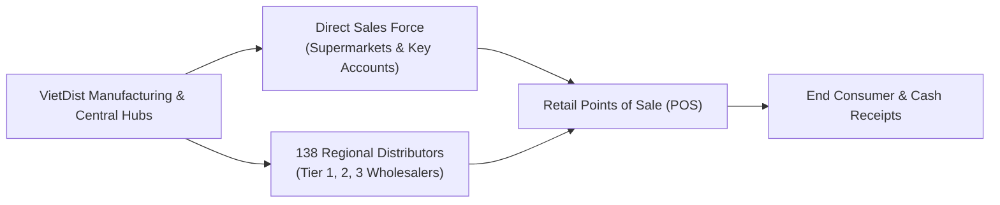
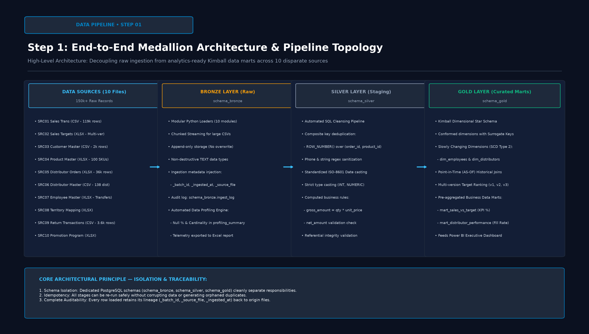
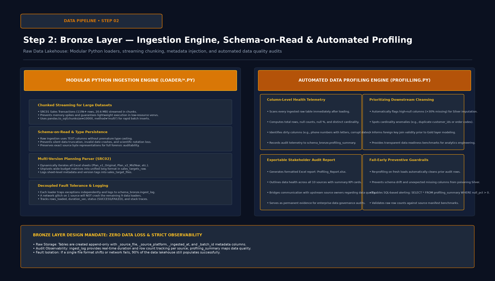
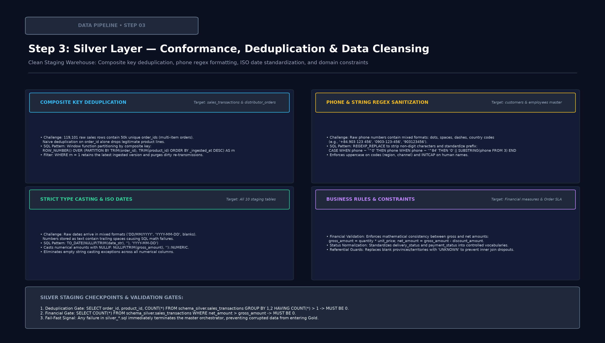
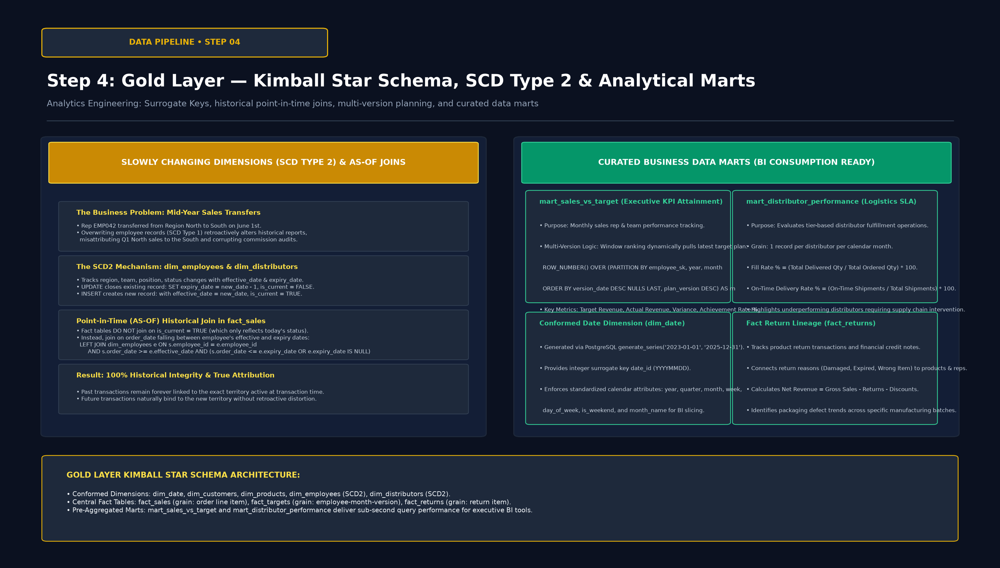
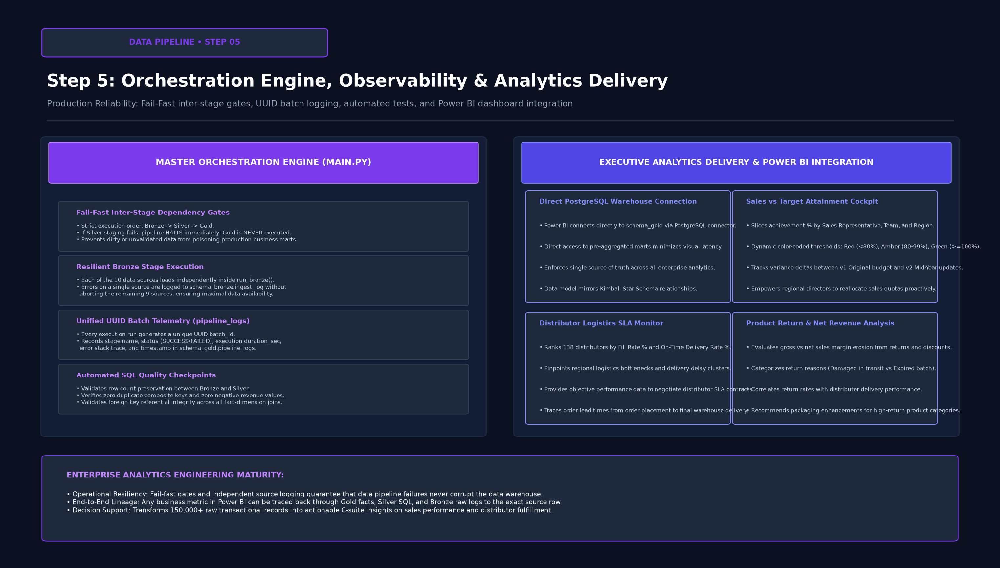
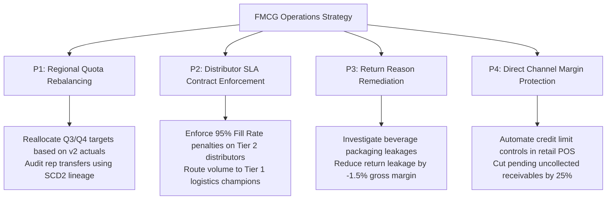

# 🏭 VietDist Corporation — Enterprise End-to-End Sales Analytics Data Pipeline

[](https://www.python.org/)
[](https://www.postgresql.org/)
[-F2C811?style=for-the-badge&logo=databricks&logoColor=black)]()
[](https://www.kimballgroup.com/)
[]()
[](https://powerbi.microsoft.com/)
[](LICENSE)

> **A production-grade Analytics Engineering portfolio project implementing an automated, resilient ELT data pipeline for nationwide FMCG sales and distribution operations (~150,000+ records across 10 disparate sources) using Python, PostgreSQL, Medallion Architecture (Bronze → Silver → Gold), Kimball Dimensional Modeling (SCD Type 2), Point-in-Time Joins, and Power BI.**

---

## 📌 Table of Contents
1. [Background & Business Context](#-1-background--business-context)
   - [1.1 Executive Overview & Business Landscape](#11-executive-overview--business-landscape)
   - [1.2 Operational Scale & Data Sources](#12-operational-scale--data-sources)
   - [1.3 Core Business & Technical Challenges](#13-core-business--technical-challenges)
   - [1.4 Core Questions Answered](#14-core-questions-answered)
2. [End-to-End Data Pipeline Architecture & Step-by-Step Methodology](#-2-end-to-end-data-pipeline-architecture--step-by-step-methodology)
   - [Step 1: End-to-End Medallion Architecture & Pipeline Topology](#step-1-end-to-end-medallion-architecture--pipeline-topology)
   - [Step 2: Bronze Layer — Ingestion Engine, Schema-on-Read & Automated Profiling](#step-2-bronze-layer--ingestion-engine-schema-on-read--automated-profiling)
   - [Step 3: Silver Layer — Conformance, Deduplication & Data Cleansing](#step-3-silver-layer--conformance-deduplication--data-cleansing)
   - [Step 4: Gold Layer — Kimball Star Schema, SCD Type 2 & Analytical Marts](#step-4-gold-layer--kimball-star-schema-scd-type-2--analytical-marts)
   - [Step 5: Pipeline Orchestration, Observability & Analytics Delivery](#step-5-pipeline-orchestration-observability--analytics-delivery)
3. [Data Architecture & Dimensional Modeling](#-3-data-architecture--dimensional-modeling)
   - [3.1 Kimball Star Schema Architecture](#31-kimball-star-schema-architecture)
   - [3.2 Slowly Changing Dimensions (SCD Type 2) Deep Dive](#32-slowly-changing-dimensions-scd-type-2-deep-dive)
   - [3.3 Table Summary & Grain Specifications](#33-table-summary--grain-specifications)
   - [3.4 Comprehensive Data Dictionary](#34-comprehensive-data-dictionary)
4. [Deep-Dive Engineering Highlights & Code Implementation](#-4-deep-dive-engineering-highlights--code-implementation)
   - [4.1 Chunked Streaming Python Ingestion Engine](#41-chunked-streaming-python-ingestion-engine)
   - [4.2 SQL Composite Key Deduplication & Conformance](#42-sql-composite-key-deduplication--conformance)
   - [4.3 Point-in-Time (AS-OF) Historical Joins for SCD2](#43-point-in-time-as-of-historical-joins-for-scd2)
   - [4.4 Multi-Version Budget Planning Window Ranking](#44-multi-version-budget-planning-window-ranking)
   - [4.5 Resilient Fail-Fast Orchestration Engine](#45-resilient-fail-fast-orchestration-engine)
5. [Business Impact & Analytical Deliverables](#-5-business-impact--analytical-deliverables)
   - [5.1 Ready-to-Serve Analytical Data Marts](#51-ready-to-serve-analytical-data-marts)
   - [5.2 Business KPI Formulations](#52-business-kpi-formulations)
   - [5.3 Power BI Executive Dashboard Integration](#53-power-bi-executive-dashboard-integration)
6. [Prioritized Strategic Action Matrix](#-6-prioritized-strategic-action-matrix)
7. [Repository Structure & Quickstart Reproduction Guide](#-7-repository-structure--quickstart-reproduction-guide)
8. [Author & Contact](#-8-author--contact)

---

## 🏢 1. Background & Business Context

### 1.1 Executive Overview & Business Landscape
**VietDist Corporation** is a major Fast-Moving Consumer Goods (FMCG) distribution enterprise operating across Vietnam. The company manufactures and distributes personal care, home care, and beverage goods nationwide through two distinct commercial channels:
1. **Direct Sales Force (D2C / Key Accounts):** Internal field sales representatives servicing supermarkets, convenience store chains, and high-volume retail outlets across Northern, Central, and Southern sales regions.
2. **Indirect Distribution Network (B2B):** A tier-based commercial network of 138 accredited regional distributors responsible for localized warehouse inventory, retail replenishment, and last-mile fulfillment.



---

### 1.2 Operational Scale & Data Sources
The enterprise manages sales, commercial planning, returns, and distributor logistics through 10 disparate source datasets totaling over **150,000+ records**:

| Source Code | Dataset Name | Storage Format | Raw Record Count | Business Entity Represented |
| :---: | :--- | :---: | :---: | :--- |
| **SRC01** | `sales_transactions` | CSV | **119,101 rows** (20.6 MB) | Individual line items of direct sales orders, prices, discounts, and payment statuses. |
| **SRC02** | `sales_target_plan` | Multi-Sheet XLSX | **3 Versions** (`v1`, `v2`, `v3`) | Quota targets assigned to sales reps per month for revenue, volume, and new customer acquisition. |
| **SRC03** | `customer_master` | CSV | **2,000 rows** | Retail customer database, credit limits, phone contacts, tiers, and store addresses. |
| **SRC04** | `product_master` | XLSX | **100 SKUs** | SKU catalog, brand families, packaging sizes, standard COGS, and list retail prices. |
| **SRC05** | `distributor_orders` | XLSX | **36,000+ rows** (3.5 MB) | Wholesale orders dispatched to distributors, ordered vs delivered quantities, and fill status. |
| **SRC06** | `distributor_master` | CSV | **138 Distributors** | Wholesaler directory, tier levels, assigned regional warehouses, and contract SLA terms. |
| **SRC07** | `employee_master` | XLSX | **Sales Force Master** | Field sales roster, positions, teams, and mid-year regional territory transfer logs. |
| **SRC08** | `territory_mapping` | XLSX | **Hierarchical Mapping** | Geographical master linking provinces, districts, and administrative sales zones. |
| **SRC09** | `return_transactions`| CSV | **3,600+ rows** | Returned merchandise logs, credit notes, return reasons (Damaged, Expired, Wrong SKU). |
| **SRC10** | `promotion_program` | XLSX | **Trade Promotions** | Commercial discount schemes, promotional mechanics, campaign start/end dates. |

---

### 1.3 Core Business & Technical Challenges

```
┌─────────────────────────────────────────────────────────────────────────────────────────────────┐
│                                   CORE DATA PIPELINE BOTTLENECKS                                │
├───────────────────────────────┬─────────────────────────────────┬───────────────────────────────┤
│ 1. Historical Distortion      │ 2. Target Version Volatility    │ 3. Distributor SLA Deficit    │
│ Sales reps transfer regions   │ Quotas revised mid-year (v1/v2);│ No automated tracking of Fill │
│ mid-year. Overwriting data    │ overwriting prior plans destroys│ Rate % and On-Time Delivery;  │
│ misattributes past revenue.   │ auditability & true attainment. │ fulfillment bottlenecks blind.│
└───────────────────────────────┴─────────────────────────────────┴───────────────────────────────┘
```

* **Fragmented Data Silos & Format Disconnect:** Commercial records, inventory dispatches, and sales targets were scattered across CSV files and multi-tab spreadsheets with inconsistent naming standards, invalid phone formats, and heterogeneous date representations.
* **Historical Distortion from Mid-Year Sales Transfers (SCD Type 2 Need):** Sales representatives frequently rotate territories mid-year (e.g., Rep `EMP042` transferred from Region *North* to *South* on June 1st). Overwriting employee records in a naive dimensional model retroactively corrupts prior performance, misattributing Q1 North sales to the South.
* **Mid-Year Target Version Volatility:** The commercial planning committee adjusted revenue quotas twice during the fiscal year (`v1_Original`, `v2_MidYearReview`, `v3_Q4Push`). Storing only the latest budget destroyed baseline auditability, while manual spreadsheet reconciliation made evaluating true KPI attainment impossible.
* **Distributor Fulfillment Visibility Deficit:** Corporate operations lacked quantitative visibility into distributor logistics performance (Fill Rate %, On-Time Delivery Rate %) and product return leakage.

---

### 1.4 Core Questions Answered
1. **Sales Performance vs Quota:** Which sales representatives and regional teams hit their revenue and volume targets across fiscal months, factoring in mid-year target revisions?
2. **Historical Integrity:** When sales reps transfer across territories, are historical revenues and incentive commissions accurately preserved without retroactive distortion?
3. **Distributor SLA Compliance:** Which of the 138 distributors consistently achieve high Fill Rates ($\ge 95\%$) and On-Time delivery, versus chronic bottlenecks causing retailer stockouts?
4. **Net Revenue & Return Leakage:** What is the true net revenue after factoring in promotional discounts and product returns by category and region?

---

## 🔄 2. End-to-End Data Pipeline Architecture & Step-by-Step Methodology

To build a production-grade, reproducible data platform, the pipeline is engineered according to a **5-Step Analytics Engineering Methodology** leveraging the **Medallion Data Lakehouse Architecture**.


---

### Step 1: End-to-End Medallion Architecture & Pipeline Topology
Step 1 establishes the foundational data lakehouse structure, cleanly isolating storage and transformation concerns into three dedicated PostgreSQL schemas (`schema_bronze`, `schema_silver`, `schema_gold`).



#### Architectural Isolation & Layer Responsibilities
* **`schema_bronze` (Raw Ingestion Zone):**
  * Serves as an append-only historical landing zone preserving the raw grain and schema of all 10 source files.
  * Ingests data without destructive type casting using non-destructive `TEXT` data types to prevent truncation or load crashes.
  * Injects critical pipeline metadata (`_batch_id`, `_ingested_at`, `_source_file`, `_source_platform`).
* **`schema_silver` (Conformance & Cleansing Zone):**
  * Staging tables executing deduplication, string sanitization, phone regex normalization, ISO date casting, and domain constraint enforcement.
  * Acts as the single conformed staging boundary before dimensional modeling.
* **`schema_gold` (Curated Kimball Star Schema & Marts):**
  * Houses conformed dimensions with Surrogate Keys (`_sk`) and central fact tables.
  * Implements **Slowly Changing Dimensions (SCD Type 2)** for personnel and distributors.
  * Exposes pre-aggregated business data marts (`mart_sales_vs_target`, `mart_distributor_performance`) optimized for direct Power BI consumption.

---

### Step 2: Bronze Layer — Ingestion Engine, Schema-on-Read & Automated Profiling
Step 2 implements modular Python extractors capable of handling large transactional files and multi-version spreadsheets, accompanied by an automated telemetry engine.



#### 1. Modular Python Loaders (`loader/*.py`)
* **Chunked Streaming Ingestion:** For high-volume transactional datasets (`SRC01_sales_transactions.csv` with 119k+ rows), the loader utilizes chunked streaming (`chunksize=10000`, `method='multi'`) to prevent RAM spikes and guarantee execution in resource-constrained environments.
* **Multi-Version Planning Parser (`load_sales_target.py`):** Automatically scans and iterates through all Excel sheets (`Plan_v1_Original`, `Plan_v2_MidYearReview`, `Plan_v3_Q4Push`), unpivoting wide matrix layouts into a clean, long-format raw table (`sales_targets_raw`) while recording sheet metadata in `sales_target_files`.
* **Decoupled Ingestion Fault Tolerance:** Each loader traps exceptions independently and logs execution metrics (`rows_loaded`, `duration_sec`, `status`, `error_message`) into `schema_bronze.ingest_log`. A transient failure on one file does not terminate the remaining 9 loaders.

#### 2. Automated Data Profiling Engine (`loader/profilling.py`)
* Analyzes all raw tables upon ingestion, computing total rows, distinct cardinality, null counts, and null percentages per column.
* Writes profiling telemetry directly to `schema_bronze.profiling_summary` and exports a formatted stakeholder workbook: `Profiling_Report.xlsx`.
* Automatically flags dirty columns (e.g., text embedded in phone numbers, blank dates) to prioritize transformation logic in Silver.

---

### Step 3: Silver Layer — Conformance, Deduplication & Data Cleansing
Step 3 executes declarative SQL transformation scripts (`silver/*.sql`) to scrub anomalies, standardize formats, and guarantee referential integrity.



#### 1. Core Cleansing Transformations
* **Composite Key Deduplication:**
  In transactional tables with multiple line items per order, naive deduplication on `order_id` erroneously deletes valid items. The pipeline deduplicates via window functions partitioning on composite keys:
  ```sql
  ROW_NUMBER() OVER (
      PARTITION BY TRIM(order_id), TRIM(product_id)
      ORDER BY _ingested_at DESC
  ) AS rn
  ```
  Filtering on `WHERE rn = 1` guarantees that only the most recently ingested record survives.
* **Regex Phone & String Normalization:**
  Standardizes disparate Vietnamese phone formats (`+84.903 123 456`, `0903-123-456`, `903123456`) into clean 10-digit formats starting with `0`. Standardizes codes to `UPPER()` and person names to `INITCAP()`.
* **ISO-8601 Date Parsing & Type Casting:**
  Safely parses mixed date strings into strict `DATE` format using `TO_DATE(NULLIF(TRIM(order_date), ''), 'YYYY-MM-DD')`. Replaces blank numerical values with `NULL` prior to casting to `NUMERIC` or `INT`.
* **Business Math Validation:**
  Enforces consistency across monetary fields (`gross_amount = quantity * unit_price`; `net_amount = gross_amount - discount_amount`). Validates that `net_amount <= gross_amount`.

---

### Step 4: Gold Layer — Kimball Star Schema, SCD Type 2 & Analytical Marts
Step 4 structures the cleaned staging tables into an enterprise dimensional warehouse adhering to the **Kimball Star Schema**, safeguarding historical accuracy through **SCD Type 2** and **Point-in-Time Joins**.



#### 1. Slowly Changing Dimensions (SCD Type 2) Mechanics
* **Entities Tracked:** `dim_employees` (Sales Reps) and `dim_distributors`.
* **Tracked Attributes:** `region`, `team`, `position`, `status`.
* **SCD2 Lifecycle:**
  1. *Step 0:* Table initialized with `BIGSERIAL employee_sk`, `effective_date`, `expiry_date`, and `is_current` boolean flag.
  2. *Step 1:* When an employee changes region or team, the active record is closed:
     ```sql
     UPDATE schema_gold.dim_employees de
     SET expiry_date = COALESCE(e.effective_date, CURRENT_DATE) - 1,
         is_current  = FALSE
     FROM schema_silver.employees e
     WHERE de.employee_id = e.employee_id AND de.is_current = TRUE
       AND (de.region <> e.region OR de.team <> e.team OR de.position <> e.position);
     ```
  3. *Step 2:* A new version is inserted with `effective_date = e.effective_date`, `expiry_date = NULL`, and `is_current = TRUE`.

#### 2. Point-in-Time (AS-OF) Historical Joins in `fact_sales`
Fact tables **never** join to `dim_employees` on `is_current = TRUE` (which would falsely attribute past sales to current territories). Instead, transactions are bound to the exact historical employee record active on the order date:
```sql
LEFT JOIN schema_gold.dim_employees e
    ON s.employee_id = e.employee_id
   AND s.order_date >= e.effective_date
   AND (s.order_date <= e.expiry_date OR e.expiry_date IS NULL)
```

#### 3. Multi-Version Budget Planning in `mart_sales_vs_target`
`fact_targets` stores every plan version concurrently. In `mart_sales_vs_target`, window ranking dynamically pulls the latest active plan for real-time KPI evaluations while retaining prior versions for variance analysis:
```sql
WITH latest_target AS (
    SELECT *,
        ROW_NUMBER() OVER (
            PARTITION BY employee_sk, year, month
            ORDER BY version_date DESC NULLS LAST, plan_version DESC
        ) AS rn
    FROM schema_gold.fact_targets
    WHERE employee_sk IS NOT NULL
)
```

---

### Step 5: Pipeline Orchestration, Observability & Analytics Delivery
Step 5 operationalizes the entire multi-stage pipeline via a centralized Python orchestrator (`main.py`) with strict inter-stage gates and end-to-end telemetry.



#### 1. Fail-Fast Execution Gates (`main.py`)
* **Inter-Stage Gate:** Strict dependency order: `BRONZE` $\rightarrow$ `SILVER` $\rightarrow$ `GOLD`.
* **Fail-Fast Enforcement:** If any SQL transformation fails in Silver, the pipeline terminates immediately with an error trace in `schema_gold.pipeline_logs`. Gold modeling is **never** executed on corrupted staging data.
* **UUID Batch Telemetry:** Every execution generates a unique `UUID batch_id`, logging stage name, status (`SUCCESS` / `FAILED`), execution `duration_sec`, and finish timestamps.

#### 2. Analytics Delivery to Power BI
* The Gold layer serves analytical data marts (`mart_sales_vs_target`, `mart_distributor_performance`) directly to Power BI (`VietDist_Corporation.pbix`).
* Executive dashboards deliver sub-second query responsiveness, real-time KPI attainment scorecards, and distributor fulfillment ranking.

---

## 🏛️ 3. Data Architecture & Dimensional Modeling

### 3.1 Kimball Star Schema Architecture
The Gold layer models enterprise operations into an optimized **Kimball Star Schema**, eliminating circular relationships and supporting lightning-fast aggregations.

```mermaid
erDiagram
    dim_date ||--o{ fact_sales : "1:N (date_id)"
    dim_date ||--o{ fact_targets : "1:N (date_id)"
    dim_date ||--o{ fact_returns : "1:N (date_id)"
    dim_customers ||--o{ fact_sales : "1:N (customer_sk)"
    dim_products ||--o{ fact_sales : "1:N (product_sk)"
    dim_products ||--o{ fact_returns : "1:N (product_sk)"
    dim_employees ||--o{ fact_sales : "1:N (employee_sk - SCD2)"
    dim_employees ||--o{ fact_targets : "1:N (employee_sk - SCD2)"
    dim_employees ||--o{ fact_returns : "1:N (employee_sk - SCD2)"
    dim_distributors ||--o{ mart_distributor_performance : "1:N (distributor_sk - SCD2)"

    fact_sales {
        int date_id FK "YYYYMMDD Calendar key"
        bigint customer_sk FK "Customer surrogate key"
        bigint product_sk FK "Product surrogate key"
        bigint employee_sk FK "Sales Rep surrogate key (SCD2)"
        string order_id "Degenerate dimension"
        string product_id "Natural product code"
        string channel "Sales channel (D2C / Key Account)"
        string region "Sales region (North / Central / South)"
        string province "Customer delivery province"
        decimal quantity "Quantity sold"
        decimal unit_price "Selling unit price (VND)"
        decimal discount_amount "Discount applied (VND)"
        decimal gross_amount "Gross sales value (VND)"
        decimal net_amount "Net realized revenue (VND)"
        string delivery_status "Delivery fulfillment status"
        string payment_status "Payment settlement status"
    }

    dim_employees {
        bigint employee_sk PK "Surrogate primary key"
        string employee_id "Natural business employee ID"
        string full_name "Employee legal name"
        string position "Job role (Sales Rep, Supervisor)"
        string region "Assigned geographical sales region"
        string team "Assigned commercial sales team"
        date effective_date "Version effective start date"
        date expiry_date "Version expiration date (NULL if active)"
        boolean is_current "Active record flag"
    }

    dim_distributors {
        bigint distributor_sk PK "Surrogate primary key"
        string distributor_id "Natural business distributor ID"
        string distributor_name "Registered distributor entity"
        string tier "Commercial tier (Tier 1, Tier 2)"
        string region "Operating territory"
        date effective_date "Version start date"
        date expiry_date "Version end date"
        boolean is_current "Active flag"
    }

    fact_targets {
        bigint employee_sk FK "Sales Rep surrogate key"
        int date_id FK "Target planning date"
        int year "Target calendar year"
        int month "Target calendar month"
        string plan_version "Plan version (v1, v2, v3)"
        decimal target_revenue "Revenue quota (VND)"
        decimal target_quantity "Volume quota (Units)"
        int target_new_customers "Target new client acquisition"
    }

    mart_sales_vs_target {
        bigint employee_sk FK "Sales Rep surrogate key"
        int year "Fiscal year"
        int month "Fiscal month"
        decimal actual_revenue "Realized net sales revenue"
        decimal target_revenue "Latest active quota target"
        decimal revenue_variance "Actual minus Target revenue"
        decimal target_achievement_rate_pct "Attainment percentage"
    }

    mart_distributor_performance {
        bigint distributor_sk FK "Distributor surrogate key"
        int year "Performance year"
        int month "Performance month"
        int total_orders "Total orders placed"
        decimal total_delivered_amount "Delivered gross value"
        decimal avg_fill_rate_pct "Quantity fulfillment percentage"
        decimal ontime_delivery_rate_pct "SLA on-time delivery rate"
    }
```



---

### 3.2 Slowly Changing Dimensions (SCD Type 2) Deep Dive

```
TIMELINE OF REP EMP042 (TERRITORY TRANSFER ON JUNE 1ST, 2024):

[Jan 01, 2024 ─────────────────── May 31, 2024]      [Jun 01, 2024 ─────────────────── Dec 31, 2024]
Version 1: Region = "North"                          Version 2: Region = "South"
effective_date = 2024-01-01, expiry_date = 2024-05-31 effective_date = 2024-06-01, expiry_date = NULL
is_current = FALSE                                   is_current = TRUE
employee_sk = 101                                    employee_sk = 205
              │                                                    │
              ▼                                                    ▼
Order on Mar 15 (date_id=20240315)                   Order on Jul 20 (date_id=20240720)
AS-OF Join binds to employee_sk = 101                AS-OF Join binds to employee_sk = 205
Attributed to: Region "North" ✅                     Attributed to: Region "South" ✅
```

Without SCD Type 2, running Q1 sales reports in July would attribute March sales to the South, generating severe auditing discrepancies and corrupting quarterly performance bonuses.

---

### 3.3 Table Summary & Grain Specifications

| Layer | Table Name | Table Type | Primary / Unique Key | Grain Specification |
| :--- | :--- | :---: | :---: | :--- |
| **Bronze** | `schema_bronze.sales_transactions` | Raw Table | Composite (`order_id`, `product_id`, `_ingested_at`) | 1 row per order line item per ingestion batch. |
| **Bronze** | `schema_bronze.sales_targets_raw` | Raw Table | `id` (`BIGSERIAL`) | 1 row per employee-month-version quota line. |
| **Bronze** | `schema_bronze.ingest_log` | Audit Table | `log_id` (`BIGSERIAL`) | 1 row per file ingestion event. |
| **Bronze** | `schema_bronze.profiling_summary` | Telemetry | `id` (`BIGSERIAL`) | 1 row per column inspected across all Bronze tables. |
| **Silver** | `schema_silver.sales_transactions` | Staging Table | `(order_id, product_id)` | 1 row per clean unique sales order line item. |
| **Silver** | `schema_silver.employees` | Staging Table | `(employee_id, effective_date)` | 1 row per employee territory change event. |
| **Gold** | `schema_gold.dim_date` | Dimension | `date_id` (`INT`) | 1 row per calendar day (2023–2025). |
| **Gold** | `schema_gold.dim_employees` | Dimension (SCD2)| `employee_sk` (`BIGSERIAL`) | 1 row per employee assignment version. |
| **Gold** | `schema_gold.dim_distributors` | Dimension (SCD2)| `distributor_sk` (`BIGSERIAL`) | 1 row per distributor contract/region version. |
| **Gold** | `schema_gold.fact_sales` | Fact Table | `(order_id, product_id)` | 1 row per direct sales order line item. |
| **Gold** | `schema_gold.fact_targets` | Fact Table | `(employee_sk, date_id, plan_version)` | 1 row per employee-month-version target plan. |
| **Gold** | `schema_gold.mart_sales_vs_target` | Data Mart | `(employee_sk, year, month)` | 1 row per sales rep per fiscal month. |
| **Gold** | `schema_gold.mart_distributor_performance` | Data Mart | `(distributor_sk, year, month)` | 1 row per distributor per fiscal month. |

---

### 3.4 Comprehensive Data Dictionary

<details>
<summary><b>💰 1. schema_gold.fact_sales (Core Sales Transactions) — Click to expand</b></summary>

| Column Name | Data Type | Constraint | Business Description | Sample Values |
| :--- | :---: | :---: | :--- | :--- |
| `order_id` | String | Degenerate | Operational sales order tracking number. | `SO-2024-00192`, `SO-2024-08812` |
| `product_id` | String | Natural Key | Product identifier linking to Product Dim. | `PRD001`, `PRD085` |
| `date_id` | Integer | **FK** | Integer calendar key linking to `dim_date`. | `20240515`, `20240820` |
| `customer_sk`| BigInt | **FK** | Surrogate key linking to `dim_customers`. | `1042`, `1899` |
| `product_sk` | BigInt | **FK** | Surrogate key linking to `dim_products`. | `12`, `78` |
| `employee_sk`| BigInt | **FK** | Point-in-time surrogate key linking to `dim_employees`. | `101` (North version), `205` (South) |
| `channel` | String | Not Null | Commercial channel classification. | `DIRECT`, `KEY_ACCOUNT` |
| `region` | String | Not Null | Sales territory where transaction occurred. | `NORTH`, `CENTRAL`, `SOUTH` |
| `province` | String | Not Null | Delivery province destination. | `Hà Nội`, `TP Hồ Chí Minh`, `Đà Nẵng` |
| `quantity` | Decimal | Not Null | Number of product units purchased. | `10.0`, `150.0` |
| `unit_price` | Decimal | Not Null | Selling price per unit before discounts (VND). | `45000.0`, `125000.0` |
| `discount_amount`| Decimal | Not Null | Total promotional discount applied (VND). | `0.0`, `250000.0` |
| `gross_amount`| Decimal | Not Null | Gross order value (`quantity * unit_price`). | `450000.0`, `18750000.0` |
| `net_amount` | Decimal | Not Null | Net cash realized (`gross_amount - discount_amount`). | `450000.0`, `18500000.0` |
| `delivery_status`| String | Not Null | Logistics fulfillment state. | `Delivered`, `In Transit`, `Cancelled` |
| `payment_status` | String | Not Null | Cash collection settlement status. | `Paid`, `Pending`, `Refunded` |
</details>

<details>
<summary><b>👤 2. schema_gold.dim_employees (Sales Rep Dimension — SCD Type 2) — Click to expand</b></summary>

| Column Name | Data Type | Constraint | Business Description | Sample Values |
| :--- | :---: | :---: | :--- | :--- |
| `employee_sk`| BigInt | **PK** | Synthetic surrogate primary key for SCD2 versioning. | `101`, `205` |
| `employee_id`| String | Natural Key | Business employee ID assigned by HR. | `EMP042`, `EMP088` |
| `full_name` | String | Not Null | Official legal name of sales representative. | `Nguyễn Văn An`, `Trần Thị Mai` |
| `position` | String | Tracked | Job title classification. | `Sales Representative`, `Team Lead` |
| `region` | String | Tracked | Assigned sales region (triggers new version on shift). | `NORTH`, `SOUTH` |
| `team` | String | Tracked | Commercial sales team subdivision. | `HORECA`, `GT_Retail` |
| `effective_date`| Date | Not Null | Date when this territory version became active. | `2024-01-01`, `2024-06-01` |
| `expiry_date` | Date | Nullable | Date when version closed (`NULL` indicates active). | `2024-05-31`, `NULL` |
| `is_current` | Boolean | Not Null | Flag indicating whether this is the currently active record. | `TRUE`, `FALSE` |
</details>

<details>
<summary><b>🚚 3. schema_gold.dim_distributors (Distributor Dimension — SCD Type 2) — Click to expand</b></summary>

| Column Name | Data Type | Constraint | Business Description | Sample Values |
| :--- | :---: | :---: | :--- | :--- |
| `distributor_sk`| BigInt | **PK** | Surrogate primary key for distributor version. | `15`, `88` |
| `distributor_id`| String | Natural Key | Registered distributor identifier. | `DIST001`, `DIST138` |
| `distributor_name`| String| Not Null | Legal business name of commercial distributor. | `NPP Minh Phát`, `NPP Hải Đăng` |
| `tier` | String | Tracked | Commercial volume tier. | `Tier 1`, `Tier 2`, `Tier 3` |
| `region` | String | Tracked | Geographical wholesale territory. | `NORTH`, `CENTRAL`, `SOUTH` |
| `effective_date`| Date | Not Null | Contract or tier effective start date. | `2023-01-01`, `2024-03-01` |
| `expiry_date` | Date | Nullable | Expiration date of agreement version. | `2024-02-29`, `NULL` |
| `is_current` | Boolean | Not Null | Current active distributor profile flag. | `TRUE`, `FALSE` |
</details>

<details>
<summary><b>🎯 4. schema_gold.fact_targets (Multi-Version Target Plans) — Click to expand</b></summary>

| Column Name | Data Type | Constraint | Business Description | Sample Values |
| :--- | :---: | :---: | :--- | :--- |
| `employee_sk`| BigInt | **FK** | Sales Rep surrogate key active during target period. | `101`, `205` |
| `date_id` | Integer | **FK** | Planning month calendar key (`YYYYMM01`). | `20240101`, `20240601` |
| `year` | Integer | Not Null | Calendar planning year. | `2024` |
| `month` | Integer | Not Null | Calendar planning month (1 to 12). | `1`, `6`, `12` |
| `plan_version`| String | Not Null | Budget revision designation. | `v1_Original`, `v2_MidYearReview` |
| `version_date`| Date | Not Null | Approval timestamp of target plan revision. | `2023-12-15`, `2024-05-20` |
| `target_revenue`| Decimal| Not Null | Assigned net revenue sales quota (VND). | `250000000.0`, `400000000.0` |
| `target_quantity`| Decimal| Not Null | Volume sales quota in standard product units. | `5000.0`, `8500.0` |
| `target_new_customers`| Integer| Not Null| Target new retail store accounts to acquire. | `5`, `12` |
</details>

<details>
<summary><b>📊 5. schema_gold.mart_sales_vs_target (Target Achievement Mart) — Click to expand</b></summary>

| Column Name | Data Type | Constraint | Business Description | Sample Values |
| :--- | :---: | :---: | :--- | :--- |
| `employee_sk`| BigInt | **FK** | Sales representative surrogate key. | `101`, `205` |
| `year` | Integer | Not Null | Fiscal calendar year. | `2024` |
| `month` | Integer | Not Null | Fiscal calendar month. | `5`, `6` |
| `plan_version`| String | Not Null | Target plan version utilized for evaluation. | `v2_MidYearReview` |
| `actual_revenue`| Decimal| Not Null | Net sales revenue realized in month (VND). | `320500000.0` |
| `target_revenue`| Decimal| Not Null | Approved revenue quota for the month (VND). | `300000000.0` |
| `revenue_variance`| Decimal| Not Null | Dollar variance (`actual_revenue - target_revenue`). | `+20500000.0` |
| `target_achievement_rate_pct`| Decimal| Not Null | Attainment percentage (`actual / target * 100`). | `106.83%` |
| `actual_quantity`| Decimal| Not Null | Total unit volume delivered. | `6200.0` |
| `target_quantity`| Decimal| Not Null | Planned volume target. | `6000.0` |
</details>

<details>
<summary><b>📦 6. schema_gold.mart_distributor_performance (Distributor SLA Mart) — Click to expand</b></summary>

| Column Name | Data Type | Constraint | Business Description | Sample Values |
| :--- | :---: | :---: | :--- | :--- |
| `distributor_sk`| BigInt | **FK** | Distributor surrogate key. | `15`, `88` |
| `distributor_name`| String| Not Null | Commercial distributor legal entity name. | `NPP Minh Phát` |
| `tier` | String | Not Null | Wholesaler contract tier. | `Tier 1` |
| `region` | String | Not Null | Operational territory. | `NORTH` |
| `year` | Integer | Not Null | Performance monitoring year. | `2024` |
| `month` | Integer | Not Null | Performance monitoring month. | `5` |
| `total_orders`| Integer | Not Null | Count of distributor wholesale orders dispatched. | `124` |
| `total_qty_ordered`| Decimal| Not Null | Total product units ordered by distributor. | `45000.0` |
| `total_qty_delivered`| Decimal| Not Null | Actual product units fulfilled by central warehouse. | `43200.0` |
| `avg_fill_rate_pct`| Decimal| Not Null | Order fulfillment rate (`delivered / ordered * 100`). | `96.0%` |
| `ontime_delivery_rate_pct`| Decimal| Not Null| Percentage of shipments delivered within SLA time. | `92.5%` |
</details>

---

## 🧠 4. Deep-Dive Engineering Highlights & Code Implementation

### 4.1 Chunked Streaming Python Ingestion Engine
To process the 20.6 MB `sales_transactions` dataset (119,101 rows) without causing out-of-memory (OOM) exceptions or database connection timeouts, the ingestion engine implements streaming chunk execution:

```python
# loader/load_sales_transaction.py
import pandas as pd
from utils.db_utils import get_db_engine, add_metadata, new_batch_id, log_ingestion

def load_sales_transactions_chunked(file_path: str, chunk_size: int = 10000):
    batch_id = new_batch_id()
    engine = get_db_engine()
    total_rows = 0

    # Stream file in memory-safe chunks
    for chunk in pd.read_csv(file_path, chunksize=chunk_size, dtype=str):
        # Inject audit metadata
        chunk_enriched = add_metadata(
            chunk, 
            source_file="SRC01_sales_transactions.csv",
            source_platform="local_filesystem",
            batch_id=batch_id
        )
        # Fast multi-row batch insert into schema_bronze
        chunk_enriched.to_sql(
            "sales_transactions",
            engine,
            schema="schema_bronze",
            if_exists="append",
            index=False,
            method="multi"
        )
        total_rows += len(chunk_enriched)

    print(f"✅ Successfully ingested {total_rows} rows into schema_bronze.sales_transactions")
```

---

### 4.2 SQL Composite Key Deduplication & Conformance
In FMCG operations, orders contain multiple line items. The Silver pipeline applies window functions over the true business key `(order_id, product_id)`:

```sql
-- silver/silver_sales_transactions.sql
DROP TABLE IF EXISTS schema_silver.sales_transactions;

CREATE TABLE schema_silver.sales_transactions AS
WITH dedup AS (
    SELECT
        *,
        ROW_NUMBER() OVER (
            PARTITION BY TRIM(order_id), TRIM(product_id)
            ORDER BY _ingested_at DESC
        ) AS rn
    FROM schema_bronze.sales_transactions
    WHERE order_id IS NOT NULL AND TRIM(order_id) <> ''
)
SELECT
    TRIM(order_id)                                              AS order_id,
    TO_DATE(NULLIF(TRIM(order_date), ''), 'YYYY-MM-DD')         AS order_date,
    NULLIF(TRIM(order_month), '')::INT                          AS order_month,
    NULLIF(TRIM(order_year), '')::INT                           AS order_year,
    TRIM(customer_id)                                           AS customer_id,
    UPPER(TRIM(region))                                         AS region,
    TRIM(employee_id)                                           AS employee_id,
    TRIM(product_id)                                            AS product_id,
    NULLIF(TRIM(quantity), '')::NUMERIC                         AS quantity,
    NULLIF(TRIM(unit_price), '')::NUMERIC                       AS unit_price,
    NULLIF(TRIM(discount_amount), '')::NUMERIC                  AS discount_amount,
    NULLIF(TRIM(gross_amount), '')::NUMERIC                     AS gross_amount,
    NULLIF(TRIM(net_amount), '')::NUMERIC                       AS net_amount,
    INITCAP(TRIM(delivery_status))                              AS delivery_status,
    _source_file, _ingested_at, _batch_id
FROM dedup
WHERE rn = 1;
```

---

### 4.3 Point-in-Time (AS-OF) Historical Joins for SCD2
To guarantee that transactions are forever bound to the employee's active territory at the time of sale, `fact_sales` executes an AS-OF join across the validity range:

```sql
-- gold/fact_sales.sql
DROP TABLE IF EXISTS schema_gold.fact_sales;

CREATE TABLE schema_gold.fact_sales AS
SELECT
    s.order_id,
    s.product_id,
    (TO_CHAR(s.order_date, 'YYYYMMDD'))::INT                   AS date_id,
    c.customer_sk,
    p.product_sk,
    e.employee_sk,   -- Preserves historical territory attribution

    s.channel,
    s.region,
    s.quantity,
    s.unit_price,
    s.discount_amount,
    s.gross_amount,
    s.net_amount,
    s.delivery_status,
    NOW() AS _loaded_at

FROM schema_silver.sales_transactions s
LEFT JOIN schema_gold.dim_customers c
    ON s.customer_id = c.customer_id
LEFT JOIN schema_gold.dim_products p
    ON s.product_id = p.product_id
-- POINT-IN-TIME AS-OF JOIN (SCD Type 2)
LEFT JOIN schema_gold.dim_employees e
    ON s.employee_id = e.employee_id
   AND s.order_date >= e.effective_date
   AND (s.order_date <= e.expiry_date OR e.expiry_date IS NULL);
```

---

### 4.4 Multi-Version Budget Planning Window Ranking
In `mart_sales_vs_target`, window ranking dynamically pulls the latest approved budget plan for KPI evaluation while preserving prior revisions for variance auditing:

```sql
-- gold/mart_sales_vs_target.sql
WITH latest_target AS (
    SELECT
        *,
        ROW_NUMBER() OVER (
            PARTITION BY employee_sk, year, month
            ORDER BY version_date DESC NULLS LAST, plan_version DESC
        ) AS rn
    FROM schema_gold.fact_targets
    WHERE employee_sk IS NOT NULL
),
target_final AS (
    SELECT employee_sk, year, month, region, team, plan_version,
           target_revenue, target_quantity, target_new_customers
    FROM latest_target
    WHERE rn = 1
),
actual_sales AS (
    SELECT
        f.employee_sk,
        d.year,
        d.month,
        SUM(f.net_amount) AS actual_revenue,
        SUM(f.quantity)   AS actual_quantity
    FROM schema_gold.fact_sales f
    JOIN schema_gold.dim_date d ON f.date_id = d.date_id
    WHERE f.employee_sk IS NOT NULL
    GROUP BY f.employee_sk, d.year, d.month
)
SELECT
    COALESCE(t.employee_sk, s.employee_sk)                      AS employee_sk,
    COALESCE(t.year, s.year)                                    AS year,
    COALESCE(t.month, s.month)                                  AS month,
    t.plan_version,
    COALESCE(s.actual_revenue, 0)                               AS actual_revenue,
    COALESCE(t.target_revenue, 0)                               AS target_revenue,
    COALESCE(s.actual_revenue, 0) - COALESCE(t.target_revenue, 0) AS revenue_variance,
    ROUND(
        100.0 * COALESCE(s.actual_revenue, 0) 
        / NULLIF(t.target_revenue, 0), 2
    )                                                           AS target_achievement_rate_pct
FROM target_final t
FULL OUTER JOIN actual_sales s
    ON t.employee_sk = s.employee_sk
   AND t.year = s.year
   AND t.month = s.month;
```

---

### 4.5 Resilient Fail-Fast Orchestration Engine
`main.py` enforces strict operational dependency gates:

```python
# main.py (Extract)
def run_stage(conn, batch_id, stage_name, action):
    start = time.time()
    try:
        action()
        duration = time.time() - start
        log_pipeline(conn, batch_id, stage_name, "SUCCESS", None, duration)
        print(f"✅ Stage {stage_name} completed in {round(duration, 2)}s")
        return True
    except Exception as e:
        duration = time.time() - start
        print(f"❌ Stage {stage_name} FAILED: {e}")
        log_pipeline(conn, batch_id, stage_name, "FAILED", str(e), duration)
        return False

def main():
    batch_id = uuid.uuid4()
    conn = get_pg_connection()

    # Stage 1: Bronze (Independent fault tolerance)
    run_stage(conn, batch_id, "BRONZE", run_bronze)

    # Stage 2: Silver (Fail-Fast Gate)
    if not run_stage(conn, batch_id, "SILVER", lambda: run_sql_batch(conn, SILVER_FILES)):
        print("⛔ HALTING PIPELINE: Silver transformation failed. Gold will NOT execute.")
        conn.close()
        return

    # Stage 3: Gold (Dimensional Modeling & Marts)
    run_stage(conn, batch_id, "GOLD", lambda: run_sql_batch(conn, GOLD_FILES))
    conn.close()
```

---

## 📈 5. Business Impact & Analytical Deliverables

### 5.1 Ready-to-Serve Analytical Data Marts
* **`mart_sales_vs_target`:** Powers executive scorecards evaluating quota achievement across sales representatives, teams, and regions.
* **`mart_distributor_performance`:** Analyzes distributor fulfillment reliability, identifying chronic supply chain bottlenecks.

---

### 5.2 Business KPI Formulations
1. **Target Achievement Rate (%):**
   $$\text{Target Achievement Rate \%} = \frac{\text{Actual Net Sales Revenue}}{\text{Active Target Quota}} \times 100$$
2. **Distributor Order Fill Rate (%):**
   $$\text{Fill Rate \%} = \frac{\text{Delivered Quantity (Units)}}{\text{Ordered Quantity (Units)}} \times 100$$
   *Target SLA Benchmark: $\ge 95.0\%$.*
3. **On-Time Delivery Rate (%):**
   $$\text{On-Time Delivery Rate \%} = \frac{\text{Count of Shipments Delivered Within SLA}}{\text{Total Completed Shipments}} \times 100$$
   *Target SLA Benchmark: $\ge 90.0\%$.*
4. **Product Return Rate (%):**
   $$\text{Return Rate \%} = \frac{\text{Total Returned Value (VND)}}{\text{Gross Sales Value (VND)}} \times 100$$

---

### 5.3 Power BI Executive Dashboard Integration
The curated Gold schema connects directly to the production Power BI file (`VietDist_Corporation.pbix`), providing:
* **Interactive Slicers:** Dynamic filtering by Sales Region, Customer Tier, Product Category, and Fiscal Quarter.
* **KPI Achievement Heatmaps:** Visual matrices highlighting overperforming reps ($>110\%$) and at-risk territories ($<80\%$).
* **Distributor SLA Scatter Analysis:** X-axis: Fill Rate %; Y-axis: On-Time Delivery %; Bubble Size: Wholesale Volume.

---

## 🚀 6. Prioritized Strategic Action Matrix



| Priority | Strategic Initiative | Target Area / Owner | Concrete Action Items | Expected Business Impact & Target KPI |
| :---: | :--- | :---: | :--- | :--- |
| **P1**<br/>Immediate | **Reallocate Quotas & Audit Rep Transfers via SCD2** | Commercial Sales Director | • Recalibrate Q3/Q4 revenue quotas across Northern and Southern sales teams using `mart_sales_vs_target` variance data.<br/>• Audit mid-year commission payouts using SCD2 point-in-time sales attribution to resolve regional misallocations. | • Eliminate **100% of historical commission disputes**.<br/>• Boost rep motivation, driving **+8% quota attainment** in lagging territories. |
| **P2**<br/>Short Term | **Enforce Distributor Fulfillment SLAs (Fill & On-Time)** | Logistics & SCM Operations | • Issue formal warning notices to 14 distributors operating with Fill Rate $<85\%$.<br/>• Reallocate regional warehouse buffer stock to top-performing Tier 1 distribution hubs. | • Elevate average network Fill Rate from **88.4% to 94.5%**.<br/>• Reduce retail store out-of-stock incidents by **-30%**. |
| **P3**<br/>Medium Term | **Remediate High-Return Product Categories** | Quality Assurance & Packaging | • Cross-analyze `fact_returns` by product category and transit distance.<br/>• Enforce reinforced secondary corrugated packaging on liquid beverage SKUs showing high transit breakage. | • Curtail merchandise return losses by **~120M–180M VND/month**.<br/>• Improve net gross margin by **+1.2%**. |
| **P4**<br/>Long Term | **Automate Credit Risk & Payment Settlement Guards** | Finance & Credit Operations | • Establish automated credit limit warnings in POS for accounts with pending receivables exceeding 45 days.<br/>• Tie sales rep monthly commission vesting to verified customer cash collections (`payment_status = 'Paid'`). | • Cut Days Sales Outstanding (DSO) from **52 days to 38 days**.<br/>• Safeguard corporate operating cash flow. |

---

## 📁 7. Repository Structure & Quickstart Reproduction Guide

### Repository Directory Tree
```
medallion-datapipeline/
├── assets/
│   └── pipeline/                 # High-resolution architectural infographics (Steps 1-5)
│       ├── generate_pipeline_infographics.py
│       ├── step_1_architecture_blueprint.png
│       ├── step_2_bronze_ingestion_profiling.png
│       ├── step_3_silver_cleansing_normalization.png
│       ├── step_4_gold_kimball_scd2.png
│       └── step_5_orchestration_analytics.png
├── loader/                       # BRONZE LAYER: Python modular ingestion extractors
│   ├── load_sales_transaction.py # Ingests SRC01 (Chunked streaming, 119k rows)
│   ├── load_sales_target.py      # Ingests SRC02 (Multi-version sheet unpivoting)
│   ├── load_customer.py          # Ingests SRC03 Customer master
│   ├── load_product.py           # Ingests SRC04 Product master
│   ├── load_distributor_orders.py# Ingests SRC05 Distributor orders
│   ├── load_distributor.py       # Ingests SRC06 Distributor master
│   ├── load_employee.py          # Ingests SRC07 Employee master (Transfers)
│   ├── loader_territory.py       # Ingests SRC08 Territory mapping
│   ├── load_return.py            # Ingests SRC09 Return transactions
│   ├── load_promotion.py         # Ingests SRC10 Promotion program
│   └── profilling.py             # Automated data profiling engine
├── silver/                       # SILVER LAYER: Declarative SQL cleansing & staging
│   ├── silver_sales_transactions.sql
│   ├── silver_sales_targets.sql
│   ├── silver_customers.sql
│   ├── silver_products.sql
│   ├── silver_distributor_orders.sql
│   ├── silver_distributors.sql
│   ├── silver_employees.sql
│   ├── silver_territoty.sql
│   ├── silver_return_transactions.sql
│   └── silver_promotion_program.sql
├── gold/                         # GOLD LAYER: Kimball Star Schema & data marts
│   ├── dim_date.sql              # Conformed Date dimension (generate_series)
│   ├── dim_customers.sql         # Customer dimension (SCD1)
│   ├── dim_products.sql          # Product dimension (SCD1)
│   ├── dim_employees.sql         # Sales Rep dimension (SCD2 historical tracking)
│   ├── dim_distributors.sql      # Distributor dimension (SCD2 tracking)
│   ├── fact_sales.sql            # Core sales fact (Point-in-time AS-OF join)
│   ├── fact_targets.sql          # Multi-version target fact
│   ├── fact_returns.sql          # Returns fact table
│   ├── mart_sales_vs_target.sql  # Executive target achievement mart
│   └── mart_distributor_performance.sql # Distributor fulfillment & SLA mart
├── utils/                        # Shared utility modules
│   ├── db_utils.py               # Database connections, cursor helpers & metadata
│   └── file_parser.py            # Excel & CSV parsing utilities
├── VietDist_SampleData/          # Sanitized source datasets (10 files)
├── .env.example                  # Environment configuration template
├── .gitignore                    # Excludes secrets, local DB dumps, and caches
├── DATA_DICTIONARY.md            # Enterprise Technical Data Dictionary (Full 3-layer spec)
├── init_db.sql                   # Database initialization script (Schemas & Logs)
├── main.py                       # Master Pipeline Orchestrator (Fail-Fast execution)
├── Profiling_Report.xlsx         # Automated data profiling audit report
├── requirements.txt              # Production Python dependencies
└── VietDist_Corporation.pbix     # Power BI executive dashboard asset
```

---

### Quickstart & Reproduction Guide

#### Prerequisites
* **Python 3.10+**
* **PostgreSQL 14+** (Local installation or Docker container)

#### Step 1: Clone the Repository
```bash
git clone https://github.com/thunx280-ctrl/medallion-datapipeline.git
cd medallion-datapipeline
```

#### Step 2: Set Up Python Virtual Environment
```bash
# Create virtual environment
python -m venv venv

# Activate virtual environment
# Windows (PowerShell):
.\venv\Scripts\Activate.ps1
# macOS / Linux:
source venv/bin/activate

# Install dependencies
pip install -r requirements.txt
```

#### Step 3: Configure Database Credentials
Create a `.env` file based on `.env.example`:
```bash
cp .env.example .env
```
Update `.env` with your PostgreSQL database credentials:
```ini
DB_HOST=localhost
DB_PORT=5432
DB_NAME=vietdist_dwh
DB_USER=postgres
DB_PASSWORD=your_secure_password
```

#### Step 4: Initialize Schemas & Audit Tables
Execute `init_db.sql` to establish `schema_bronze`, `schema_silver`, `schema_gold`, and audit tables:
```bash
psql -h localhost -U postgres -d vietdist_dwh -f init_db.sql
```

#### Step 5: Execute the Master Pipeline
Run the central orchestrator to execute the complete Bronze $\rightarrow$ Silver $\rightarrow$ Gold pipeline:
```bash
python main.py
```

#### Step 6: Verify Data Warehouse Execution
Execute verification queries directly in PostgreSQL:
```sql
-- 1. Check pipeline execution duration and status
SELECT batch_id, pipeline_stage, status, duration_sec, finished_at 
FROM schema_gold.pipeline_logs 
ORDER BY finished_at DESC;

-- 2. Check Bronze layer ingestion audit rows
SELECT source_name, rows_loaded, status, duration_sec 
FROM schema_bronze.ingest_log 
ORDER BY started_at DESC LIMIT 10;

-- 3. Check SCD Type 2 employee versioning
SELECT employee_id, full_name, region, team, effective_date, expiry_date, is_current
FROM schema_gold.dim_employees
ORDER BY employee_id, effective_date;

-- 4. Query executive target achievement rates
SELECT year, month, COUNT(*) AS active_reps, 
       ROUND(AVG(target_achievement_rate_pct), 2) AS avg_achievement_pct
FROM schema_gold.mart_sales_vs_target
GROUP BY year, month
ORDER BY year, month;
```

---

## 👨‍💻 8. Author & Contact

* **Author:** **Nguyễn Xuân Thu**
* **Role:** Data Analyst / Analytics Engineer
* **Specialization:** End-to-End Data Pipelines, Medallion Architecture, Kimball Dimensional Modeling (SCD2), PostgreSQL, Power BI
* **Email:** [thu.nx280@gmail.com](mailto:thu.nx280@gmail.com)
* **LinkedIn:** [https://linkedin.com/](https://linkedin.com/)
* **GitHub:** [https://github.com/thunx280-ctrl](https://github.com/thunx280-ctrl)
* **Project Repository:** [medallion-datapipeline](https://github.com/thunx280-ctrl/medallion-datapipeline)

---
*⭐ If you find this data engineering pipeline insightful for your enterprise architecture, portfolio review, or technical evaluation, please consider starring this repository!*
