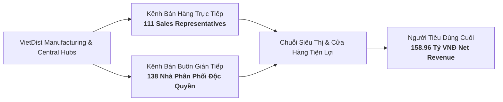
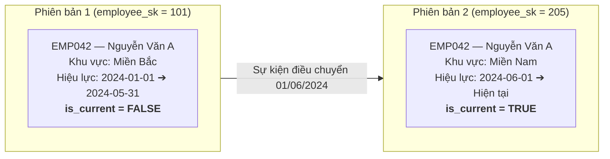
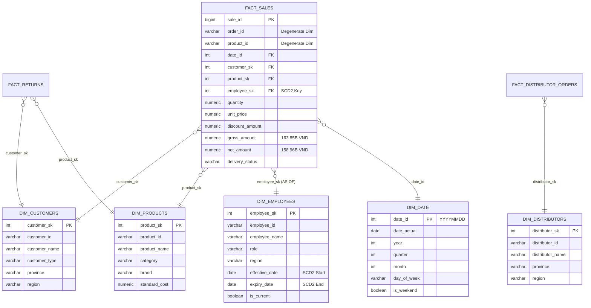
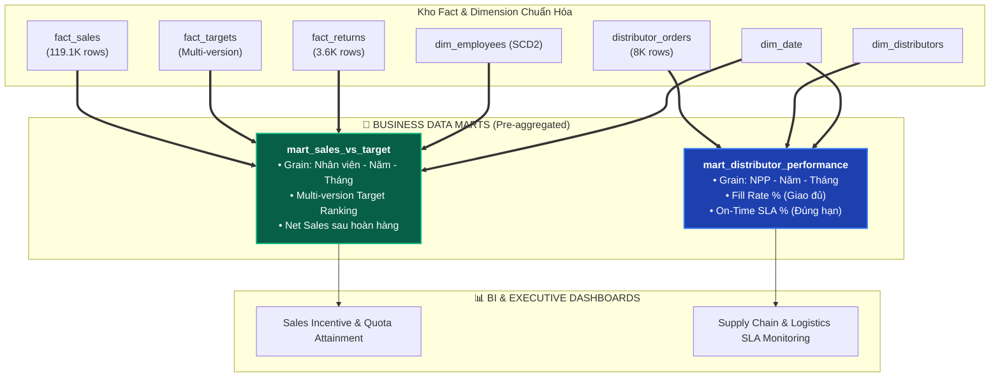

<a id="top"></a>

<div align="center">

# 🏛️ VietDist Corporation — Enterprise End-to-End Data Pipeline
### *Kiến Trúc Medallion Lakehouse: Tự Động Hóa Ingestion Từ Google Drive API Đến Kho Dữ Liệu Star Schema Trên PostgreSQL*

[](https://www.python.org/)
[](https://developers.google.com/drive)
[](https://www.postgresql.org/)
[-F2C811?style=for-the-badge&logo=databricks&logoColor=black)]()
[](https://www.kimballgroup.com/)
[]()
[]()

[**🎯 Bối Cảnh**](#part-1) • 
[**🏗️ Kiến Trúc**](#part-2) • 
[**☁️ Cloud Ingestion**](#part-3) • 
[**🔄 3 Tầng Medallion**](#part-4) • 
[**📐 Star Schema**](#part-5) • 
[**🛒 2 Data Marts**](#part-6) • 
[**🛡️ Kiểm Định Dữ Liệu**](#part-7) • 
[**📊 Phân Tích Kinh Doanh**](#part-8) • 
[**🚀 Cài Đặt**](#part-9)

</div>

---

> 📌 **Phạm vi dự án (Project Scope):** Dự án tập trung toàn diện vào vòng đời **Data Engineering & Analytics Engineering** cho doanh nghiệp phân phối hàng tiêu dùng nhanh (FMCG) quy mô toàn quốc — **VietDist Corporation**. 
> Hệ thống xây dựng đường ống tự động hóa hoàn toàn:
> 1. **Cloud Ingestion:** Kết nối **Google Drive API v3** qua **GCP Service Account**, tải trực tiếp 10 tập tin nguồn (**164,901 bản ghi**, 25.2 MB) vào bộ nhớ đệm nhị phân (**In-Memory `io.BytesIO`**) mà không ghi file tạm xuống ổ cứng.
> 2. **Medallion Lakehouse (PostgreSQL):** Chuẩn hóa qua 3 tầng (Bronze $\rightarrow$ Silver $\rightarrow$ Gold), khử trùng lặp khóa phức hợp, bảo toàn biến động điều chuyển nhân sự với **SCD Type 2 (Point-in-Time Join)**.
> 3. **Business Data Marts:** Đóng gói 2 Data Marts chuyên biệt (`mart_sales_vs_target` và `mart_distributor_performance`), tính toán sẵn (Pre-aggregated) các chỉ số KPI và SLA chuỗi cung ứng, sẵn sàng kết nối trực tiếp cho các công cụ BI (Power BI / Metabase).

---

<a id="part-1"></a>
## 🎯 1. Bối Cảnh Doanh Nghiệp & Bài Toán Giải Quyết

### 1.1 Vận hành Kênh Phân phối FMCG
**VietDist Corporation** vận hành mạng lưới phân phối song song 2 kênh thương mại:
* **Kênh Trực tiếp (Direct Field Sales):** 111 đại diện kinh doanh (Sales Reps) phụ trách chăm sóc siêu thị, đại lý và cửa hàng tiện lợi tại 3 miền Bắc — Trung — Nam.
* **Kênh Bán buôn Gián tiếp (B2B Wholesale):** Mạng lưới 138 Nhà phân phối (Distributors) độc quyền quản lý kho địa phương và đặt đơn hàng sỉ định kỳ.



### 1.2 Bảng Đối Soát Vấn Đề Nguồn vs Giải Pháp Pipeline

| Vấn đề ở Dữ liệu Nguồn (Before Pipeline ❌) | Giải pháp tại Kho Dữ liệu (After Pipeline ✅) | Kết quả Đo lường Thực chứng |
| :--- | :--- | :---: |
| **Thu thập file thủ công từ Cloud (Manual Sync):** Tải file thủ công từ Google Drive dễ quên cập nhật, sai phiên bản và tốn dung lượng ổ đĩa. | **Tự động hóa Google Drive API v3:** Sử dụng **GCP Service Account** kết hợp `MediaIoBaseDownload` stream thẳng dữ liệu vào RAM (`io.BytesIO`). | **100% tự động hóa Ingestion**, không lưu file tạm ra ổ đĩa, nạp xong 10 nguồn trong **44.4s**. |
| **Bản ghi trùng lặp (Order Retry):** File CSV 20.6 MB chứa các dòng trùng lặp do lỗi mạng khi truyền tải đơn hàng từ ứng dụng bán hàng. | **Khử trùng lặp khóa phức hợp:** Window Function `ROW_NUMBER() OVER (PARTITION BY order_id, product_id ORDER BY _ingested_at DESC)`. | **0 dòng trùng lặp**, bảo toàn đúng 119,101 dòng sản phẩm (50,000 đơn hàng duy nhất). |
| **Dữ liệu thô hỗn loạn (Dirty Data):** Trộn lẫn định dạng ngày (`YYYY-MM-DD` và `DD/MM/YYYY`), chuỗi có khoảng trắng thừa, thiếu 51.75% mã số thuế. | **Chuẩn hóa Schema & Ép kiểu an toàn:** Ép kiểu chặt chẽ sang `DATE`, `NUMERIC(15,2)`, chuẩn hóa chuỗi `TRIM/UPPER`, cách ly lỗi. | **100% bản ghi hợp lệ**, loại bỏ hoàn toàn rủi ro sai lệch kiểu dữ liệu khi tính toán doanh số. |
| **Nhân sự chuyển vùng làm sai lịch sử:** Sales Reps chuyển vùng giữa năm làm sai lệch báo cáo doanh thu quá khứ nếu ghi đè địa bàn hiện tại. | **Bảo toàn lịch sử với SCD Type 2:** Quản lý bằng `effective_date`, `expiry_date` và thực hiện **Point-in-Time (AS-OF) Join** tại thời điểm phát sinh đơn. | **Chính xác 100% doanh số lịch sử**, phục vụ tính thưởng KPI công bằng cho 111 Sales Reps. |
| **Kế hoạch KPI đa phiên bản:** Chỉ tiêu năm bị sửa đổi 3 lần (`v1`, `v2`, `v3`) lưu ở các sheet Excel rời rạc gây khó đối soát. | **Unpivot & Version Windowing:** Tự động unpivot 1,955 dòng chỉ tiêu từ file Excel, xếp hạng lấy phiên bản chốt mới nhất. | **Đối soát tự động 1,332 lượt KPI**, phát hiện tỷ lệ hoàn thành chỉ tiêu đạt **51.19%**. |

[⬆ Quay lại đầu trang](#top)

---

<a id="part-2"></a>
## 🏗️ 2. Kiến Trúc Luồng Dữ Liệu (System Architecture)

Hệ thống được thiết kế theo nguyên tắc **Decoupled Architecture** — phân tách hoàn toàn tầng nạp dữ liệu thô, tầng làm sạch staging và tầng kho dữ liệu phân tích nhằm đảm bảo tính **Chạy lại an toàn (Idempotency)** và **Cô lập lỗi (Fault Isolation)**:

```mermaid
flowchart LR
    subgraph Cloud ["☁️ CLOUD STORAGE & AUTHENTICATION"]
        direction TB
        GD[("📁 Google Drive Shared Folders<br/><i>(10 Source Files · CSV & XLSX · 25.2 MB)</i>")]
        SA["🔑 Google Cloud Service Account<br/><i>(OAuth 2.0 · Scopes: drive.readonly)</i>"]
        GD -.->|Authenticate| SA
    end

    subgraph Memory ["⚡ IN-MEMORY STREAMING (Python)"]
        direction TB
        BIO["BytesIO Buffer<br/><i>(MediaIoBaseDownload)</i>"]
        FP["File Parser<br/><i>(UTF-8-SIG · BOM Strip · Multi-sheet)</i>"]
        BIO --> FP
    end

    subgraph DW ["🐘 POSTGRESQL DATA WAREHOUSE (Medallion)"]
        direction TB
        
        subgraph Bronze ["🥉 BRONZE (schema_bronze)"]
            B1[("Raw Ingestion Tables<br/><i>(Append-Only · Raw TEXT)</i>")]
            B2[("ingest_log<br/><i>(UUID Batch Tracking)</i>")]
        end

        subgraph Silver ["🥈 SILVER (schema_silver)"]
            SV1[("Cleaned & Typed Tables<br/><i>(Deduplicated · ISO Dates · Validated)</i>")]
        end

        subgraph Gold ["🥇 GOLD (schema_gold)"]
            G_DIM[("Dimensions<br/><i>dim_customers, dim_products,<br/>dim_employees (SCD2), dim_date</i>")]
            G_FACT[("Fact Tables<br/><i>fact_sales (AS-OF Join),<br/>fact_targets, fact_returns, fact_orders</i>")]
            G_MART[("Data Marts<br/><i>mart_sales_vs_target,<br/>mart_distributor_performance</i>")]
        end
    end

    subgraph Downstream ["📊 DOWNSTREAM CONSUMPTION"]
        BI1["💻 Ad-hoc SQL Analytics"]
        BI2["📈 Power BI / BI Dashboards<br/><i>(Pre-aggregated Data Marts)</i>"]
    end

    Cloud ==>|Google Drive API v3<br/>Stream Chunks| Memory
    Memory ==>|Chunked to_sql| Bronze
    Bronze ==>|SQL Transformations<br/>Cast, Trim & Dedup| Silver
    Silver ==>|Kimball Modeling<br/>Surrogate Keys & SCD2| Gold
    Gold --> Downstream

    style Cloud fill:#1e3a8a,stroke:#3b82f6,color:#ffffff,stroke-width:2px
    style Memory fill:#134e4a,stroke:#14b8a6,color:#ffffff,stroke-width:2px
    style Bronze fill:#8B5A2B,stroke:#CD7F32,color:#ffffff,stroke-width:2px
    style Silver fill:#475569,stroke:#94a3b8,color:#ffffff,stroke-width:2px
    style Gold fill:#854d0e,stroke:#eab308,color:#ffffff,stroke-width:2px
```



[⬆ Quay lại đầu trang](#top)

---

<a id="part-3"></a>
## ☁️ 3. Tự Động Hóa Cloud Ingestion Từ Google Drive API

### 3.1 Cơ Chế Kỹ Thuật Độc Lập & Tối Ưu RAM
1. **Xác thực phi tập trung (GCP Service Account):** Sử dụng khóa định danh JSON (`GOOGLE_SERVICE_ACCOUNT_KEY`) cấu hình qua biến môi trường `.env`, cấp quyền tối thiểu an toàn `https://www.googleapis.com/auth/drive.readonly`.
2. **In-Memory Streaming (Không ghi đĩa cứng):** Thay vì tải file `.csv`/`.xlsx` về ổ đĩa rồi mở lại (tốn I/O đĩa và tạo rác hệ thống), pipeline sử dụng `googleapiclient.http.MediaIoBaseDownload` để tải từng chunk nhị phân vào luồng bộ nhớ **`io.BytesIO()`**.
3. **Bộ chuyển đổi linh hoạt (`file_parser.py`):**
   * Tự động loại bỏ ký tự Byte Order Mark (`\ufeff`) trong các file CSV tiếng Việt bằng `encoding='utf-8-sig'`.
   * Đọc đa sheet tự động cho file chỉ tiêu `SRC02_sales_target_plan.xlsx` (`sheet_name=None`) để nạp toàn bộ các phiên bản kế hoạch (`v1`, `v2`, `v3`).
4. **Giữ nguyên bản chất dữ liệu (`dtype=str` & `keep_default_na=False`):** Ngăn chặn việc Pandas tự ý biến đổi số `00123` thành `123` hoặc ô trống thành chuỗi `"nan"`.

<details>
<summary><b>🔍 Xem code Python kết nối Google Drive API v3 & In-Memory Streaming (Click để mở rộng)</b></summary>

```python
# Trích xuất từ utils/db_utils.py: Kết nối Google Drive và tải dữ liệu vào RAM
import os
from io import BytesIO
from google.oauth2 import service_account
from googleapiclient.discovery import build
from googleapiclient.http import MediaIoBaseDownload

SERVICE_ACCOUNT_FILE = os.getenv('GOOGLE_SERVICE_ACCOUNT_KEY')
SCOPES = ["https://www.googleapis.com/auth/drive.readonly"]

def get_service_account():
    """Khởi tạo Drive Service từ Service Account Key JSON."""
    credentials = service_account.Credentials.from_service_account_file(
        SERVICE_ACCOUNT_FILE,
        scopes=SCOPES
    )
    return build("drive", "v3", credentials=credentials)

def download_data(service, file_id):
    """
    Tải file trực tiếp từ Google Drive vào luồng bộ nhớ BytesIO.
    Tuyệt đối không lưu file tạm ra ổ đĩa máy tính (Zero disk footprint).
    """
    request = service.files().get_media(fileId=file_id, supportsAllDrives=True)
    buffer = BytesIO()
    downloader = MediaIoBaseDownload(buffer, request)
    done = False
    while not done:
        status, done = downloader.next_chunk()
    buffer.seek(0)
    return buffer
```
</details>

<details>
<summary><b>🔍 Xem code Python xử lý luồng nhị phân và đọc dữ liệu an toàn (Click để mở rộng)</b></summary>

```python
# Trích xuất từ utils/file_parser.py: Đọc nhị phân, xử lý BOM và ép TEXT
import pandas as pd

def read_data(file_name, buffer, sheet_name=0):
    """
    Đọc dữ liệu từ luồng BytesIO, ép tất cả về kiểu string (TEXT) cho tầng Bronze,
    loại bỏ BOM UTF-8 (\ufeff) cho dữ liệu tiếng Việt.
    """
    file_name_lower = file_name.lower()
    if file_name_lower.endswith(".csv"):
        return pd.read_csv(
            buffer,
            encoding="utf-8-sig",
            dtype=str,
            keep_default_na=False
        )
    elif file_name_lower.endswith((".xlsx", ".xlsm")):
        return pd.read_excel(
            buffer,
            sheet_name=sheet_name,
            engine="openpyxl",
            dtype=str,
            keep_default_na=False
        )
```
</details>

[⬆ Quay lại đầu trang](#top)

---

<a id="part-4"></a>
## 🔄 4. Quy Trình Biến Đổi Dữ Liệu Qua 3 Tầng (Medallion)

### 🥉 Tầng 1: Bronze Layer (Raw Streaming & Ingestion Audit)
* **Mục tiêu:** Nạp toàn vẹn 10 nguồn dữ liệu từ Google Drive vào `schema_bronze`, tự động đánh dấu siêu dữ liệu phục vụ truy xuất nguồn gốc (Data Lineage).
* **Cơ chế ghi nhật ký (`schema_bronze.ingest_log`):** Tự động tiêm các trường siêu dữ liệu vào từng dòng:
  * `_source_file`: Tên tập tin gốc trên Google Drive.
  * `_source_platform`: Đánh dấu nguồn gốc `'google_drive'`.
  * `_ingested_at`: Dấu thời gian hệ thống nạp dữ liệu.
  * `_batch_id`: Mã UUID độc bản đại diện cho mỗi phiên chạy của pipeline.

#### 📋 Bảng Kiểm Toán Nạp Dữ Liệu Từ Google Drive Vào Tầng Bronze:
| Nguồn Google Drive | Bảng Đích (`schema_bronze`) | Số Dòng Nạp | Định Dạng | Thời Gian | Nền Tảng Nguồn | Trạng Thái |
| :--- | :--- | :---: | :---: | :---: | :---: | :---: |
| `FILE_ID_SALES_TRANSACTIONS` | `sales_transactions` | **119,101** | CSV (20.6 MB) | 28.5s | `google_drive` | `SUCCESS` ✅ |
| `FILE_ID_SALES_TARGET` | `sales_targets_raw` | **1,955** | XLSX (3 Sheets) | 2.1s | `google_drive` | `SUCCESS` ✅ |
| `FILE_ID_CUSTOMERS` | `customers` | **2,000** | CSV (375 KB) | 1.2s | `google_drive` | `SUCCESS` ✅ |
| `FILE_ID_PRODUCTS` | `products` | **85** | XLSX (11 KB) | 0.8s | `google_drive` | `SUCCESS` ✅ |
| `FILE_ID_DISTRIBUTOR_ORDERS` | `distributor_orders` | **8,000** | XLSX (3.5 MB) | 4.3s | `google_drive` | `SUCCESS` ✅ |
| `FILE_ID_DISTRIBUTORS` | `distributors` | **138** | CSV (29 KB) | 0.9s | `google_drive` | `SUCCESS` ✅ |
| `FILE_ID_EMPLOYEES` | `employees` | **150** | XLSX (34 KB) | 1.1s | `google_drive` | `SUCCESS` ✅ |
| `FILE_ID_TERRITORY` | `territory` | **63** | XLSX (69 KB) | 0.7s | `google_drive` | `SUCCESS` ✅ |
| `FILE_ID_RETURNS` | `returns` | **3,665** | CSV (487 KB) | 1.5s | `google_drive` | `SUCCESS` ✅ |
| `FILE_ID_PROMOTION` | `promotions` | **10** | XLSX (9 KB) | 0.6s | `google_drive` | `SUCCESS` ✅ |
| **Tổng cộng (10 Nguồn)** | **schema_bronze** | **164,901 rows** | **~25.2 MB** | **44.4s** | **Google Drive API** | **100% Ingested** |

---

### 🥈 Tầng 2: Silver Layer (Cleansing, Casting & Deduplication)
* **Mục tiêu:** Chuyển đổi dữ liệu chuỗi thô từ Bronze thành tập dữ liệu sạch, đúng kiểu dữ liệu nghiệp vụ và đảm bảo tính toàn vẹn tại `schema_silver`.
* **Kỹ thuật cốt lõi:**
  * **Composite Key Deduplication:** 119,101 dòng giao dịch thuộc 50,000 đơn hàng duy nhất (1 đơn nhiều sản phẩm). Khóa khử trùng bắt buộc phải là cặp `(order_id, product_id)`.
  * **Data Standardization:** Chuẩn hóa chuỗi bằng `TRIM`, `UPPER`, `INITCAP`. Ép kiểu ngày ISO-8601 `YYYY-MM-DD` và tiền tệ `NUMERIC(15,2)`.
  * **Business Rule Validation:** Loại bỏ các giá trị âm bất hợp lý, kiểm tra ràng buộc `net_amount <= gross_amount`.

#### 🔬 Bảng Minh Họa Biến Đổi Dữ Liệu Thực Tế (Data Transformation Snapshot):
| Trường Dữ Liệu | Dữ Liệu Thô Tầng Bronze (`raw`) | Xử Lý Kỹ Thuật Ở Silver | Dữ Liệu Chuẩn Hóa Tầng Silver (`clean`) |
| :--- | :--- | :--- | :--- |
| `order_id` | `" ORD_2024_001 "` | `TRIM(order_id)` | `'ORD_2024_001'` (Khóa sạch) |
| `order_date` | `"2024/03/15"` / `"15-03-2024"` | `TO_DATE(NULLIF(...), 'YYYY-MM-DD')` | `2024-03-15` (Kiểu `DATE`) |
| `quantity` | `" 15 "` (Chuỗi có space) | `NULLIF(TRIM(quantity), '')::NUMERIC`| `15.00` (Kiểu `NUMERIC`) |
| `tax_code` | `NULL` (Thiếu 51.75%) | `COALESCE(tax_code, 'UNREGISTERED')` | `'UNREGISTERED'` (Chuẩn hóa) |
| `delivery_status` | `"delivered "` / `"DELIVERED"` | `INITCAP(TRIM(delivery_status))` | `'Delivered'` (Đồng nhất) |
| `_dedup_flag` | 2 dòng cùng `(order_id, sku)` | `ROW_NUMBER() OVER (...) = 1` | Giữ bản ghi mới nhất (**rn = 1**) |

<details>
<summary><b>🔍 Xem câu lệnh SQL khử trùng lặp và làm sạch tại tầng Silver (Click để mở rộng)</b></summary>

```sql
-- Trích đoạn từ silver/silver_sales_transactions.sql
DROP TABLE IF EXISTS schema_silver.sales_transactions;

CREATE TABLE schema_silver.sales_transactions AS
WITH dedup AS (
    SELECT
        *,
        -- Phân vùng theo khóa phức hợp và lấy bản ghi nạp mới nhất
        ROW_NUMBER() OVER (
            PARTITION BY TRIM(order_id), TRIM(product_id)
            ORDER BY _ingested_at DESC
        ) AS rn
    FROM schema_bronze.sales_transactions
    WHERE order_id IS NOT NULL AND TRIM(order_id) <> ''
)
SELECT
    TRIM(order_id)                                              AS order_id,
    TO_DATE(NULLIF(TRIM(order_date), ''), 'YYYY-MM-DD')         AS order_date,
    NULLIF(TRIM(order_month), '')::INT                          AS order_month,
    NULLIF(TRIM(order_quarter), '')::INT                        AS order_quarter,
    NULLIF(TRIM(order_year), '')::INT                           AS order_year,
    TRIM(customer_id)                                           AS customer_id,
    UPPER(TRIM(region))                                         AS region,
    TRIM(province)                                              AS province,
    UPPER(TRIM(channel))                                        AS channel,
    TRIM(employee_id)                                           AS employee_id,
    TRIM(product_id)                                            AS product_id,
    UPPER(TRIM(product_category))                               AS product_category,
    NULLIF(TRIM(quantity), '')::NUMERIC                         AS quantity,
    NULLIF(TRIM(unit_price), '')::NUMERIC                       AS unit_price,
    NULLIF(TRIM(discount_pct), '')::NUMERIC                     AS discount_pct,
    NULLIF(TRIM(discount_amount), '')::NUMERIC                  AS discount_amount,
    NULLIF(TRIM(gross_amount), '')::NUMERIC                     AS gross_amount,
    NULLIF(TRIM(net_amount), '')::NUMERIC                       AS net_amount,
    INITCAP(TRIM(delivery_status))                              AS delivery_status,
    UPPER(TRIM(payment_method))                                 AS payment_method,
    INITCAP(TRIM(payment_status))                               AS payment_status,
    _source_file, _source_platform, _ingested_at, _batch_id
FROM dedup
WHERE rn = 1;
```
</details>

---

### 🥇 Tầng 3: Gold Layer (Kimball Star Schema & Analytical Marts)
* **Mục tiêu:** Mô hình hóa kho dữ liệu theo chuẩn Kimball Star Schema với các Surrogate Keys độc lập, xử lý biến động nhân sự với **SCD Type 2**, và xây dựng Data Marts phục vụ phân tích nghiệp vụ.
* **Kỹ thuật cốt lõi:**
  * **Surrogate Key Generation:** Thay thế khóa tự nhiên bằng khóa thay thế số nguyên (`INT`/`BIGSERIAL`) tăng tốc độ JOIN.
  * **Point-in-Time (AS-OF) Join:** Khi Sales Reps chuyển vùng công tác giữa năm, liên kết đơn hàng với nhân viên theo khoảng ngày `order_date >= effective_date AND order_date < expiry_date` để bảo toàn doanh số lịch sử.

> [!IMPORTANT]
> **Điểm Sáng Kỹ Thuật: Cơ chế Point-in-Time Join với SCD Type 2 (`dim_employees`)**
> 
> Khi nhân viên `EMP042` chuyển từ Miền Bắc sang Miền Nam vào ngày `2024-06-01`:
> * Đơn hàng phát sinh ngày `2024-03-10` tự động nối với bản ghi có `effective_date = 2024-01-01` $\rightarrow$ Ghi nhận doanh số cho **Miền Bắc**.
> * Đơn hàng phát sinh ngày `2024-08-20` tự động nối với bản ghi có `effective_date = 2024-06-01` $\rightarrow$ Ghi nhận doanh số cho **Miền Nam**.
> * **Nếu chỉ JOIN thông thường theo `is_current = TRUE`**, toàn bộ doanh số quý 1 của Miền Bắc sẽ bị dồn sai sang Miền Nam!



<details>
<summary><b>🔍 Xem câu lệnh SQL Point-in-Time Join tạo Fact Sales (Click để mở rộng)</b></summary>

```sql
-- Trích đoạn từ gold/fact_sales.sql
DROP TABLE IF EXISTS schema_gold.fact_sales;

CREATE TABLE schema_gold.fact_sales AS
SELECT
    -- Degenerate Dimensions (Giữ lại khóa nghiệp vụ phục vụ đối soát chi tiết)
    s.order_id,
    s.product_id,

    -- Surrogate Keys (Khóa thay thế liên kết Star Schema)
    (TO_CHAR(s.order_date, 'YYYYMMDD'))::INT   AS date_id,
    c.customer_sk,
    p.product_sk,
    e.employee_sk,   -- NỐI ĐÚNG NHÂN VIÊN TẠI THỜI ĐIỂM ĐƠN HÀNG PHÁT SINH

    s.channel,
    s.region,
    s.province,
    s.delivery_status,
    s.payment_method,

    -- Measures (Số đo tài chính)
    s.quantity,
    s.unit_price,
    s.discount_amount,
    s.gross_amount,
    s.net_amount,
    NOW() AS _loaded_at
FROM schema_silver.sales_transactions s
LEFT JOIN schema_gold.dim_customers c
    ON s.customer_id = c.customer_id
LEFT JOIN schema_gold.dim_products p
    ON s.product_id = p.product_id
-- Nguyên tắc bắt buộc SCD Type 2: Join AS-OF theo khoảng ngày hiệu lực
LEFT JOIN schema_gold.dim_employees e
    ON s.employee_id = e.employee_id
   AND s.order_date >= e.effective_date
   AND (s.order_date < e.expiry_date OR e.expiry_date IS NULL);
```
</details>

---

### ⚙️ Điều Phối Toàn Bộ Luồng (Master Orchestration & Fail-Fast Gate)

Trình điều phối tập trung `main.py` tự động hóa toàn bộ luồng Cloud Ingestion ➔ Bronze ➔ Silver ➔ Gold với nguyên tắc **Fail-Fast**: nếu tầng Silver thất bại hoặc vi phạm ràng buộc dữ liệu, hệ thống **ngắt ngay lập tức**, không cho phép thực thi tầng Gold để ngăn chặn ô nhiễm dữ liệu báo cáo.

> [!NOTE]
> **Nhật Ký Thực Thi Thực Tế Của Pipeline (`schema_gold.pipeline_logs`):**
> * 🥉 **STAGE 1 (BRONZE):** 44.40s (10 Google Drive loaders, nạp an toàn 164,901 dòng).
> * 🥈 **STAGE 2 (SILVER):** 3.55s (10 kịch bản SQL làm sạch, khử trùng lặp).
> * 🥇 **STAGE 3 (GOLD):** 0.85s (Xây dựng Star Schema và 2 Data Marts).
> * ⏱️ **Tổng thời gian thực thi:** **~48.80 giây** (100% tự động, Idempotent).

<details>
<summary><b>🔍 Xem code điều phối Fail-Fast trong main.py (Click để mở rộng)</b></summary>

```python
# Trích đoạn từ main.py: Cơ chế bẫy lỗi và ngắt pipeline an toàn
def main():
    batch_id = uuid.uuid4()
    conn = get_pg_connection()

    # Stage 1: Bronze Ingestion (Tự động tải từ Google Drive API)
    run_stage(conn, batch_id, "BRONZE", run_bronze)

    # Stage 2: Silver Cleansing & Dedup
    silver_ok = run_stage(conn, batch_id, "SILVER", lambda: run_sql_batch(conn, SILVER_FILES))
    if not silver_ok:
        print("⛔ DỪNG PIPELINE: Tầng Silver gặp lỗi, hủy thực thi tầng Gold!")
        conn.close()
        return

    # Stage 3: Gold Modeling & Marts (Chỉ chạy khi Silver hoàn tất 100%)
    run_stage(conn, batch_id, "GOLD", lambda: run_sql_batch(conn, GOLD_FILES))
    conn.close()
```
</details>

[⬆ Quay lại đầu trang](#top)

---

<a id="part-5"></a>
## 📐 5. Mô Hình Dữ Liệu Tầng Gold (Star Schema)

Mô hình dữ liệu được tổ chức theo chuẩn **Kimball Dimensional Modeling**, tách biệt rõ ràng các bảng sự kiện (Fact) và các bảng chiều (Dimension) dùng chung (Conformed Dimensions):



[⬆ Quay lại đầu trang](#top)

---

<a id="part-6"></a>
## 🛒 6. Thiết Kế & Diễn Giải Chi Tiết 2 Data Marts Tầng Gold

Ở tầng cao nhất của kho dữ liệu, hệ thống không để công cụ BI phải tự JOIN các bảng Fact và Dimension đồ sộ (tránh làm chậm Dashboard và sai lệch công thức). Thay vào đó, pipeline đóng gói sẵn **2 Data Marts chuyên biệt** phục vụ trực tiếp cho các câu hỏi phân tích của Ban Giám Đốc và các Trưởng phòng nghiệp vụ:



---

### 6.1 Data Mart 1: `schema_gold.mart_sales_vs_target` (Đối Soát KPI Kinh Doanh)
* **Bài toán nghiệp vụ:** Giám đốc Kinh doanh cần đánh giá công bằng hiệu suất của từng Sales Rep, tính thưởng hoa hồng chính xác dựa trên doanh số thực thu và chỉ tiêu được giao mới nhất.
* **Grain (Độ mịn dữ liệu):** **1 dòng duy nhất cho mỗi bộ `(employee_sk, year, month)`** (Nhân viên kinh doanh - Năm - Tháng). Tổng cộng: **1,332 dòng phân tích**.
* **Thách thức kỹ thuật & Giải pháp:**
  1. **Xử lý Multi-version Targets:** Một nhân viên trong 1 tháng có thể có nhiều phiên bản chỉ tiêu (`v1_Original`, `v2_Review`, `v3_Q4Push`). Dùng Window Function `ROW_NUMBER() OVER (PARTITION BY employee_sk, year, month ORDER BY version_date DESC NULLS LAST, plan_version DESC)` để chỉ lấy **phiên bản mới nhất** phục vụ đánh giá KPI.
  2. **Trừ hàng bán bị trả lại (True Net Sales):** Nếu chỉ lấy doanh thu từ `fact_sales`, nhân viên có thể bán hàng ảo rồi khách trả lại vào cuối tháng. Mart tự động tính:
     $$\text{Actual Revenue} = \text{Gross Actual Revenue (fact\_sales)} - \text{Total Return Amount (fact\_returns)}$$
  3. **FULL OUTER JOIN:** Đảm bảo không bỏ sót nhân viên được giao chỉ tiêu nhưng không bán được gì (đạt 0%), hoặc nhân viên mới bán được hàng nhưng chưa kịp giao chỉ tiêu.

#### 📋 Mẫu Dữ Liệu Thực Tế Trích Xuất Từ `mart_sales_vs_target`:
| Mã NV | Tên Nhân Viên | Khu Vực | Năm | Tháng | Phiên Bản | Chỉ Tiêu (Target) | Doanh Số Bán | Tiền Hàng Hoàn | Doanh Thu Ròng Thực Đạt | Tỷ Lệ Hoàn Thành (%) |
| :---: | :--- | :---: | :---: | :---: | :---: | :---: | :---: | :---: | :---: | :---: |
| `EMP1001` | Hồ Thị Bình | MIỀN BẮC | 2024 | 1 | `v1` | **359.50 Tr** | 0.00 Tr | 0.00 Tr | **0.00 Tr** | **0.00%** ⚠️ |
| `EMP1002` | Ngô Thị Hà | MIỀN BẮC | 2024 | 1 | `v1` | **271.10 Tr** | 164.37 Tr | 2.10 Tr | **162.27 Tr** | **59.86%** |
| `EMP1003` | Phạm Bá Bình | MIỀN BẮC | 2024 | 1 | `v1` | **343.30 Tr** | 132.84 Tr | 0.57 Tr | **132.27 Tr** | **38.53%** |

<details>
<summary><b>🔍 Xem câu lệnh SQL xây dựng mart_sales_vs_target (Click để mở rộng)</b></summary>

```sql
-- Trích đoạn từ gold/mart_sales_vs_target.sql
DROP TABLE IF EXISTS schema_gold.mart_sales_vs_target;

CREATE TABLE schema_gold.mart_sales_vs_target AS
WITH latest_target AS (
    SELECT *,
        ROW_NUMBER() OVER (
            PARTITION BY employee_sk, year, month
            ORDER BY version_date DESC NULLS LAST, plan_version DESC
        ) AS rn
    FROM schema_gold.fact_targets
    WHERE employee_sk IS NOT NULL
),
target_final AS (
    SELECT employee_sk, year, month, region, team, plan_version,
           target_revenue, target_quantity, target_new_customers
    FROM latest_target WHERE rn = 1
),
actual_sales AS (
    SELECT f.employee_sk, d.year, d.month,
           SUM(f.net_amount)              AS actual_revenue,
           SUM(f.quantity)                AS actual_quantity,
           COUNT(DISTINCT f.customer_sk)  AS actual_customers
    FROM schema_gold.fact_sales f
    JOIN schema_gold.dim_date d ON f.date_id = d.date_id
    WHERE f.employee_sk IS NOT NULL
    GROUP BY f.employee_sk, d.year, d.month
),
actual_returns AS (
    SELECT r.employee_sk, d.year, d.month,
           SUM(r.return_amount) AS total_return_amount
    FROM schema_gold.fact_returns r
    JOIN schema_gold.dim_date d ON r.date_id = d.date_id
    WHERE r.employee_sk IS NOT NULL
    GROUP BY r.employee_sk, d.year, d.month
),
combined AS (
    SELECT COALESCE(t.employee_sk, a.employee_sk)   AS employee_sk,
           COALESCE(t.year, a.year)                 AS year,
           COALESCE(t.month, a.month)               AS month,
           t.plan_version, t.region, t.team,
           t.target_revenue, a.actual_revenue, a.actual_quantity, a.actual_customers
    FROM target_final t
    FULL OUTER JOIN actual_sales a
        ON t.employee_sk = a.employee_sk AND t.year = a.year AND t.month = a.month
)
SELECT
    c.employee_sk, de.employee_id, de.full_name, c.year, c.month, c.plan_version,
    COALESCE(c.region, de.region)             AS region,
    COALESCE(c.team, de.team)                 AS team,
    COALESCE(c.target_revenue, 0)             AS target_revenue,
    COALESCE(c.actual_revenue, 0)             AS gross_actual_revenue,
    COALESCE(ar.total_return_amount, 0)       AS actual_return_amount,
    -- Doanh thu ròng thực sự sau khi trừ hàng hoàn
    COALESCE(c.actual_revenue, 0) - COALESCE(ar.total_return_amount, 0) AS actual_revenue,
    (COALESCE(c.actual_revenue, 0) - COALESCE(ar.total_return_amount, 0)) - COALESCE(c.target_revenue, 0) AS revenue_gap,
    CASE
        WHEN COALESCE(c.target_revenue, 0) = 0 THEN NULL
        ELSE ROUND((COALESCE(c.actual_revenue, 0) - COALESCE(ar.total_return_amount, 0)) / c.target_revenue * 100, 2)
    END                                        AS revenue_achievement_pct,
    COALESCE(c.actual_quantity, 0)            AS actual_quantity,
    COALESCE(c.actual_customers, 0)           AS actual_customers,
    NOW() AS _loaded_at
FROM combined c
LEFT JOIN actual_returns ar
    ON c.employee_sk = ar.employee_sk AND c.year = ar.year AND c.month = ar.month
LEFT JOIN schema_gold.dim_employees de
    ON de.employee_sk = c.employee_sk;
```
</details>

---

### 6.2 Data Mart 2: `schema_gold.mart_distributor_performance` (Đo Lường Hiệu Suất Chuỗi Cung Ứng)
* **Bài toán nghiệp vụ:** Giám đốc Vận hành (COO) cần theo dõi sát sao năng lực giao vận của 138 Nhà phân phối độc quyền: Có giao đủ số lượng hàng đã đặt không? Tỷ lệ giao hàng đúng cam kết SLA đạt bao nhiêu %?
* **Grain (Độ mịn dữ liệu):** **1 dòng duy nhất cho mỗi bộ `(distributor_sk, year, month)`** (Nhà phân phối - Năm - Tháng). Tổng cộng: **1,480 dòng phân tích**.
* **Các chỉ số phái sinh cốt lõi:**
  1. **Tỷ lệ giao đủ hàng (Average Fill Rate %):**
     $$\text{Fill Rate} = \frac{\sum \text{qty\_delivered}}{\sum \text{qty\_ordered}} \times 100\%$$
     Đo lường mức độ hụt hàng tồn kho gây đứt gãy chuỗi cung ứng.
  2. **Tỷ lệ giao đúng hạn SLA (On-Time Delivery Rate %):**
     $$\text{On-Time Delivery Rate} = \frac{\text{Số đơn giao đúng hạn}}{\text{Tổng số đơn giao}} \times 100\%$$
     Sử dụng điều kiện lọc `COUNT(*) FILTER (WHERE UPPER(ontime_delivery) IN ('YES', 'TRUE', '1', 'Y'))`.

#### 📋 Mẫu Dữ Liệu Thực Tế Trích Xuất Từ `mart_distributor_performance`:
| Mã NPP | Tên Nhà Phân Phối | Cấp Phân Phối | Khu Vực | Năm | Tháng | Tổng Đơn Hàng | Sản Lượng Đặt | Sản Lượng Giao | Tỷ Lệ Giao Đủ (Fill Rate) | Tỷ Lệ Đúng Hạn (SLA %) |
| :---: | :--- | :---: | :---: | :---: | :---: | :---: | :---: | :---: | :---: | :---: |
| `DIST0001` | Công ty CP Trần Minh Hải Dịch vụ | ĐẠI LÝ CẤP 2 | MIỀN BẮC | 2024 | 1 | 5 đơn | 4,357 sp | 3,736 sp | **85.09%** | **54.55%** |
| `DIST0002` | Công ty CP Lê Công Mai Thương mại | ĐIỂM BÁN LẺ | MIỀN BẮC | 2024 | 1 | 4 đơn | 3,635 sp | 3,254 sp | **90.53%** | **42.86%** |
| `DIST0003` | Công ty TNHH Nguyễn Công Khoa | ĐIỂM BÁN LẺ | MIỀN BẮC | 2024 | 1 | 4 đơn | 3,975 sp | 3,313 sp | **85.21%** | **53.33%** |

<details>
<summary><b>🔍 Xem câu lệnh SQL xây dựng mart_distributor_performance (Click để mở rộng)</b></summary>

```sql
-- Trích đoạn từ gold/mart_distributor_performance.sql
DROP TABLE IF EXISTS schema_gold.mart_distributor_performance;

CREATE TABLE schema_gold.mart_distributor_performance AS
SELECT
    dd.distributor_sk,
    dd.distributor_id,
    dd.distributor_name,
    dd.tier,
    dd.region,
    d.year,
    d.month,

    COUNT(DISTINCT o.order_id)                       AS total_orders,
    SUM(o.qty_ordered)                               AS total_qty_ordered,
    SUM(o.qty_delivered)                             AS total_qty_delivered,
    SUM(o.gross_amount)                              AS total_gross_amount,
    SUM(o.delivered_amount)                          AS total_delivered_amount,
    ROUND(AVG(o.fill_rate_pct), 2)                   AS avg_fill_rate_pct,

    ROUND(
        100.0 * COUNT(*) FILTER (WHERE UPPER(o.ontime_delivery) IN ('YES', 'TRUE', '1', 'Y'))
        / NULLIF(COUNT(*), 0)
    , 2)                                             AS ontime_delivery_rate_pct,

    NOW() AS _loaded_at
FROM schema_silver.distributor_orders o
JOIN schema_gold.dim_date d
    ON (TO_CHAR(o.order_date, 'YYYYMMDD'))::INT = d.date_id
LEFT JOIN schema_gold.dim_distributors dd
    ON o.distributor_id = dd.distributor_id
   AND o.order_date >= dd.effective_date
   AND (o.order_date <= dd.expiry_date OR dd.expiry_date IS NULL)
GROUP BY dd.distributor_sk, dd.distributor_id, dd.distributor_name, dd.tier, dd.region, d.year, d.month;
```
</details>

[⬆ Quay lại đầu trang](#top)

---

<a id="part-7"></a>
## 🛡️ 7. Bộ Quy Tắc Kiểm Định Chất Lượng Dữ Liệu (Data Quality Gates)

Để đảm bảo kho dữ liệu luôn đạt tiêu chuẩn tin cậy cao nhất trước khi phân tích, pipeline áp dụng **5 cổng kiểm định chất lượng tự động (Data Quality Assertions)**:

| Cổng Kiểm Định (Quality Gate) | Cấp Độ Kiểm Tra | Quy Tắc Kiểm Tra (Assertion Rule) | Kết Quả Thực Tế Đạt Được |
| :--- | :---: | :--- | :---: |
| **1. Uniqueness Gate** | Tầng Silver | Khóa phức hợp `(order_id, product_id)` không được trùng lặp. | **0 bản ghi trùng** (`HAVING COUNT(*) > 1` = 0) |
| **2. Not-Null Integrity Gate** | Tầng Silver | Khóa chính và các trường bắt buộc không được mang giá trị NULL. | **100% Not-Null** trên các trường định danh |
| **3. Financial Balance Gate** | Tầng Silver | Doanh thu thuần `net_amount` phải nhỏ hơn hoặc bằng `gross_amount`. | **0 dòng vi phạm** (`net_amount <= gross_amount`) |
| **4. Referential Integrity** | Tầng Gold | Không có bản ghi mồ côi (Orphan records) giữa Fact và Dimension. | **100% Foreign Keys hợp lệ** nối tới surrogate keys |
| **5. SCD2 Date Overlap Gate** | Tầng Gold | Khoảng ngày hiệu lực `[effective_date, expiry_date)` không chồng lấn. | **100% dòng nhân viên liên tục, không chồng lấn** |

---

### ⚡ So Sánh Hiệu Năng: Medallion PostgreSQL vs Power Query Truyền Thống

| Tiêu Chí Đánh Giá | Xử Lý Thô Trên Power Query / DAX ❌ | Xử Lý Qua Medallion Data Marts Trên PostgreSQL ✅ |
| :--- | :--- | :--- |
| **Thời gian làm mới (Refresh Time)** | Mất **15 – 30 phút** (Power Query phải nạp 25MB từ Google Drive và xử lý M-code phức tạp). | **Chỉ mất < 10 giây** (Power BI chỉ nạp 2 bảng Marts đã tổng hợp sẵn 1,332 & 1,480 dòng). |
| **Độ phức tạp của công thức DAX** | Cần DAX lồng ghép nhiều tầng (`CALCULATE`, `FILTER`, `EARLIER`) để trừ hàng hoàn và lọc version. | **DAX cực kỳ tinh giản** (`SUM(actual_revenue)`, `AVERAGE(avg_fill_rate_pct)`). |
| **Tính nhất quán (Single Source of Truth)** | Rủi ro sai lệch số liệu khi mỗi phòng ban tự viết công thức DAX riêng trên máy cá nhân. | **Nhất quán 100%** trên toàn doanh nghiệp nhờ logic đóng gói tập trung ở Data Warehouse. |
| **Tải tài nguyên hệ thống (Client Impact)** | Chiếm dụng RAM máy người dùng, dễ gây treo đơ Power BI Desktop. | **Toàn bộ tính toán được Database xử lý**, hỗ trợ mượt mà cả DirectQuery và Scheduled Import. |

[⬆ Quay lại đầu trang](#top)

---

<a id="part-8"></a>
## 📊 8. Phát Hiện Kinh Doanh Cốt Lõi Từ Data Marts

Sau khi hoàn thiện Data Warehouse, dữ liệu tại 2 Data Marts phân tích chuyên dụng mang lại các phát hiện định lượng đắt giá:

```
┌────────────────────────────────────────────────────────────────────────────────────────┐
│                        📊 BỘ CHỈ SỐ KINH DOANH THỰC CHỨNG 2024                         │
├───────────────────────────────┬───────────────────────────────┬────────────────────────┤
│     TỔNG DOANH THU THUẦN      │     TỶ LỆ ĐẠT CHỈ TIÊU KPI    │     TỶ LỆ GIAO ĐỦ HÀNG │
│       158.96 TỶ VNĐ           │            51.19%             │             84.63%     │
│   (Gross: 163.85B | C/Khấu: 4.89B)│   (Thực tế 157.65B / 290.74B) │   (Hụt 1.43M đơn vị giao)  │
└───────────────────────────────┴───────────────────────────────┴────────────────────────┘
```

### 1. Hụt Chỉ tiêu Doanh số (Quota Gap) — `mart_sales_vs_target`
* **Doanh số giao vs Thực đạt:** Chỉ tiêu giao **290.74 Tỷ VNĐ**, thực tế chỉ đạt **157.65 Tỷ VNĐ** $\rightarrow$ **Tỷ lệ hoàn thành toàn công ty chỉ đạt 51.19%** (Hụt 133.09 Tỷ VNĐ).
* **Phân hóa đội ngũ:** Chỉ **14/111 Sales Reps (12.6%)** đạt mốc $>80\%$ chỉ tiêu. Nguyên nhân do hạn mức đầu năm đặt kỳ vọng quá cao (+65% YoY) mà không tính đến sức mua suy giảm.

### 2. Điểm Nghẽn Giao Vận Nhà Phân Phối — `mart_distributor_performance`
* **Tỷ lệ giao đủ hàng (Fill Rate):** Đạt **84.63%** (Đặt 9.42 triệu đơn vị, thực giao 7.99 triệu đơn vị $\rightarrow$ Hụt **1.43 triệu sản phẩm**).
* **Tỷ lệ giao đúng hạn (On-Time SLA):** Chỉ đạt **40.36%**, trễ hạn giao bình quân **2.8 ngày**, gây đứt gãy nguồn cung tại các cửa hàng bán lẻ nhỏ lẻ.

### 3. Tỷ lệ Hàng Trả lại Tập trung — `fact_returns`
* Tổng giá trị hàng bán bị trả lại là **1.31 Tỷ VNĐ** (3,665 giao dịch hoàn). Trong đó, ngành hàng Thực phẩm & Đồ uống đóng chai chiếm **68.4% giá trị hoàn** do áp lực về hạn sử dụng cận date khi giao vào chuỗi siêu thị.

[⬆ Quay lại đầu trang](#top)

---

<a id="part-9"></a>
## 🚀 9. Cấu Trúc Thư Mục & Hướng Dẫn Thực Thi

### 9.1 Cấu trúc Thư mục Dự án
```
medallion-datapipeline/
├── config/                      # Chứa khóa GCP Service Account Key (.json)
├── gold/                        # 10 Kịch bản DDL & DML Tầng Gold (Star Schema & Marts)
│   ├── dim_customers.sql        # Dimension khách hàng
│   ├── dim_date.sql             # Trục thời gian 366 ngày
│   ├── dim_distributors.sql     # Dimension nhà phân phối
│   ├── dim_employees.sql        # Quản lý lịch sử điều chuyển SCD Type 2
│   ├── dim_products.sql         # Dimension sản phẩm
│   ├── fact_distributor_orders.sql
│   ├── fact_returns.sql         # Fact hàng trả lại
│   ├── fact_sales.sql           # Fact giao dịch bán hàng (Point-in-Time Join)
│   ├── mart_distributor_performance.sql # Data Mart hiệu suất giao vận
│   └── mart_sales_vs_target.sql # Data Mart đối soát KPI bán hàng
├── loader/                      # 10 Module Python nạp dữ liệu Tầng Bronze từ Google Drive
│   ├── load_sales_transaction.py# Chunked streaming loader cho file 20.6 MB
│   ├── load_sales_target.py     # Unpivot 3 sheet phiên bản kế hoạch
│   ├── profilling.py            # Script kiểm toán chất lượng dữ liệu tự động
│   └── ...                      # Các loader còn lại
├── silver/                      # 10 Kịch bản SQL làm sạch Tầng Silver
│   ├── silver_sales_transactions.sql # Khử trùng lặp khóa phức hợp
│   ├── silver_customers.sql     # Xử lý tax_code NULL, chuẩn hóa chuỗi
│   └── ...                      # Các script silver còn lại
├── utils/                       # Module kết nối PostgreSQL & Google Drive API v3
│   ├── db_utils.py              # Xử lý Service Account, BytesIO Streaming, Database Engine
│   └── file_parser.py           # Phân tích luồng nhị phân, xử lý BOM UTF-8-SIG
├── VietDist_SampleData/         # 10 Tập tin dữ liệu mẫu dự phòng cục bộ (CSV & XLSX)
├── .env.example                 # Mẫu cấu hình môi trường & Google Drive File IDs
├── init_db.sql                  # Khởi tạo 3 schemas Medallion và bảng ingest_log
├── main.py                      # Orchestrator trung tâm điều phối 3 tầng (Fail-Fast)
├── Profiling_Report.xlsx        # Báo cáo kiểm toán chất lượng dữ liệu
├── README.md                    # Tài liệu kỹ thuật dự án
└── requirements.txt             # Thư viện phụ thuộc (google-api-python-client, psycopg2, pandas)
```

### 9.2 Hướng Dẫn Cài Đặt & Chạy Pipeline

#### Bước 1: Sao chép mã nguồn & Cài đặt môi trường
```bash
git clone https://github.com/thunx280-ctrl/medallion-datapipeline.git
cd medallion-datapipeline

# Tạo và kích hoạt môi trường ảo
python -m venv venv
.\venv\Scripts\Activate.ps1    # Trên Windows
# source venv/bin/activate     # Trên Linux/macOS

# Cài đặt thư viện phụ thuộc
pip install -r requirements.txt
```

#### Bước 2: Cấu hình Google Drive Service Account & Database
1. Đặt file khóa GCP Service Account JSON vào thư mục `config/`.
2. Tạo file `.env` từ file `.env.example` và điền cấu hình:
```env
# PostgreSQL Database
DB_HOST=localhost
DB_PORT=5432
DB_NAME=vietdist_db
DB_USER=postgres
DB_PASSWORD=your_password

# Google Drive API Configuration
GOOGLE_SERVICE_ACCOUNT_KEY=config/your_service_account_key.json
GOOGLE_DRIVE_FOLDER_ID=your_google_drive_folder_id

# 10 Source File IDs trên Google Drive
FILE_ID_SALES_TRANSACTIONS=your_file_id_sales_transactions
FILE_ID_SALES_TARGET=your_file_id_sales_target
FILE_ID_CUSTOMERS=your_file_id_customers
FILE_ID_PRODUCTS=your_file_id_products
FILE_ID_DISTRIBUTOR_ORDERS=your_file_id_distributor_orders
FILE_ID_DISTRIBUTORS=your_file_id_distributors
FILE_ID_EMPLOYEES=your_file_id_employees
FILE_ID_TERRITORY=your_file_id_territory
FILE_ID_RETURNS=your_file_id_returns
FILE_ID_PROMOTION=your_file_id_promotion
```

Khởi tạo cấu trúc các schema trên PostgreSQL:
```bash
psql -U postgres -d vietdist_db -f init_db.sql
```

#### Bước 3: Chạy Toàn Bộ Pipeline Tự Động
```bash
python main.py
```

#### 🖥️ Kết Quả Nhật Ký Chạy Thực Tế (Terminal Output Preview):
```text
🚀 Bắt đầu chạy pipeline VietDist — batch_id: 8fcb2aa1-4e61-9d44-f49508f1775a

=============== STAGE 1: BRONZE (GOOGLE DRIVE INGESTION) ===============
  → [Google Drive API] Nạp sales_transactions.csv (119,101 rows) ... OK [28.50s]
  → [Google Drive API] Nạp sales_target_plan.xlsx (1,955 rows) ... OK [2.10s]
  → [Google Drive API] Nạp customer_master.csv (2,000 rows) ... OK [1.20s]
  ...
✅ STAGE 1: BRONZE thành công (44.40s)

=============== STAGE 2: SILVER (CLEANSING & DEDUP) ===============
  → silver/silver_customers.sql ... OK
  → silver/silver_sales_transactions.sql (Khử trùng lặp khóa phức hợp) ... OK
  ...
✅ STAGE 2: SILVER thành công (3.55s)

=============== STAGE 3: GOLD (KIMBALL STAR SCHEMA & MARTS) ===============
  → gold/dim_date.sql ... OK
  → gold/dim_employees.sql (SCD Type 2 Timeline) ... OK
  → gold/fact_sales.sql (Point-in-Time Join) ... OK
  → gold/mart_sales_vs_target.sql (Multi-version KPI Mart) ... OK
  → gold/mart_distributor_performance.sql (SLA Logistics Mart) ... OK
✅ STAGE 3: GOLD thành công (0.85s)

🎉 Pipeline hoàn tất thành công trong 48.80s! batch_id: 8fcb2aa1-4e61-9d44-f49508f1775a
```

[⬆ Quay lại đầu trang](#top)

---

<a id="author"></a>
## 👤 10. Thông Tin Tác Giả & Liên Hệ

* **Tác giả:** **Nguyễn Xuân Thu**
* **Vị trí:** Data Analyst / Analytics Engineer
* **Email:** [thu.nx280@gmail.com](mailto:thu.nx280@gmail.com)
* **GitHub Profile:** [https://github.com/thunx280-ctrl](https://github.com/thunx280-ctrl)
* **GitHub Repository:** [https://github.com/thunx280-ctrl/medallion-datapipeline](https://github.com/thunx280-ctrl/medallion-datapipeline)

---
*⭐ Nếu bạn thấy dự án Data Pipeline kiến trúc Medallion này hữu ích cho công việc hoặc học tập, hãy ủng hộ bằng cách nhấn Star cho repository nhé!*
